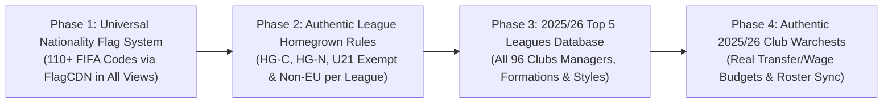

# 🏆 TOUCHLINE — Stage 12 Comprehensive Audit & Plan: 2025/26 Top 5 European Leagues Database (96 Clubs Tactics & Budgets), Real Nationality Flags & Authentic Homegrown Rules

> [!NOTE]
> เอกสารฉบับนี้อัปเดตจากการตรวจสอบ Commit ล่าสุด `fb88eac` (`feat(trophies): expand competition and trophy support` — +1,584 บรรทัด) พร้อมวางแผนพัฒนา **Stage 12** แบบเจาะลึกสำหรับ **5 ลีกใหญ่ยุโรป (96 สโมสร ประจำฤดูกาล 2025/26)** ครอบคลุมทั้ง:
> 1. **ฐานข้อมูล 96 สโมสร ฤดูกาล 2025/26**: ผู้จัดการทีมจริง, แผนการเล่นหลัก/รอง (`Primary & Secondary Formation`), ปรัชญาแท็กติก (`Tactical Preset & 3-Phase Team Instructions`) และงบเสริมทัพ/เพดานค่าเหนื่อยตามสถานะการเงินจริง
> 2. **ระบบแสดงธงสัญชาติจริง (`<NationalityFlag />`)**: เปลี่ยนจากตัวอักษรย่อ 3 ตัว (`ENG`, `ESP`, `BRA`) เป็นรูปธงชาติจริงความละเอียดสูงจาก FlagCDN (`flagcdn.com`) ครบกว่า 110 สัญชาติในทุกหน้าของเกม (แก้ปัญหา Windows ไม่แสดงอีโมจิธงชาติ 100%)
> 3. **ระบบกฎ Homegrown (`HG-C` / `HG-N`), ดาวรุ่ง `U21 Exempt` และโควตาต่างชาติ (`Non-EU`)**: แยกตามกฎจริงของแต่ละลีกใน 5 ลีกใหญ่ยุโรป (`Premier League`, `LaLiga`, `Bundesliga`, `Serie A`, `Ligue 1`) และถ้วยยุโรป `UEFA List A & List B`

---

## 1. ผลการตรวจสอบ Commit ล่าสุด (`fb88eac`) และจุดที่ต้องยกระดับในฐานข้อมูลปัจจุบัน

### 1.1 สิ่งที่ติดตั้งสำเร็จแล้วใน `fb88eac`
- ✅ **แก้สโมสรซ้ำในอังกฤษและรหัส `shortName` ชนกัน 7 คู่**: แยก `Luton Town`, `Cardiff City`, `Plymouth Argyle` ลงใน `ENG_L1` และแก้รหัส `PALM`, `CORD`, `KASH`, `CRZ`, `STKP`, `FEC`, `VNFC` เรียบร้อย
- ✅ **เร่งความเร็วเอนจินจำลองแมตช์ 23 ลีก (`playersByClubId` + Batch Standings)**: การกดข้ามวัน (`Advance Day`) ลื่นไหลขึ้นอย่างชัดเจน
- ✅ **เพิ่มถ้วยสโมสรทวีปนอกยุโรป (`AFC_ACL`, `CONMEBOL_LIB`, `CONCACAF_CCC`) + เพลย์ออฟเลื่อนชั้น + ฉากชูถ้วยแชมป์ลีกทันทีที่แต้มขาด**

### 1.2 จุดอ่อนของฐานข้อมูลสโมสร 5 ลีกใหญ่ยุโรปในโค้ดปัจจุบันที่ตรวจพบ (4 จุดหลัก)
1. **แผนการเล่นและคำสั่งแท็กติกของทุกสโมสรยังเป็นการสุ่ม (`rng.pick(FORMATIONS_POOL)`)**:
   - ใน [src/engine/worldGenerator.ts](file:///c:/Users/chaiyasit/Documents/Football-Management-Simulation/src/engine/worldGenerator.ts#L835-L850) โค้ดใช้ `const primaryFormation = rng.pick(FORMATIONS_POOL)` และใช้คำสั่งแท็กติกค่าเริ่มต้น (`Balanced / Standard / Mixed`) เหมือนกันทั้ง 394 สโมสร!
   - ส่งผลให้ **Man City ของ Pep Guardiola**, **Barcelona ของ Hansi Flick**, **Man Utd ของ Ruben Amorim (`3-4-3`)** หรือ **Inter Milan (`3-5-2`)** ไม่ได้เล่นในแผนและสไตล์จริงของตัวเอง
2. **งบเสริมทัพ (`transferBudget`) ใช้สูตรคำนวณจาก Reputation แบบเหมารวม (`repFactor * 28M`)**:
   - ใน [src/engine/worldGenerator.ts](file:///c:/Users/chaiyasit/Documents/Football-Management-Simulation/src/engine/worldGenerator.ts#L852-L855) ทุกทีมที่มี Reputation เท่ากันจะได้งบเท่ากันเป๊ะ โดยไม่ได้สะท้อนสถานะการเงินจริงฤดูกาล 2025/26 (เช่น **Barcelona** ที่มีข้อจำกัดเพดานค่าเหนื่อย LaLiga ควรมีงบเริ่มต้นตึงตัวกว่า **Real Madrid / Man City / PSG / Chelsea** หรือสโมสรอย่าง **Brighton / Como 1907 / Newcastle / Aston Villa** ที่มีงบเสริมทัพสูงกว่าค่า Reputation พื้นฐาน)
3. **สัญชาตินักเตะและลีกยังแสดงเป็นข้อความ 3 ตัวอักษร (`ENG`, `ESP`, `GER`) โดยไม่มีรูปธงชาติจริง**:
   - บนระบบปฏิบัติการ Windows เบราว์เซอร์จะไม่เรนเดอร์ Unicode Flag Emoji จึงต้องใช้คอมโพเนนต์รูปธงจริง **`<NationalityFlag />`** จาก CDN มาตรฐาน (`https://flagcdn.com/w40/<iso2>.png`)
4. **กฎ Homegrown ในปัจจุบันเหมารวมทุกลีกเป็นกฎเดียวกัน และมีบั๊ก `pIdx >= 14` ใน `worldGenerator.ts`**:
   - ใน [src/engine/worldGenerator.ts](file:///c:/Users/chaiyasit/Documents/Football-Management-Simulation/src/engine/worldGenerator.ts#L802-L805) บรรทัด `isHomegrown: Boolean(pSeed.isYouth) || pSeed.natCode === config.countryId || pIdx >= 14` ทำให้นักเตะต่างชาติทุกคนที่อยู่ลำดับที่ 14–20 ของทีมถูกตีตราเป็น `Homegrown` แบบผิดๆ และยังไม่ได้แยกประเภท **`HG-C` (เด็กปั้นสโมสร)**, **`HG-N` (เด็กปั้นในประเทศ)**, และ **`U21 Exempt` (ดาวรุ่งอายุไม่เกิน 21 ปีที่ไม่กินโควตา 25 คน)**

---

## 2. แผนการพัฒนา Stage 12 แบบละเอียด (4 Phases สำหรับสั่ง AI Studio)

---

### Phase 1: ระบบแสดงธงสัญชาติจริงทั่วทั้งเกม (`<NationalityFlag />` Component)

#### 1.1 สร้างคอมโพเนนต์ `<NationalityFlag />` ใน [src/components/TrophyAndKitVisuals.tsx](file:///c:/Users/chaiyasit/Documents/Football-Management-Simulation/src/components/TrophyAndKitVisuals.tsx) (และ export ผ่าน [src/components/ClubBadge.tsx](file:///c:/Users/chaiyasit/Documents/Football-Management-Simulation/src/components/ClubBadge.tsx))
- สร้างตารางแมปรหัส FIFA / IOC 3 ตัวอักษร ➔ รหัส ISO-3166 ของ **FlagCDN (`https://flagcdn.com/w40/<iso>.png` และ `https://flagcdn.com/<iso>.svg`)** ครอบคลุมกว่า **110 สัญชาติ** ในเกม:
  - **สหราชอาณาจักร (Home Nations แยกธงชัดเจน!)**:
    - `ENG` ➔ `gb-eng` (ธงกางเขนเซนต์จอร์จ อังกฤษ 🏴󠁧󠁢󠁥󠁮󠁧󠁿)
    - `SCO` ➔ `gb-sct` (ธงเซนต์แอนดรูว์ สกอตแลนด์ 🏴󠁧󠁢󠁳󠁣󠁴󠁿)
    - `WAL` ➔ `gb-wls` (ธงมังกรแดง เวลส์ 🏴󠁧󠁢󠁷󠁬󠁳󠁿)
    - `NIR` ➔ `gb-nir` (ไอร์แลนด์เหนือ)
  - **ยุโรป**: `ESP: 'es'`, `GER: 'de'`, `ITA: 'it'`, `FRA: 'fr'`, `POR: 'pt'`, `NED: 'nl'`, `BEL: 'be'`, `TUR: 'tr'`, `AUT: 'at'`, `SUI: 'ch'`, `GRE: 'gr'`, `CRO: 'hr'`, `SRB: 'rs'`, `NOR: 'no'`, `SWE: 'se'`, `DEN: 'dk'`, `FIN: 'fi'`, `ISL: 'is'`, `IRL: 'ie'`, `POL: 'pl'`, `UKR: 'ua'`, `CZE: 'cz'`, `SVK: 'sk'`, `HUN: 'hu'`, `ROU: 'ro'`, `SVN: 'si'`, `SLO: 'si'`, `BIH: 'ba'`, `MNE: 'me'`, `ALB: 'al'`, `MKD: 'mk'`, `GEO: 'ge'`, `ARM: 'am'`, `ISR: 'il'`, `KOS: 'xk'`, `BUL: 'bg'`
  - **อเมริกาใต้ & เหนือ**: `BRA: 'br'`, `ARG: 'ar'`, `URU: 'uy'`, `COL: 'co'`, `ECU: 'ec'`, `CHI: 'cl'`, `PAR: 'py'`, `PER: 'pe'`, `VEN: 've'`, `BOL: 'bo'`, `USA: 'us'`, `CAN: 'ca'`, `MEX: 'mx'`, `CRC: 'cr'`, `JAM: 'jm'`
  - **แอฟริกา, เอเชีย & โอเชียเนีย**: `MAR: 'ma'`, `SEN: 'sn'`, `EGY: 'eg'`, `NGA: 'ng'`, `GHA: 'gh'`, `CIV: 'ci'`, `CMR: 'cm'`, `ALG: 'dz'`, `TUN: 'tn'`, `MLI: 'ml'`, `GUI: 'gn'`, `GAB: 'ga'`, `BFA: 'bf'`, `COD: 'cd'`, `ANG: 'ao'`, `MOZ: 'mz'`, `ZAM: 'zm'`, `RSA: 'za'`, `JPN: 'jp'`, `KOR: 'kr'`, `KSA: 'sa'`, `IRN: 'ir'`, `IRQ: 'iq'`, `QAT: 'qa'`, `UAE: 'ae'`, `UZB: 'uz'`, `AUS: 'au'`, `NZL: 'nz'`, `THA: 'th'`
- **Props ของ `<NationalityFlag />`**:
  - `code: string` (เช่น `'ENG'`, `'ESP'`, `'BRA'`)
  - `size?: 'xs' | 'sm' | 'md' | 'lg'` (`xs: 16×12px`, `sm: 20×15px`, `md: 24×18px`, `lg: 32×24px`)
  - `showCode?: boolean` (แสดงรหัส `'ENG'` คู่กับรูปธง)
  - `showCountryName?: boolean` (แสดงชื่อประเทศเต็ม เช่น `'England / อังกฤษ'`)
- **จุดที่นำไปแสดงผลแทนข้อความดิบทั้งหมด**:
  1. [src/components/ManagementViews.tsx](file:///c:/Users/chaiyasit/Documents/Football-Management-Simulation/src/components/ManagementViews.tsx) — ตาราง `Squad`, `Tactics`, `Transfers`, `Scouting`, `Youth Academy`, `World Clubs`, `Competitions` (ปุ่มเลือกลีก/บอลถ้วยแสดงธงชาติคู่กับโลโก้ FotMob)
  2. [src/components/PlayerProfilePage.tsx](file:///c:/Users/chaiyasit/Documents/Football-Management-Simulation/src/components/PlayerProfilePage.tsx) & [src/ui/UIComponents.tsx](file:///c:/Users/chaiyasit/Documents/Football-Management-Simulation/src/ui/UIComponents.tsx) — เฮดเดอร์โปรไฟล์นักเตะและ `PlayerHoverCard`
  3. [src/components/TitleScreen.tsx](file:///c:/Users/chaiyasit/Documents/Football-Management-Simulation/src/components/TitleScreen.tsx) — หน้าเลือกสัญชาติผู้จัดการทีม และหน้าเลือกประเทศ/สโมสรใน Career Wizard

---

### Phase 2: ระบบกฎ Homegrown (`HG-C` / `HG-N`), ดาวรุ่ง `U21 Exempt` และโควตา `Non-EU` ตามกฎจริงของ 5 ลีกใหญ่ยุโรป

#### 2.1 แก้ตรรกะการกำหนดสถานะ Homegrown ของนักเตะใน [src/engine/worldGenerator.ts](file:///c:/Users/chaiyasit/Documents/Football-Management-Simulation/src/engine/worldGenerator.ts#L801-L833)
- **ลบเงื่อนไข `|| pIdx >= 14` ทิ้ง!** (เพื่อไม่ให้นักเตะต่างชาติอายุมากถูกตั้งเป็น Homegrown มั่ว)
- เพิ่มฟิลด์ `homegrownStatus?: 'HGC' | 'HGN' | 'NONE'` ใน `Player` ([src/types/game.ts](file:///c:/Users/chaiyasit/Documents/Football-Management-Simulation/src/types/game.ts)):
  1. **`'HGC'` (Club-Trained Homegrown / เด็กปั้นสโมสร)**:
     - นักเตะที่ `isYouthAcademy === true` หรือมีชื่ออยู่ในคลัง **`CLUB_TRAINED_PLAYERS_BY_CLUB`** (เช่น `ARS`: Bukayo Saka, Ethan Nwaneri, Myles Lewis-Skelly | `MCI`: Phil Foden, Rico Lewis | `LIV`: Curtis Jones, Conor Bradley, Jarell Quansah, Trent Alexander-Arnold | `CHE`: Reece James, Levi Colwill, Trevoh Chalobah, Josh Acheampong | `MUN`: Kobbie Mainoo, Luke Shaw, Marcus Rashford | `TOT`: Mikey Moore | `RMA`: Dani Carvajal, Fran García, Lucas Vázquez, Raúl Asencio | `BAR`: Lamine Yamal, Pau Cubarsí, Gavi, Alejandro Balde, Fermín López, Marc Casadó, Marc Bernal | `ATM`: Pablo Barrios, Koke | `BAY`: Jamal Musiala, Aleksandar Pavlović, Josip Stanišić | `INT`: Federico Dimarco | `ROM`: Lorenzo Pellegrini, Niccolò Pisilli | `JUV`: Kenan Yıldız, Nicolò Fagioli | `MIL`: Davide Calabria, Matteo Gabbia | `PSG`: Warren Zaïre-Emery, Senny Mayulu)
  2. **`'HGN'` (Nation-Trained Homegrown / ฝึกในประเทศนั้นครบ 3 ปีก่อนอายุ 21)**:
     - นักเตะที่มีสัญชาติตรงกับประเทศของสโมสร (`pSeed.natCode === config.countryId` หรือเวลส์ `WAL` ในลีกอังกฤษ)
     - **รวมถึงนักเตะต่างชาติชื่อดังที่ย้ายมาฝึกในประเทศนั้นก่อนอายุ 18 ปี (`FOREIGN_NATION_HOMEGROWN_PLAYERS`)**:
       - ในอังกฤษ (`ENG`): **William Saliba** (`ARS`), **Gabriel Martinelli** (`ARS`), **David Raya** (`ARS`), **João Pedro** (`CHE`/`BHA`), **Alejandro Garnacho**, **Amad Diallo** (`MUN`), **Pape Matar Sarr** (`TOT`), **Illan Meslier**
       - ในสเปน (`ESP`): **Vinícius Júnior** (`RMA`), **Rodrygo** (`RMA`), **Federico Valverde** (`RMA`), **Eduardo Camavinga** (`RMA`), **Arda Güler** (`RMA`), **Endrick** (`RMA`), **Ronald Araújo** (`BAR`)
       - ในอิตาลี (`ITA`): **Nico Paz** (`COM`), **Assane Diao** (`COM`)
  3. **`U21 Exempt` (ดาวรุ่งอายุ ≤ 21 ปี / ≤ 22 ปีในอิตาลี)**:
     - ไม่ต้องใช้โควตาใน 25 คนของทีมชุดใหญ่ (`isU21Exempt = age <= (countryId === 'ITA' ? 22 : 21)`) มีสิทธิ์ลงสนามในเกมลีกได้ทันทีโดยอัตโนมัติ!

#### 2.2 ตารางกฎ Homegrown & Squad Registration แยกตามลีกใน 5 ลีกใหญ่ยุโรป ([src/engine/tacticsEngine.ts](file:///c:/Users/chaiyasit/Documents/Football-Management-Simulation/src/engine/tacticsEngine.ts#L808-L910))

| ลีก (`LeagueId`) | ชื่อกฎการลงทะเบียนจริง (2025/26) | เพดานทีมชุดใหญ่ (`maxSeniorSquad`) | โควตา Homegrown ขั้นต่ำ (`minHGN` / `minHGC`) | เพดานนักเตะต่างชาติ / Non-HG | กฎดาวรุ่ง (`U21 / U22 Exempt`) |
| :--- | :--- | :---: | :---: | :---: | :--- |
| 🏴󠁧󠁢󠁥󠁮󠁧󠁿 **`ENG_PL`** | **Premier League 25-Man Squad Rule** | **25 คน** (อายุ > 21) | ขั้นต่ำ **8 `HGN`** (ฝึกในอังกฤษ/เวลส์) | ส่งนักเตะ Non-HG ได้สูงสุด **17 คน** | **นักเตะอายุ ≤ 21 ปี ลงเล่นได้ไม่จำกัด** (ไม่เสียโควตา 25 คน) |
| 🇪🇸 **`ESP_LL`** | **LaLiga 25-Man & Non-EU Quota** | **25 คน** (เบอร์ `#1–#25`) | ขั้นต่ำ **4 `HGN`** (และ **8 HG** สำหรับทีมไปเล่นถ้วยยุโรป) | นักเตะนอก EU (`Non-EU`) สูงสุด **3 คน** (อเมริกาใต้ที่อยู่ครบ 2 ปีได้สัญชาติคู่ EU) | **ดาวรุ่ง U21 อคาเดมี (เบอร์ `#26+`) ลงเล่นได้ไม่จำกัด** |
| 🇩🇪 **`GER_BL`** | **DFL Local Player Rule (`Local-Player-Regelung`)** | **30 คน** (ยืดหยุ่น) | ขั้นต่ำ **8 `HGN`** (ต้องเป็นเด็กปั้นสโมสร **`4 HGC`**) | ไม่จำกัด Non-EU แต่ต้องมีนักเตะท้องถิ่นครบเกณฑ์ | **ดาวรุ่ง U21 ลงเล่นได้ไม่จำกัด** |
| 🇮🇹 **`ITA_SA`** | **FIGC Lista dei 25 (`4+4 Rule`)** | **25 คน** (อายุ > 22) | ขั้นต่ำ **8 HG** (**`4 HGC` เด็กปั้นสโมสร + `4 HGN` ฝึกในอิตาลี**) | ส่งนักเตะนอกโควตา HG ได้สูงสุด **17 คน** | **นักเตะอายุ ≤ 22 ปี (`Under-22`) ลงเล่นได้ไม่จำกัด!** |
| 🇫🇷 **`FRA_L1`** | **LFP Squad & Non-EU Rule** | **25 คน** (อายุ > 21) | ขั้นต่ำ **6 `HGN`** (ฝึกในฝรั่งเศส) | นักเตะนอก EU สูงสุด **4 คน** *(นักเตะแอฟริกา/ACP ได้รับยกเว้นตามสัญญา Cotonou)* | **ดาวรุ่ง U21 ที่ฝึกกับสโมสรลงเล่นได้ไม่จำกัด** |
| 🌍 **`UEFA_UCL` / `UEL` / `UECL`** | **UEFA List A (25) & List B (U21)** | **25 คน** (List A) | ขั้นต่ำ **8 HG** (**`4 HGC` + `4 HGN`**) | สูงสุด **17 คน** ใน List A | **List B: ดาวรุ่งอายุ ≤ 21 ปี ลงเล่นได้ไม่จำกัด** |

---

### Phase 3 & 4: อัปเดตฐานข้อมูล 96 สโมสรใน 5 ลีกใหญ่ยุโรป ฤดูกาล 2025/26 (ผู้จัดการทีม, แผนหลัก/แผนรอง, ปรัชญาแท็กติก และงบเสริมทัพจริง)

#### 3.1 ระบบ 8 ปรัชญาแท็กติกมาตรฐาน (`TacticalPresetId` ➔ `TeamInstructions`)
ใน [src/engine/tacticsEngine.ts](file:///c:/Users/chaiyasit/Documents/Football-Management-Simulation/src/engine/tacticsEngine.ts) สร้างพรีเซ็ตคำสั่งทีมทั้ง 3 เฟส (`buildAuthenticTeamInstructions(preset)`) เพื่อผูกให้กับแต่ละสโมสรใน `CLUB_TEMPLATES`:

1. **`CONTROL_POSSESSION` (Pep Guardiola / Luis Enrique / Mikel Arteta / Vincent Kompany)**:
   - `Mentality: 'Positive'`, `Passing: 'Shorter'`, `Tempo: 'Standard'`, `Width: 'Wide'`, `BuildUp: 'Play Out of Defence'`, `Pressing: 'High'`, `DefensiveLine: 'High'`, `LineOfEngagement: 'High'`, `PossessionLost: 'Counter-Press'`, `PossessionWon: 'Hold Shape'`
2. **`GEGENPRESS_HIGH_LINE` (Hansi Flick / Arne Slot / Jürgen Klopp / Roberto De Zerbi)**:
   - `Mentality: 'Attacking'`, `Passing: 'Mixed'`, `Tempo: 'Higher'`, `Width: 'Wide'`, `BuildUp: 'Play Out of Defence'`, `Pressing: 'Very High'`, `DefensiveLine: 'Very High'`, `LineOfEngagement: 'High'`, `PossessionLost: 'Counter-Press'`, `PossessionWon: 'Counter'`
3. **`WING_BACK_OVERLOAD` (Ruben Amorim / Simone Inzaghi & Chivu / Xabi Alonso / Gian Piero Gasperini / Oliver Glasner / Antonio Conte)**:
   - `Mentality: 'Positive'`, `Passing: 'Mixed'`, `Tempo: 'Higher'`, `Width: 'Wide'`, `BuildUp: 'Play Out of Defence'`, `Pressing: 'High'`, `DefensiveLine: 'High'`, `LineOfEngagement: 'Mid'`, `PossessionLost: 'Counter-Press'`, `PossessionWon: 'Counter'`
4. **`VERTICAL_TIKI_TAKA` (Enzo Maresca / Cesc Fàbregas / Fabian Hürzeler / Sebastian Hoeneß / Marcelino)**:
   - `Mentality: 'Positive'`, `Passing: 'Shorter'`, `Tempo: 'Higher'`, `Width: 'Standard'`, `BuildUp: 'Play Out of Defence'`, `Pressing: 'High'`, `DefensiveLine: 'High'`, `LineOfEngagement: 'High'`, `PossessionLost: 'Counter-Press'`, `PossessionWon: 'Counter'`
5. **`FLUID_COUNTER_ATTACK` (Unai Emery / Diego Simeone / Massimiliano Allegri / Eddie Howe / Niko Kovač / Thomas Frank)**:
   - `Mentality: 'Balanced'`, `Passing: 'More Direct'`, `Tempo: 'Higher'`, `Width: 'Standard'`, `BuildUp: 'Mixed'`, `Pressing: 'Standard'`, `DefensiveLine: 'Standard'`, `LineOfEngagement: 'Mid'`, `PossessionLost: 'Regroup'`, `PossessionWon: 'Counter'`
6. **`HIGH_INTENSITY_DIRECT` (Andoni Iraola / Marco Silva / Adi Hütter / Gerardo Seoane)**:
   - `Mentality: 'Positive'`, `Passing: 'More Direct'`, `Tempo: 'Much Higher'`, `Width: 'Wide'`, `BuildUp: 'Mixed'`, `Pressing: 'Very High'`, `DefensiveLine: 'High'`, `LineOfEngagement: 'High'`, `PossessionLost: 'Counter-Press'`, `PossessionWon: 'Counter'`
7. **`COMPACT_MID_BLOCK` (Nuno Espírito Santo / David Moyes / Ernesto Valverde / Vincenzo Italiano / Maurizio Sarri)**:
   - `Mentality: 'Balanced'`, `Passing: 'Mixed'`, `Tempo: 'Standard'`, `Width: 'Standard'`, `BuildUp: 'Mixed'`, `Pressing: 'Standard'`, `DefensiveLine: 'Standard'`, `LineOfEngagement: 'Mid'`, `PossessionLost: 'Regroup'`, `PossessionWon: 'Counter'`
8. **`LOW_BLOCK_DIRECT_COUNTER` (José Bordalás / Sean Dyche / Scott Parker / Davide Nicola / Frank Schmidt)**:
   - `Mentality: 'Cautious'`, `Passing: 'More Direct'`, `Tempo: 'Higher'`, `Width: 'Narrow'`, `BuildUp: 'More Direct'`, `Pressing: 'Low'`, `DefensiveLine: 'Deep'`, `LineOfEngagement: 'Low'`, `PossessionLost: 'Regroup'`, `PossessionWon: 'Counter'`

---

#### 3.2 ตารางฐานข้อมูลสโมสร 2025/26 ชุดที่ 1: 🏴󠁧󠁢󠁥󠁮󠁧󠁿 Premier League (`ENG_PL` — 20 สโมสร)

| # | สโมสร (`shortName`) | ผู้จัดการทีม (2025/26) | แผนหลัก (`Primary`) | แผนรอง (`Secondary`) | ปรัชญาแท็กติก (`tacticalPreset`) | งบเสริมทัพ (`transferBudget`) | เพดานค่าเหนื่อย/สัปดาห์ (`wageBudget`) |
| :-: | :--- | :--- | :---: | :---: | :--- | :---: | :---: |
| 1 | **Arsenal** (`ARS`) | Mikel Arteta | `4-3-3` | `4-2-3-1` | `CONTROL_POSSESSION` | **€110M** | €4.20M/wk |
| 2 | **Manchester City** (`MCI`) | Pep Guardiola | `4-2-3-1` | `4-3-3` | `CONTROL_POSSESSION` | **€135M** | €4.85M/wk |
| 3 | **Liverpool** (`LIV`) | Arne Slot | `4-2-3-1` | `4-3-3` | `GEGENPRESS_HIGH_LINE` | **€105M** | €4.10M/wk |
| 4 | **Chelsea** (`CHE`) | Enzo Maresca | `4-2-3-1` | `4-3-3` | `VERTICAL_TIKI_TAKA` | **€115M** | €3.85M/wk |
| 5 | **Manchester United** (`MUN`) | Ruben Amorim | `3-4-3` | `3-5-2` | `WING_BACK_OVERLOAD` | **€95M** | €4.15M/wk |
| 6 | **Newcastle United** (`NEW`) | Eddie Howe | `4-3-3` | `4-2-3-1` | `HIGH_INTENSITY_DIRECT` | **€90M** | €2.85M/wk |
| 7 | **Tottenham Hotspur** (`TOT`) | Thomas Frank | `4-2-3-1` | `4-3-3` | `FLUID_COUNTER_ATTACK` | **€85M** | €2.95M/wk |
| 8 | **Aston Villa** (`AVL`) | Unai Emery | `4-2-3-1` | `4-4-2` | `FLUID_COUNTER_ATTACK` | **€70M** | €2.75M/wk |
| 9 | **Brighton & Hove Albion** (`BHA`) | Fabian Hürzeler | `4-2-3-1` | `3-4-3` | `VERTICAL_TIKI_TAKA` | **€75M** | €1.95M/wk |
| 10 | **Nottingham Forest** (`NFO`) | Nuno Espírito Santo | `4-2-3-1` | `5-4-1` | `COMPACT_MID_BLOCK` | **€52M** | €1.85M/wk |
| 11 | **West Ham United** (`WHU`) | Graham Potter | `4-2-3-1` | `3-5-2` | `VERTICAL_TIKI_TAKA` | **€58M** | €2.15M/wk |
| 12 | **AFC Bournemouth** (`BOU`) | Andoni Iraola | `4-2-3-1` | `4-3-3` | `HIGH_INTENSITY_DIRECT` | **€50M** | €1.65M/wk |
| 13 | **Crystal Palace** (`CRY`) | Oliver Glasner | `3-4-3` | `5-4-1` | `WING_BACK_OVERLOAD` | **€48M** | €1.75M/wk |
| 14 | **Fulham** (`FUL`) | Marco Silva | `4-2-3-1` | `4-3-3` | `COMPACT_MID_BLOCK` | **€45M** | €1.70M/wk |
| 15 | **Brentford** (`BRE`) | Keith Andrews | `4-3-3` | `3-5-2` | `FLUID_COUNTER_ATTACK` | **€42M** | €1.45M/wk |
| 16 | **Everton** (`EVE`) | David Moyes | `4-2-3-1` | `4-4-2` | `COMPACT_MID_BLOCK` | **€40M** | €1.65M/wk |
| 17 | **Wolverhampton Wanderers** (`WOL`) | Vítor Pereira | `3-4-3` | `3-5-2` | `WING_BACK_OVERLOAD` | **€38M** | €1.55M/wk |
| 18 | **Leeds United** (`LEE`) | Daniel Farke | `4-2-3-1` | `4-3-3` | `CONTROL_POSSESSION` | **€42M** | €1.50M/wk |
| 19 | **Burnley** (`BUR`) | Scott Parker | `4-2-3-1` | `4-4-2` | `COMPACT_MID_BLOCK` | **€30M** | €1.25M/wk |
| 20 | **Sunderland** (`SUN`) | Régis Le Bris | `4-3-3` | `4-2-3-1` | `FLUID_COUNTER_ATTACK` | **€28M** | €1.15M/wk |

---

#### 3.3 ตารางฐานข้อมูลสโมสร 2025/26 ชุดที่ 2: 🇪🇸 LaLiga EA Sports (`ESP_LL` — 20 สโมสร)

| # | สโมสร (`shortName`) | ผู้จัดการทีม (2025/26) | แผนหลัก (`Primary`) | แผนรอง (`Secondary`) | ปรัชญาแท็กติก (`tacticalPreset`) | งบเสริมทัพ (`transferBudget`) | เพดานค่าเหนื่อย/สัปดาห์ (`wageBudget`) |
| :-: | :--- | :--- | :---: | :---: | :--- | :---: | :---: |
| 1 | **Real Madrid** (`RMA`) | Xabi Alonso | `4-2-3-1` | `3-4-3` | `WING_BACK_OVERLOAD` | **€140M** | €5.10M/wk |
| 2 | **FC Barcelona** (`BAR`) | Hansi Flick | `4-2-3-1` | `4-3-3` | `GEGENPRESS_HIGH_LINE` | **€48M** *(Salary Cap)* | €3.95M/wk |
| 3 | **Atlético de Madrid** (`ATM`) | Diego Simeone | `5-3-2` | `4-4-2` | `FLUID_COUNTER_ATTACK` | **€78M** | €3.10M/wk |
| 4 | **Athletic Club** (`ATH`) | Ernesto Valverde | `4-2-3-1` | `4-3-3` | `HIGH_INTENSITY_DIRECT` | **€45M** | €1.85M/wk |
| 5 | **Villarreal CF** (`VIL`) | Marcelino | `4-4-2` | `4-2-3-1` | `FLUID_COUNTER_ATTACK` | **€40M** | €1.65M/wk |
| 6 | **Real Sociedad** (`RSO`) | Sergio Francisco | `4-3-3` | `4-2-3-1` | `VERTICAL_TIKI_TAKA` | **€38M** | €1.60M/wk |
| 7 | **Real Betis** (`BET`) | Manuel Pellegrini | `4-2-3-1` | `4-3-3` | `CONTROL_POSSESSION` | **€28M** | €1.45M/wk |
| 8 | **Sevilla FC** (`SEV`) | Matías Almeyda | `4-2-3-1` | `4-3-3` | `HIGH_INTENSITY_DIRECT` | **€18M** | €1.35M/wk |
| 9 | **Valencia CF** (`VAL`) | Carlos Corberán | `4-2-3-1` | `5-4-1` | `COMPACT_MID_BLOCK` | **€16M** | €1.15M/wk |
| 10 | **Girona FC** (`GIR`) | Míchel Sánchez | `4-3-3` | `4-2-3-1` | `CONTROL_POSSESSION` | **€26M** | €1.20M/wk |
| 11 | **Celta de Vigo** (`CEL`) | Claudio Giráldez | `3-4-3` | `4-3-3` | `WING_BACK_OVERLOAD` | **€20M** | €1.10M/wk |
| 12 | **CA Osasuna** (`OSA`) | Alessio Lisci | `4-3-3` | `4-2-3-1` | `COMPACT_MID_BLOCK` | **€15M** | €0.95M/wk |
| 13 | **RCD Mallorca** (`MLL`) | Jagoba Arrasate | `4-2-3-1` | `5-3-2` | `COMPACT_MID_BLOCK` | **€15M** | €0.95M/wk |
| 14 | **Rayo Vallecano** (`RAY`) | Íñigo Pérez | `4-2-3-1` | `4-4-2` | `HIGH_INTENSITY_DIRECT` | **€12M** | €0.85M/wk |
| 15 | **Getafe CF** (`GET`) | José Bordalás | `4-4-2` | `5-4-1` | `LOW_BLOCK_DIRECT_COUNTER` | **€12M** | €0.85M/wk |
| 16 | **RCD Espanyol** (`ESP`) | Manolo González | `4-4-2` | `4-2-3-1` | `LOW_BLOCK_DIRECT_COUNTER` | **€12M** | €0.85M/wk |
| 17 | **Deportivo Alavés** (`ALA`) | Eduardo Coudet | `4-2-3-1` | `4-1-4-1` | `HIGH_INTENSITY_DIRECT` | **€11M** | €0.80M/wk |
| 18 | **Levante UD** (`LEV`) | Julián Calero | `4-4-2` | `4-2-3-1` | `COMPACT_MID_BLOCK` | **€10M** | €0.75M/wk |
| 19 | **Elche CF** (`ELC`) | Eder Sarabia | `4-3-3` | `3-4-3` | `CONTROL_POSSESSION` | **€10M** | €0.75M/wk |
| 20 | **Real Oviedo** (`OVI`) | Veljko Paunović | `4-2-3-1` | `4-4-2` | `COMPACT_MID_BLOCK` | **€10M** | €0.72M/wk |

---

#### 3.4 ตารางฐานข้อมูลสโมสร 2025/26 ชุดที่ 3: 🇩🇪 Bundesliga (`GER_BL` — 18 สโมสร)

| # | สโมสร (`shortName`) | ผู้จัดการทีม (2025/26) | แผนหลัก (`Primary`) | แผนรอง (`Secondary`) | ปรัชญาแท็กติก (`tacticalPreset`) | งบเสริมทัพ (`transferBudget`) | เพดานค่าเหนื่อย/สัปดาห์ (`wageBudget`) |
| :-: | :--- | :--- | :---: | :---: | :--- | :---: | :---: |
| 1 | **Bayern Munich** (`FCB`) | Vincent Kompany | `4-2-3-1` | `4-3-3` | `GEGENPRESS_HIGH_LINE` | **€105M** | €4.60M/wk |
| 2 | **Bayer 04 Leverkusen** (`B04`) | Erik ten Hag | `3-4-3` | `4-2-3-1` | `WING_BACK_OVERLOAD` | **€75M** | €2.35M/wk |
| 3 | **Borussia Dortmund** (`BVB`) | Niko Kovač | `4-2-3-1` | `3-4-3` | `FLUID_COUNTER_ATTACK` | **€65M** | €2.65M/wk |
| 4 | **RB Leipzig** (`RBL`) | Ole Werner | `4-4-2` | `4-2-3-1` | `GEGENPRESS_HIGH_LINE` | **€60M** | €2.20M/wk |
| 5 | **VfB Stuttgart** (`VFB`) | Sebastian Hoeneß | `4-2-3-1` | `4-4-2` | `VERTICAL_TIKI_TAKA` | **€42M** | €1.65M/wk |
| 6 | **Eintracht Frankfurt** (`SGE`) | Dino Toppmöller | `3-4-3` | `4-2-3-1` | `FLUID_COUNTER_ATTACK` | **€48M** | €1.70M/wk |
| 7 | **SC Freiburg** (`SCF`) | Julian Schuster | `4-2-3-1` | `4-4-2` | `COMPACT_MID_BLOCK` | **€28M** | €1.25M/wk |
| 8 | **VfL Wolfsburg** (`WOB`) | Paul Simonis | `4-2-3-1` | `4-3-3` | `VERTICAL_TIKI_TAKA` | **€35M** | €1.55M/wk |
| 9 | **Borussia M'gladbach** (`BMG`) | Gerardo Seoane | `4-2-3-1` | `4-3-3` | `FLUID_COUNTER_ATTACK` | **€24M** | €1.30M/wk |
| 10 | **Werder Bremen** (`SVW`) | Horst Steffen | `3-5-2` | `4-3-3` | `WING_BACK_OVERLOAD` | **€20M** | €1.15M/wk |
| 11 | **TSG Hoffenheim** (`TSG`) | Christian Ilzer | `4-2-3-1` | `3-5-2` | `HIGH_INTENSITY_DIRECT` | **€24M** | €1.25M/wk |
| 12 | **1. FSV Mainz 05** (`M05`) | Bo Henriksen | `3-4-3` | `3-5-2` | `HIGH_INTENSITY_DIRECT` | **€22M** | €1.10M/wk |
| 13 | **1. FC Union Berlin** (`FCU`) | Steffen Baumgart | `3-5-2` | `4-3-3` | `LOW_BLOCK_DIRECT_COUNTER` | **€18M** | €1.05M/wk |
| 14 | **FC Augsburg** (`FCA`) | Sandro Wagner | `4-3-1-2` | `4-4-2` | `COMPACT_MID_BLOCK` | **€16M** | €0.95M/wk |
| 15 | **1. FC Köln** (`KOE`) | Lukas Kwasniok | `4-2-3-1` | `3-4-3` | `HIGH_INTENSITY_DIRECT` | **€16M** | €1.05M/wk |
| 16 | **Hamburger SV** (`HSV`) | Merlin Polzin | `4-3-3` | `4-2-3-1` | `CONTROL_POSSESSION` | **€18M** | €1.05M/wk |
| 17 | **1. FC Heidenheim** (`HDH`) | Frank Schmidt | `4-2-3-1` | `4-4-2` | `LOW_BLOCK_DIRECT_COUNTER` | **€12M** | €0.75M/wk |
| 18 | **FC St. Pauli** (`STP`) | Alexander Blessin | `3-4-3` | `3-5-2` | `COMPACT_MID_BLOCK` | **€12M** | €0.75M/wk |

---

#### 3.5 ตารางฐานข้อมูลสโมสร 2025/26 ชุดที่ 4: 🇮🇹 Serie A Enilive (`ITA_SA` — 20 สโมสร)

| # | สโมสร (`shortName`) | ผู้จัดการทีม (2025/26) | แผนหลัก (`Primary`) | แผนรอง (`Secondary`) | ปรัชญาแท็กติก (`tacticalPreset`) | งบเสริมทัพ (`transferBudget`) | เพดานค่าเหนื่อย/สัปดาห์ (`wageBudget`) |
| :-: | :--- | :--- | :---: | :---: | :--- | :---: | :---: |
| 1 | **Inter Milan** (`INT`) | Cristian Chivu | `3-5-2` | `3-4-3` | `WING_BACK_OVERLOAD` | **€72M** | €3.20M/wk |
| 2 | **SSC Napoli** (`NAP`) | Antonio Conte | `4-3-3` | `3-5-2` | `WING_BACK_OVERLOAD` | **€80M** | €2.55M/wk |
| 3 | **Juventus** (`JUV`) | Igor Tudor | `3-4-3` | `4-2-3-1` | `WING_BACK_OVERLOAD` | **€70M** | €2.85M/wk |
| 4 | **AC Milan** (`MIL`) | Massimiliano Allegri | `4-2-3-1` | `4-3-3` | `FLUID_COUNTER_ATTACK` | **€68M** | €2.60M/wk |
| 5 | **Atalanta BC** (`ATA`) | Ivan Jurić *(แก้ซ้ำ)* | `3-4-3` | `3-5-2` | `WING_BACK_OVERLOAD` | **€55M** | €1.85M/wk |
| 6 | **AS Roma** (`ROM`) | Gian Piero Gasperini | `3-4-3` | `3-5-2` | `GEGENPRESS_HIGH_LINE` | **€50M** | €2.20M/wk |
| 7 | **SS Lazio** (`LAZ`) | Maurizio Sarri | `4-3-3` | `4-2-3-1` | `VERTICAL_TIKI_TAKA` | **€38M** | €1.75M/wk |
| 8 | **ACF Fiorentina** (`FIO`) | Stefano Pioli | `4-2-3-1` | `3-4-3` | `FLUID_COUNTER_ATTACK` | **€36M** | €1.55M/wk |
| 9 | **Bologna FC 1909** (`BOL`) | Vincenzo Italiano | `4-2-3-1` | `4-3-3` | `GEGENPRESS_HIGH_LINE` | **€35M** | €1.40M/wk |
| 10 | **Como 1907** (`COM`) | Cesc Fàbregas | `4-2-3-1` | `4-3-3` | `VERTICAL_TIKI_TAKA` | **€48M** *(Hartono Owners)* | €1.35M/wk |
| 11 | **Torino FC** (`TOR`) | Marco Baroni | `3-5-2` | `4-2-3-1` | `COMPACT_MID_BLOCK` | **€24M** | €1.15M/wk |
| 12 | **Genoa CFC** (`GEN`) | Patrick Vieira | `3-5-2` | `4-3-3` | `COMPACT_MID_BLOCK` | **€20M** | €1.05M/wk |
| 13 | **Udinese Calcio** (`UDI`) | Kosta Runjaić | `3-5-2` | `3-4-3` | `COMPACT_MID_BLOCK` | **€20M** | €0.95M/wk |
| 14 | **US Sassuolo** (`SAS`) | Fabio Grosso | `4-3-3` | `4-2-3-1` | `FLUID_COUNTER_ATTACK` | **€18M** | €0.95M/wk |
| 15 | **Parma Calcio 1913** (`PAR`) | Carlos Cuesta | `4-2-3-1` | `4-3-3` | `VERTICAL_TIKI_TAKA` | **€20M** | €0.92M/wk |
| 16 | **Cagliari Calcio** (`CAG`) | Fabio Pisacane | `3-5-2` | `4-4-2` | `LOW_BLOCK_DIRECT_COUNTER` | **€14M** | €0.85M/wk |
| 17 | **Hellas Verona** (`VER`) | Paolo Zanetti | `4-2-3-1` | `3-4-3` | `LOW_BLOCK_DIRECT_COUNTER` | **€13M** | €0.80M/wk |
| 18 | **US Lecce** (`LEC`) | Eusebio Di Francesco | `4-3-3` | `4-2-3-1` | `FLUID_COUNTER_ATTACK` | **€14M** | €0.78M/wk |
| 19 | **Pisa SC** (`PIS`) | Alberto Gilardino | `3-4-3` | `3-5-2` | `COMPACT_MID_BLOCK` | **€12M** | €0.70M/wk |
| 20 | **US Cremonese** (`CRE`) | Davide Nicola | `3-5-2` | `5-3-2` | `LOW_BLOCK_DIRECT_COUNTER` | **€12M** | €0.70M/wk |

---

#### 3.6 ตารางฐานข้อมูลสโมสร 2025/26 ชุดที่ 5: 🇫🇷 Ligue 1 McDonald's (`FRA_L1` — 18 สโมสร)

| # | สโมสร (`shortName`) | ผู้จัดการทีม (2025/26) | แผนหลัก (`Primary`) | แผนรอง (`Secondary`) | ปรัชญาแท็กติก (`tacticalPreset`) | งบเสริมทัพ (`transferBudget`) | เพดานค่าเหนื่อย/สัปดาห์ (`wageBudget`) |
| :-: | :--- | :--- | :---: | :---: | :--- | :---: | :---: |
| 1 | **Paris Saint-Germain** (`PSG`) | Luis Enrique | `4-3-3` | `4-2-3-1` | `CONTROL_POSSESSION` | **€130M** | €4.75M/wk |
| 2 | **Olympique de Marseille** (`OM`) | Roberto De Zerbi | `4-2-3-1` | `3-4-3` | `VERTICAL_TIKI_TAKA` | **€52M** | €2.10M/wk |
| 3 | **AS Monaco** (`ASM`) | Adi Hütter | `4-2-3-1` | `3-4-3` | `GEGENPRESS_HIGH_LINE` | **€50M** | €1.90M/wk |
| 4 | **LOSC Lille** (`LOSC`) | Bruno Genesio | `4-2-3-1` | `4-3-3` | `VERTICAL_TIKI_TAKA` | **€42M** | €1.60M/wk |
| 5 | **Olympique Lyonnais** (`OL`) | Paulo Fonseca | `4-2-3-1` | `4-3-3` | `CONTROL_POSSESSION` | **€35M** | €1.65M/wk |
| 6 | **OGC Nice** (`NIC`) | Franck Haise | `3-4-3` | `3-5-2` | `WING_BACK_OVERLOAD` | **€34M** | €1.40M/wk |
| 7 | **RC Lens** (`RCL`) | Pierre Sage | `3-4-3` | `4-2-3-1` | `WING_BACK_OVERLOAD` | **€28M** | €1.20M/wk |
| 8 | **Stade Rennais FC** (`REN`) | Habib Beye | `4-3-3` | `3-4-3` | `FLUID_COUNTER_ATTACK` | **€36M** | €1.35M/wk |
| 9 | **RC Strasbourg Alsace** (`RCSA`) | Liam Rosenior | `4-2-3-1` | `3-4-3` | `VERTICAL_TIKI_TAKA` | **€30M** *(BlueCo)* | €1.10M/wk |
| 10 | **Stade Brestois 29** (`SB29`) | Éric Roy | `4-3-3` | `4-2-3-1` | `COMPACT_MID_BLOCK` | **€20M** | €0.95M/wk |
| 11 | **Toulouse FC** (`TFC`) | Carles Martínez Novell | `3-4-3` | `4-2-3-1` | `FLUID_COUNTER_ATTACK` | **€18M** | €0.88M/wk |
| 12 | **Paris FC** (`PFC`) | Stéphane Gilli | `4-2-3-1` | `4-3-1-2` | `VERTICAL_TIKI_TAKA` | **€35M** *(Arnault & Red Bull)* | €1.15M/wk |
| 13 | **FC Lorient** (`FCL`) | Olivier Pantaloni | `3-4-3` | `4-4-2` | `COMPACT_MID_BLOCK` | **€14M** | €0.75M/wk |
| 14 | **FC Nantes** (`FCN`) | Luis Castro | `4-3-3` | `4-2-3-1` | `FLUID_COUNTER_ATTACK` | **€15M** | €0.85M/wk |
| 15 | **AJ Auxerre** (`AJA`) | Christophe Pélissier | `4-2-3-1` | `5-4-1` | `LOW_BLOCK_DIRECT_COUNTER` | **€12M** | €0.72M/wk |
| 16 | **Angers SCO** (`SCO`) | Alexandre Dujeux | `4-2-3-1` | `4-4-2` | `LOW_BLOCK_DIRECT_COUNTER` | **€10M** | €0.65M/wk |
| 17 | **Le Havre AC** (`HAC`) | Didier Digard | `5-3-2` | `4-3-3` | `LOW_BLOCK_DIRECT_COUNTER` | **€10M** | €0.65M/wk |
| 18 | **FC Metz** (`FCM`) | Stéphane Le Mignan | `4-2-3-1` | `4-3-3` | `COMPACT_MID_BLOCK` | **€11M** | €0.68M/wk |

---

## 3. สรุปไฟล์ที่จะแก้ไขใน Stage 12

1. [src/types/game.ts](file:///c:/Users/chaiyasit/Documents/Football-Management-Simulation/src/types/game.ts) — เพิ่ม `TacticalPresetId`, `homegrownStatus?: 'HGC' | 'HGN' | 'NONE'`, `LeagueRegistrationRules` ใน `LeagueConfig`, และเพิ่ม `preferredFormation`, `secondaryFormation`, `tacticalPreset`, `transferBudgetEur`, `wageBudgetEur` ใน `ClubSeedTemplate`
2. [src/components/TrophyAndKitVisuals.tsx](file:///c:/Users/chaiyasit/Documents/Football-Management-Simulation/src/components/TrophyAndKitVisuals.tsx) & [src/components/ClubBadge.tsx](file:///c:/Users/chaiyasit/Documents/Football-Management-Simulation/src/components/ClubBadge.tsx) — สร้างคอมโพเนนต์ `<NationalityFlag />` พร้อมตารางแมป 110+ สัญชาติ FIFA ➔ FlagCDN (`https://flagcdn.com/w40/<iso2>.png`)
3. [src/engine/leaguesConfig.ts](file:///c:/Users/chaiyasit/Documents/Football-Management-Simulation/src/engine/leaguesConfig.ts) — อัปเดตข้อมูลทั้ง 96 สโมสรใน `ENG_PL`, `ESP_LL`, `GER_BL`, `ITA_SA`, `FRA_L1` ให้มีผู้จัดการทีม 2025/26, แผนหลัก/รอง, ปรัชญาแท็กติก, งบเสริมทัพจริง และกฎ `registrationRules` ประจำลีก
4. [src/engine/tacticsEngine.ts](file:///c:/Users/chaiyasit/Documents/Football-Management-Simulation/src/engine/tacticsEngine.ts) & [src/engine/worldGenerator.ts](file:///c:/Users/chaiyasit/Documents/Football-Management-Simulation/src/engine/worldGenerator.ts) — สร้าง `buildAuthenticTeamInstructions(preset)`, ใช้แผนและงบจริงจาก `CLUB_TEMPLATES`, แก้ตรรกะ `homegrownStatus` (`HGC` / `HGN` / `U21 Exempt`), และปรับ `evaluateSquadRegistration` ให้ตรวจตามกฎจริงของแต่ละลีก
5. [src/components/ManagementViews.tsx](file:///c:/Users/chaiyasit/Documents/Football-Management-Simulation/src/components/ManagementViews.tsx), [src/components/PlayerProfilePage.tsx](file:///c:/Users/chaiyasit/Documents/Football-Management-Simulation/src/components/PlayerProfilePage.tsx), [src/components/TitleScreen.tsx](file:///c:/Users/chaiyasit/Documents/Football-Management-Simulation/src/components/TitleScreen.tsx), [src/ui/UIComponents.tsx](file:///c:/Users/chaiyasit/Documents/Football-Management-Simulation/src/ui/UIComponents.tsx) — แสดง `<NationalityFlag />` ในทุกตารางและโปรไฟล์นักเตะ พร้อมป้าย **`HG-C`**, **`HG-N`**, **`U21`**, **`Non-EU`** ในหน้าลงทะเบียนนักเตะ
