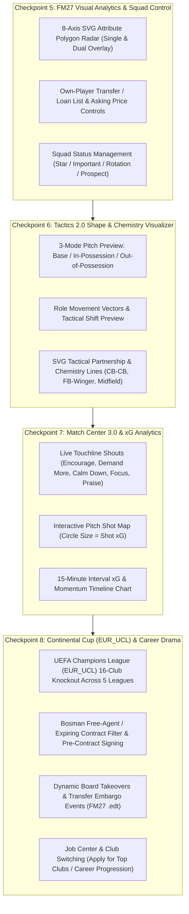

# แผนอัปเกรดเกม TOUCHLINE สู่ความสมบูรณ์ระดับ Football Manager 27 — Phase 2 (Checkpoints 5–8)

เอกสารนี้คือแผนงาน **Phase 2 (Checkpoints 5–8)** ต่อเนื่องจาก Phase 1 (Checkpoints 1–4 ที่พัฒนาและทดสอบผ่านครบ `9/9` Unit Tests แล้ว) เพื่อยกระดับทั้ง **UI/Data Visualization**, **Tactical Visualizer**, **Matchday Experience 3.0** และ **Continental & Career Depth** ให้เทียบเคียงประสบการณ์ของ **Football Manager 27 (FM27)**

> [!NOTE]
> **สรุปสถานะ Phase 1 (ดำเนินการเสร็จสมบูรณ์ 100%):**
> - **[x] Checkpoint 1:** Match Engine 2.0 (Team/Player Instructions ครบทุกมิติ, ใบแดงลดพลังทีมจริง, Stamina Drain รายนาที, เปลี่ยนตัวสด 5 คน, Half-Time Team Talk, ต่อเวลา 120 นาที + ดวลจุดโทษ และพิกัด 2D Pitch Radar ตามตำแหน่งจริง)
> - **[x] Checkpoint 2:** Staff Impact (โค้ช/นักกายภาพ/แมวมองส่งผลจริง), Fog of War Scouting, โทษแบนใบแดง/ใบเหลืองสะสม และระบบ Squad Dynamics พูดคุยแก้ปัญหาเมื่อนักเตะไม่พอใจ
> - **[x] Checkpoint 3:** Living World AI (AI ซื้อขายกันเองและยื่นข้อเสนอซื้อนักเตะทีมผู้เล่น), ระบบเจ้าของสโมสร Sugar Daddy 4 รูปแบบจาก `sugardaddy.edt` และแถบปรับสมดุลงบ Transfer ↔ Wage Budget
> - **[x] Checkpoint 4:** ฟุตบอลถ้วยในประเทศ (Domestic Cups R16 → Final), ระบบข้ามฤดูกาลอัตโนมัติ (End-of-Season Rollover: เลื่อนชั้น/ตกชั้น + Youth Intake + รีเซ็ตตาราง) และหน้าต่างเปรียบเทียบนักเตะ (Compare Tab)

---

## ผังสถาปัตยกรรมระบบที่จะเพิ่มใน Phase 2

---

## รายละเอียดแผนงานแยกตาม Checkpoint (Phase 2)

### Checkpoint 5: FM27 Visual Analytics (8-Axis Polygon Radar) & การจัดการสถานะ/ตั้งขายนักเตะในทีม

ยกระดับหน้าต่างโปรไฟล์นักเตะและการบริหารขุมกำลังในทีมของผู้เล่นให้ใช้งานได้ครบวงจรเหมือนหน้า Player Profile & Transfer Status ใน FM27

#### 1. ไฟล์ที่ต้องแก้ไข
- [game.ts](file:///c:/Users/chaiyasit/Documents/Football-Management-Simulation/src/types/game.ts)
- [worldSimulationService.ts](file:///c:/Users/chaiyasit/Documents/Football-Management-Simulation/src/engine/worldSimulationService.ts)
- [SquadAndProfileModal.tsx](file:///c:/Users/chaiyasit/Documents/Football-Management-Simulation/src/components/SquadAndProfileModal.tsx)
- [App.tsx](file:///c:/Users/chaiyasit/Documents/Football-Management-Simulation/src/App.tsx)

#### 2. รายละเอียดการพัฒนา
1. **กราฟใยแมงมุม 8 แกน (8-Axis SVG Attribute Polygon Radar):**
   - สร้างคอมโพเนนต์ SVG Polygon Radar ใน [SquadAndProfileModal.tsx](file:///c:/Users/chaiyasit/Documents/Football-Management-Simulation/src/components/SquadAndProfileModal.tsx) คำนวณค่าเฉลี่ย 8 มิติหลักสไตล์ FM27:
     - **Attacking (เกมรุก):** `finishing`, `longShots`, `offTheBall`, `composure`
     - **Speed (ความเร็ว):** `pace`, `acceleration`, `agility`
     - **Physical (ความแข็งแกร่ง):** `strength`, `stamina`, `naturalFitness`, `balance`
     - **Defending (เกมรับ):** `tackling`, `marking`, `positioning`, `anticipation`
     - **Mental (จิตวิทยา/ความมุ่งมั่น):** `determination`, `workRate`, `bravery`, `teamwork`, `leadership`
     - **Vision & Passing (การสร้างสรรค์เกม):** `passing`, `vision`, `decisions`, `crossing`
     - **Aerial (ลูกกลางอากาศ):** `heading`, `jumpingReach`
     - **Technique (เทคนิค/การเลี้ยงบอล):** `dribbling`, `firstTouch`, `technique`, `flair`
     - *(สำหรับผู้รักษาประตู จะสลับแกนเป็น Reflexes, Handling, One-on-Ones, Command of Area, Aerial, Distribution, Mental, Speed)*
   - แสดงผลทั้งในแท็บ `Attributes` (แสดง Polygon ของนักเตะเทียบค่าเฉลี่ยลีก) และในแท็บ `Compare` (ซ้อน Polygon 2 สีระหว่างนักเตะ A สีเขียว Emerald และนักเตะ B สีฟ้า Cyan เพื่อให้เห็นจุดเด่น-จุดด้อยทันที)
2. **แผงควบคุมสถานะนักเตะและการตั้งขาย/ปล่อยยืม (Own-Player Transfer & Squad Status Controls):**
   - ในแท็บ `Contract & Transfer` ของ [SquadAndProfileModal.tsx](file:///c:/Users/chaiyasit/Documents/Football-Management-Simulation/src/components/SquadAndProfileModal.tsx#L451-L525) เมื่อเปิดดูนักเตะของสโมสรตัวเอง (`isMyPlayer === true`):
     - ปุ่มสลับสถานะ **ขึ้นบัญชีขาย (Transfer Listed)** และ **ขึ้นบัญชีปล่อยยืม (Loan Listed)**
     - ตัวปรับ **ราคาตั้งขาย (Asking Price)** (เช่น `0.75x`, `1.0x`, `1.25x`, `1.5x` ของมูลค่าตลาด)
     - ตัวเปลี่ยน **สถานะในทีม (Squad Status / Playing Time Pathway):** `STAR_PLAYER`, `IMPORTANT_PLAYER`, `REGULAR_STARTER`, `SQUAD_PLAYER`, `FRINGE_PLAYER`, `YOUNGSTER`
   - เพิ่มฟังก์ชัน `updatePlayerSquadAndTransferStatus` ใน [worldSimulationService.ts](file:///c:/Users/chaiyasit/Documents/Football-Management-Simulation/src/engine/worldSimulationService.ts):
     - ถ้านักเตะถูกตั้ง `transferListed = true` หรือลดราคา Asking Price ลง ระบบจำลองตลาด AI (`simulateAITransfers` และ `maybeGenerateIncomingTransferBidForUserClub`) จะเพิ่มโอกาสยื่นข้อเสนอซื้อนักเตะคนนั้นขึ้นอีก 3 เท่า!
     - ถ้าถูกลด Squad Status จาก `STAR_PLAYER` ลงเป็น `FRINGE_PLAYER` นักเตะอาจเสียขวัญกำลังใจ (`morale` ลดลง) และส่งข้อความประท้วงเข้า Inbox

#### 3. เกณฑ์การตรวจสอบ (Verification Checkpoint 5)
- เปิดหน้าต่างนักเตะ ตรวจสอบกราฟ 8 แกนในแท็บ `Attributes` และกราฟซ้อน 2 คนในแท็บ `Compare`
- ทดสอบตั้งค่า `Transfer Listed` + ปรับ `Asking Price` ของนักเตะทีมตัวเอง แล้วจำลองวันในช่วงตลาดเปิดเพื่อยืนยันว่า AI ยื่นข้อเสนอเข้ามาซื้อนักเตะที่ขึ้นบัญชีขายได้ง่ายขึ้น

---

### Checkpoint 6: Tactics 2.0 — ผังจำลองการยืนตำแหน่งเมื่อมีบอล/ไม่มีบอล (In/Out-of-Possession Shape) & เส้นความเข้าขา (Chemistry Links)

นำฟีเจอร์เรือธงของยุคใหม่ใน FM27 คือการเห็นรูปขบวนตอนครองบอลบุก (In-Possession) เทียบกับตอนถอยลงมาตั้งรับ (Out-of-Possession) และเส้นเชื่อมความสัมพันธ์ระหว่างตำแหน่งมาไว้ในหน้า `Tactics`

#### 1. ไฟล์ที่ต้องแก้ไข
- [tacticsEngine.ts](file:///c:/Users/chaiyasit/Documents/Football-Management-Simulation/src/engine/tacticsEngine.ts)
- [TacticsView.tsx](file:///c:/Users/chaiyasit/Documents/Football-Management-Simulation/src/components/TacticsView.tsx)

#### 2. รายละเอียดการพัฒนา
1. **ปุ่มสลับโหมดแสดงผังสนาม 3 โหมด (3-Mode Pitch Shape Visualizer):**
   - เพิ่มปุ่มสลับบนหัวสนามใน [TacticsView.tsx](file:///c:/Users/chaiyasit/Documents/Football-Management-Simulation/src/components/TacticsView.tsx#L236-L246):
     - **`Base Shape` (ผังพื้นฐาน):** แสดงพิกัดเริ่มต้นของแผนและลากเปลี่ยนตำแหน่งได้ตามปกติ
     - **`In-Possession` (เมื่อครองบอลบุก):** คำนวณพิกัดใหม่ (`computeTacticalPhaseCoordinates`) โดยขยับตำแหน่งนักเตะตาม `Role`, `Duty`, `PlayerInstructions` และ `TeamInstructions` พร้อมลูกศรประ (Movement Vector Arrow) ชี้จากจุดเดิมไปยังจุดยืนขณะบุก เช่น:
       - `INVERTED_WING_BACK` หรือสั่ง `CUT_INSIDE` → หุบเข้ากลางไปช่วยพื้นที่ DM/MC
       - `WING_BACK` (`ATTACK`) → เติมขึ้นสูงระดับปีก
       - `HALF_BACK` / `ANCHOR` → ถอยลงไประหว่างคู่ CB เพื่อสร้างฐาน 3 กองหลัง (Back-3 Build-up)
       - `INSIDE_FORWARD` → หุบเข้ากรอบเขตโทษ (`Half-Space`)
       - `FALSE_NINE` / `DEEP_LYING_FORWARD` → ถอยลงมาเชื่อมเกมหน้ากรอบเขตโทษ
     - **`Out-of-Possession` (เมื่อไม่มีบอล/ตั้งรับ):** คำนวณพิกัดตาม `Line of Engagement` และ `Defensive Line` (เช่น `LOW_BLOCK` ถอยลงมาแพ็คแน่นหน้าเขตโทษ, `HIGH_PRESS` ดันไลน์ขึ้นสูงถึงครึ่งสนาม)
2. **เส้นเชื่อมความเข้าขาในสนาม (Tactical Partnership & Chemistry Lines):**
   - วาดเส้นเชื่อม SVG (`<line>`) บนผังสนามใน [TacticsView.tsx](file:///c:/Users/chaiyasit/Documents/Football-Management-Simulation/src/components/TacticsView.tsx#L250-L280) ระหว่างคู่ตำแหน่งสำคัญ:
     - คู่เซ็นเตอร์แบ็ก (`CB ↔ CB`)
     - แบ็กกับปีกฝั่งเดียวกัน (`LB ↔ LW/LM`, `RB ↔ RW/RM`)
     - คู่กองกลาง (`DM ↔ MC`, `MC ↔ AMC`)
     - แนวรุก (`AMC ↔ ST`, `ST ↔ ST`)
   - สีของเส้นคำนวณจากความถนัดตำแหน่ง (`getPositionFitScore`), ค่า `teamwork`, `morale` และ `tacticalFamiliarity`:
     - **สีเขียวเข้ม (`#10b981`):** ประสานงานยอดเยี่ยม (มอบโบนัสใน Match Engine)
     - **สีเหลือง (`#f59e0b`):** ประสานงานปานกลาง
     - **สีแดงประ (`#ef4444`):** บทบาททับซ้อนกันหรือคนใดคนหนึ่งยืนผิดตำแหน่ง (เช่น สั่ง `CUT_INSIDE` ซ้อนกันในพื้นที่แคบโดยไม่มีคนเติมริมเส้น)

#### 3. เกณฑ์การตรวจสอบ (Verification Checkpoint 6)
- ในหน้า `Tactics` ทดสอบสลับปุ่ม `Base Shape` / `In-Possession` / `Out-of-Possession` แล้วสังเกตการขยับของหมุดนักเตะบนสนามตาม Role (เช่น IWB หุบเข้ากลาง, IF ตัดเข้าใน) และตรวจสอบเส้น Chemistry ระหว่างตำแหน่ง

---

### Checkpoint 7: Match Center 3.0 — ตะโกนสั่งข้างสนาม (Touchline Shouts), แผนที่จุดยิง (Shot Map) และกราฟโมเมนตัม xG

เพิ่มความตื่นเต้นและเครื่องมือวิเคราะห์ข้อมูลระหว่างแข่งใน `MatchCenterView` ให้ผู้เล่นอ่านเกมและแก้เกมได้แม่นยำขึ้น

#### 1. ไฟล์ที่ต้องแก้ไข
- [game.ts](file:///c:/Users/chaiyasit/Documents/Football-Management-Simulation/src/types/game.ts)
- [matchEngine.ts](file:///c:/Users/chaiyasit/Documents/Football-Management-Simulation/src/engine/matchEngine.ts)
- [MatchCenterView.tsx](file:///c:/Users/chaiyasit/Documents/Football-Management-Simulation/src/components/MatchCenterView.tsx)

#### 2. รายละเอียดการพัฒนา
1. **ระบบตะโกนสั่งข้างสนามสด (Live Touchline Shouts):**
   - เพิ่มแถบปุ่ม **Touchline Shouts** ใน [MatchCenterView.tsx](file:///c:/Users/chaiyasit/Documents/Football-Management-Simulation/src/components/MatchCenterView.tsx) (มีคูลดาวน์ทุกๆ 15 นาทีในเกม):
     - **`Encourage` (กระตุ้นให้สู้):** เพิ่มโอกาสสร้างจังหวะบุกและขวัญกำลังใจเมื่อทีมกำลังเสมอหรือตามหลัง 1 ลูก
     - **`Demand More` (เรียกร้องให้ทุ่มเทกว่านี้):** บูสต์ Work Rate และจังหวะแย่งบอลเมื่อทีมเล่นต่ำกว่ามาตรฐาน
     - **`Calm Down` (สั่งให้ใจเย็นลง):** ลดความเสี่ยงในการเสียใบเหลืองที่ 2 / ใบแดง และลดการทำฟาวล์หน้าเขตโทษ
     - **`Focus` (เน้นสมาธิเกมรับ):** เพิ่มความเหนียวแน่นในเกมรับช่วง 15 นาทีสุดท้ายเมื่อกำลังขึ้นนำ
     - **`Praise` (ชมเชย):** เพิ่มความมั่นใจ (`Composure` / `Finishing`) เมื่อทีมกำลังนำห่าง
   - ส่งค่า `activeTouchlineShout` เข้าสู่ `simulateMatch` เพื่อคำนวณโบนัสในช่วง 15 นาทีหลังจากกดใช้
2. **แผนที่จุดยิงประตู (Interactive Pitch Shot Map) & กราฟโมเมนตัม xG 15 นาที:**
   - บันทึกพิกัดจุดยิง (`shotX`, `shotY`) และค่า `shotXg` ลงใน `MatchEvent` ของทุกจังหวะยิง (`GOAL`, `SHOT_ON_TARGET`, `SHOT_OFF_TARGET`, `BIG_CHANCE_MISSED`, `WOODWORK`) ใน [matchEngine.ts](file:///c:/Users/chaiyasit/Documents/Football-Management-Simulation/src/engine/matchEngine.ts)
   - ในหน้า [MatchCenterView.tsx](file:///c:/Users/chaiyasit/Documents/Football-Management-Simulation/src/components/MatchCenterView.tsx) เพิ่มแผง **Shot Map & xG Momentum**:
     - แสดงจุดยิงของทั้งสองทีมบนผังสนาม (ขนาดวงกลมแปรผันตามค่า `xG` ของลูกยิงนั้น และแสดงสีพิเศษสำหรับลูกที่เป็นประตู)
     - แสดงกราฟแท่งเปรียบเทียบโมเมนตัม `xG` แยกตามช่วงเวลา (`1-15'`, `16-30'`, `31-45'`, `46-60'`, `61-75'`, `76-90'`)

#### 3. เกณฑ์การตรวจสอบ (Verification Checkpoint 7)
- ทดสอบกดใช้ Touchline Shouts ระหว่างแข่ง ตรวจสอบสถานะคูลดาวน์ 15 นาที และตรวจสอบการแสดงจุดยิงใน Shot Map พร้อมค่า xG รายจังหวะ

---

### Checkpoint 8: ถ้วยใหญ่ยุโรป (UEFA Champions League `EUR_UCL`), กฎ Bosman, เทคโอเวอร์สโมสร และศูนย์หางาน (Job Center)

เติมเต็มเป้าหมายสูงสุดของการเล่นโหมด Career ด้วยถ้วยยุโรปที่นำทีมหัวตารางจากทั้ง 5 ลีกมาดวลกัน พร้อมดราม่าตลาดซื้อขายและเส้นทางอาชีพผู้จัดการทีม

#### 1. ไฟล์ที่ต้องแก้ไข
- [game.ts](file:///c:/Users/chaiyasit/Documents/Football-Management-Simulation/src/types/game.ts)
- [leagueEngine.ts](file:///c:/Users/chaiyasit/Documents/Football-Management-Simulation/src/engine/leagueEngine.ts)
- [worldGenerator.ts](file:///c:/Users/chaiyasit/Documents/Football-Management-Simulation/src/engine/worldGenerator.ts)
- [worldSimulationService.ts](file:///c:/Users/chaiyasit/Documents/Football-Management-Simulation/src/engine/worldSimulationService.ts)
- [ManagementViews.tsx](file:///c:/Users/chaiyasit/Documents/Football-Management-Simulation/src/components/ManagementViews.tsx)
- [App.tsx](file:///c:/Users/chaiyasit/Documents/Football-Management-Simulation/src/App.tsx)

#### 2. รายละเอียดการพัฒนา
1. **การแข่งขันถ้วยยุโรป (UEFA Champions League — `EUR_UCL`):**
   - คัดเลือก 16 สโมสรชั้นนำจากทั้ง 5 ลีกยุโรป (`ENG_PL` 4 ทีม, `ESP_LL` 4 ทีม, `GER_BL` 3 ทีม, `ITA_SA` 3 ทีม, `FRA_L1` 2 ทีม โดยอิงตามอันดับฤดูกาลล่าสุดหรือค่า Reputation ในฤดูกาลแรก)
   - สร้างตารางแข่งขันรอบน็อกเอาต์ยุโรป (`R16` → `QF` → `SF` → `Final`) คั่นกลางสัปดาห์ พร้อมเงินรางวัลมหาศาล (ชนะแต่ละรอบรับโบนัส €3.5M – €10M และแชมป์ยุโรปรับ €25M + ถ้วยรางวัลเข้าตู้โชว์สโมสร)
   - เพิ่มตัวเลือกสลับดูสายการแข่งขัน `UEFA Champions League (EUR_UCL)` ในหน้า `Schedule & Cups` ([ManagementViews.tsx](file:///c:/Users/chaiyasit/Documents/Football-Management-Simulation/src/components/ManagementViews.tsx))
2. **ตัวกรองสัญญากำลังจะหมด & กฎ Bosman (Expiring Contracts / Bosman Signing):**
   - เพิ่มตัวกรอง **"Expiring Contracts (< 1 Yr / Bosman)"** ในหน้า `Scouting & Transfers` ([ManagementViews.tsx](file:///c:/Users/chaiyasit/Documents/Football-Management-Simulation/src/components/ManagementViews.tsx))
   - เมื่อนักเตะเหลือสัญญาไม่ถึง 6 เดือน (ตั้งแต่วันที่ 1 มกราคมของปีที่หมดสัญญา) ผู้เล่นสามารถกด **"Approach to Sign (Bosman Free)"** เพื่อตกลงค่าเหนื่อยและเซ็นคว้าตัวมาร่วมทีมแบบไร้ค่าตัว (`Fee = €0`)
3. **เหตุการณ์เทคโอเวอร์สโมสร (Board Takeover & Transfer Embargo):**
   - อ้างอิงจากไฟล์ `valid_takeovers_only.edt` และ `transfer_embargo.edt` ของ FM27: สุ่มเหตุการณ์กลุ่มทุนใหม่เจรจาเทคโอเวอร์สโมสรในโลกของเกม (อาจเกิดช่วงสั้นๆ ที่ถูกสั่งระงับซื้อขาย `transferEmbargoUntilDate` ระหว่างตรวจสอบบัญชี และเมื่อเทคโอเวอร์สำเร็จ สโมสรมีโอกาสได้เปลี่ยนสถานะเป็น `FRONT_END` หรือ `UNDERWRITER` พร้อมเงินอัดฉีดก้อนโต)
4. **ศูนย์หางานและการย้ายสโมสร (Job Center & Club Switching):**
   - ในหน้า `Manager Profile` และ `World Overview` ([ManagementViews.tsx](file:///c:/Users/chaiyasit/Documents/Football-Management-Simulation/src/components/ManagementViews.tsx)) เพิ่มแผง **Job Center (ตำแหน่งผู้จัดการทีมที่ว่าง / เปิดรับสมัคร)**:
     - แสดงสโมสรที่ผลงานต่ำกว่าเป้า (`jobSecurity` ของโค้ชเดิมวิกฤต) หรือเปิดโอกาสให้ผู้เล่นกด **Apply for Job**
     - หากค่าชื่อเสียงของผู้จัดการทีม (`manager.reputation`) เพียงพอ บอร์ดบริหารของสโมสรใหม่จะตอบรับและย้ายผู้เล่นไปคุมสโมสรนั้นทันที (`switchControlledClub`) พร้อมบันทึกประวัติลง `manager.careerStats.clubsManaged`

#### 3. เกณฑ์การตรวจสอบ (Verification Checkpoint 8)
- ตรวจสอบสายการแข่งขัน `EUR_UCL` ในหน้า `Schedule & Cups` และการจำลองข้ามรอบจนได้แชมป์ยุโรป
- ทดสอบตัวกรองนักเตะสัญญาใกล้หมด (`Bosman`) ในหน้า `Scouting` และทดสอบการย้ายสโมสรผ่าน `Job Center`
- รันชุดทดสอบ Unit Tests ใน [engine.test.ts](file:///c:/Users/chaiyasit/Documents/Football-Management-Simulation/src/engine/engine.test.ts) เพื่อยืนยันว่าระบบใหม่ทั้งหมดทำงานร่วมกับของเดิมได้อย่างสมบูรณ์

---

> [!IMPORTANT]
> **ขั้นตอนถัดไป:** หากคุณเห็นชอบกับแผนงาน **Phase 2 (Checkpoints 5–8)** นี้ สามารถกดอนุมัติ (Proceed) หรือแจ้งปรับเปลี่ยนรายละเอียดที่ต้องการได้เลยครับ แล้วผมจะเริ่มลงมือพัฒนาทีละ Checkpoint พร้อมทดสอบทันที!
