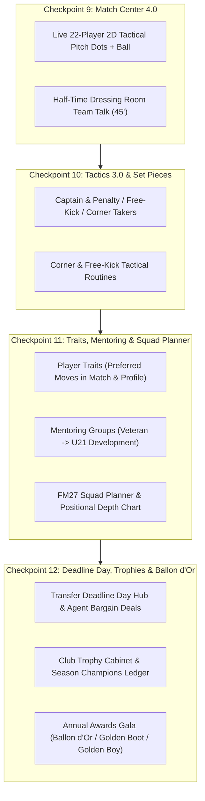

# แผนการพัฒนา Phase 3 (Checkpoints 9–12): ยกระดับ TOUCHLINE สู่ความสมบูรณ์แบบระดับ Football Manager 27

เอกสารฉบับนี้วางแผนการพัฒนา **Phase 3 (Checkpoints 9–12)** ต่อเนื่องจาก Phase 1–2 (Checkpoints 1–8 ที่พัฒนาและทดสอบผ่านครบ `10/10` แล้ว) เพื่อเติมเต็มระบบการแข่งขันสด, ลูกตั้งเตะและกัปตันทีม, การปั้นดาวรุ่ง/วางแผนขุมกำลัง และระบบเกียรติยศระยะยาวให้สมบูรณ์แบบ

---

## สถาปัตยกรรมภาพรวม Phase 3 (System Architecture)

---

## รายละเอียดการพัฒนาแบ่งตาม Checkpoint (Checkpoints 9–12)

### 🏁 Checkpoint 9: Match Center 4.0 — จุดนักเตะ 22 คนเคลื่อนที่สดบนสนาม 2D & การพูดปลุกใจช่วงพักครึ่ง (Half-Time Team Talk)

> [!IMPORTANT]
> ยกระดับประสบการณ์วันแข่งขัน (Matchday Experience) ให้ผู้จัดการทีมมองเห็นการเคลื่อนที่ของนักเตะทั้ง 22 คนบนสนาม 2D และสามารถแก้เกมในห้องแต่งตัวช่วงพักครึ่ง (`นาทีที่ 45'`) ได้จริง

1. **ไฟล์ที่แก้ไข**:
   - [game.ts](file:///c:/Users/chaiyasit/Documents/Football-Management-Simulation/src/types/game.ts)
   - [matchEngine.ts](file:///c:/Users/chaiyasit/Documents/Football-Management-Simulation/src/engine/matchEngine.ts)
   - [MatchCenterView.tsx](file:///c:/Users/chaiyasit/Documents/Football-Management-Simulation/src/components/MatchCenterView.tsx)
2. **รายละเอียดเชิงเทคนิค**:
   - **Live 22-Player 2D Pitch Visualizer**:
     - วาดเหรียญนักเตะทั้ง 22 คน (ทีมเหย้า 11 คน + ทีมเยือน 11 คน พร้อมหมายเลข/ชื่อย่อ) และลูกฟุตบอลลงบนผังสนาม SVG 2D ใน [MatchCenterView.tsx](file:///c:/Users/chaiyasit/Documents/Football-Management-Simulation/src/components/MatchCenterView.tsx)
     - คำนวณตำแหน่งยืนแบบไดนามิกตามจังหวะเวลาจริง: ทีมที่กำลังครองบอลบุกจะขยับเข้าสู่ผัง `in_possession` ดันขึ้นไปทางแดนคู่แข่งตามพิกัด `pitchX / pitchY` ของเหตุการณ์ล่าสุด ส่วนทีมรับจะถอยร่นเข้าสู่ผัง `out_of_possession` พร้อมแอนิเมชัน `transition-all duration-500`
   - **Half-Time Dressing Room Team Talk (`นาทีที่ 45'`)**:
     - เพิ่มชนิดข้อมูล `HalfTimeTalkType = 'praise' | 'encourage' | 'demand_more' | 'aggressive' | 'no_complacency'` ใน [game.ts](file:///c:/Users/chaiyasit/Documents/Football-Management-Simulation/src/types/game.ts)
     - เมื่อการแข่งขันสดเดินมาถึงนาทีที่ `45` (จบครึ่งแรก) ระบบจะหยุดเวลาชั่วคราวและเปิดแผง **ห้องแต่งตัวช่วงพักครึ่ง (Half-Time Team Talk)** ให้ผู้เล่นเลือกพูดกับลูกทีม:
       - `👏 ชื่นชมฟอร์มครึ่งแรก (Praise)` — เพิ่มความมั่นใจและการจบสกอร์ครึ่งหลัง `+9%` เมื่อทีมกำลังนำ
       - `🔥 กระตุ้นให้ฮึดสู้ (Encourage)` — เพิ่มโมเมนตัมเกมรุกและความขยัน `+8%`
       - `⚡ เรียกร้องมาตรฐานที่สูงขึ้น (Demand More)` — เร่งจังหวะบุกและการเพรสซิ่งครึ่งหลัง `+10%`
       - `💢 ทุบโต๊ะจวกฟอร์มการเล่น (Aggressive / Hairdryer)` — หากทีมตามหลังหรือเล่นแย่ จะกระตุ้นแรงฮึดครึ่งหลัง `+14%` (แต่หากทีมนำอยู่แล้วจะทำให้ขวัญกำลังใจเสีย)
       - `🎯 กำชับห้ามประมาท (Guard Against Complacency)` — ลดความผิดพลาดในเกมรับและลดโอกาสโดนตีเสมอท้ายเกมลง `-18%`
     - จำลองผลครึ่งหลัง (`นาที 46–90+`) ใหม่ผ่าน `reconcileMatchResultEventsAndStats` โดยรักษาสกอร์และสถิติครึ่งแรกไว้ 100%

---

### 🏁 Checkpoint 10: Tactics 3.0 — การตั้งกัปตันทีม, คนยิงลูกนิ่ง & แผนลูกตั้งเตะ (Captaincy & Set Piece Creator)

> [!TIP]
> ในฟุตบอลจริงและ FM27 ประตูจากลูกเตะมุม ฟรีคิก และจุดโทษคือตัวตัดสินเกมที่สูสี การให้ผู้เล่นกำหนดคนรับหน้าที่และรูปแบบการโจมตีลูกตั้งเตะเองจะเพิ่มความลึกเชิงกลยุทธ์อย่างมาก

1. **ไฟล์ที่แก้ไข**:
   - [game.ts](file:///c:/Users/chaiyasit/Documents/Football-Management-Simulation/src/types/game.ts)
   - [tacticsEngine.ts](file:///c:/Users/chaiyasit/Documents/Football-Management-Simulation/src/engine/tacticsEngine.ts)
   - [matchEngine.ts](file:///c:/Users/chaiyasit/Documents/Football-Management-Simulation/src/engine/matchEngine.ts)
   - [TacticsView.tsx](file:///c:/Users/chaiyasit/Documents/Football-Management-Simulation/src/components/TacticsView.tsx)
2. **รายละเอียดเชิงเทคนิค**:
   - เพิ่มโครงสร้าง `SetPieceSetup` ใน `TacticalSystem`:
     - `captainId`: กัปตันทีม (ส่งผลนำค่า `Leadership` + `Determination` มาเพิ่มโบนัสความนิ่งให้ทั้งทีมในช่วงท้ายเกม `นาที 75–90+` และในการดวลจุดโทษตัดสิน)
     - `penaltyTakerId`: คนยิงจุดโทษมือ 1
     - `freeKickTakerId`: คนยิงฟรีคิกมือ 1
     - `cornerTakerId`: คนเตะมุมหลัก
     - `cornerRoutine`: `'near_post' (โยนโฉบเสาแรก)` | `'far_post' (โยนกดเสาสอง)` | `'centre' (อัดจุดโทษ/กรอบ 6 หลา)` | `'short' (เล่นสั้นเซ็ตเข้าเขตโทษ)`
     - `freeKickRoutine`: `'direct_shoot' (ยิงตรงเข้ากรอบ)` | `'cross_box' (โยนเข้าหัวตัวโหม่ง)` | `'short_layoff' (เขี่ยสั้นให้แถวสองยิง)`
   - อัปเดต [matchEngine.ts](file:///c:/Users/chaiyasit/Documents/Football-Management-Simulation/src/engine/matchEngine.ts) ให้ดึงผู้เล่นที่ถูกตั้งค่าไว้ (หากอยู่ในสนาม) มารับหน้าที่ยิงจุดโทษ ฟรีคิก และเตะมุม พร้อมคำนวณโบนัสตามแผนลูกตั้งเตะและแสดงข้อความบรรยายไทยที่ตรงกับแผนที่เลือก
   - เพิ่มการ์ด **กัปตันทีม & แผนลูกตั้งเตะ (Captain & Set Pieces)** ใน [TacticsView.tsx](file:///c:/Users/chaiyasit/Documents/Football-Management-Simulation/src/components/TacticsView.tsx) พร้อมป้ายปลอกแขนกัปตัน `[C]` บนหมุดผู้เล่นในสนาม

---

### 🏁 Checkpoint 11: Player Traits (นิสัยการเล่นเฉพาะตัว), ระบบรุ่นพี่สอนรุ่นน้อง (Mentoring) & ผังขุมกำลัง (Squad Planner)

1. **ไฟล์ที่แก้ไข**:
   - [game.ts](file:///c:/Users/chaiyasit/Documents/Football-Management-Simulation/src/types/game.ts)
   - [worldGenerator.ts](file:///c:/Users/chaiyasit/Documents/Football-Management-Simulation/src/engine/worldGenerator.ts)
   - [matchEngine.ts](file:///c:/Users/chaiyasit/Documents/Football-Management-Simulation/src/engine/matchEngine.ts)
   - [worldSimulationService.ts](file:///c:/Users/chaiyasit/Documents/Football-Management-Simulation/src/engine/worldSimulationService.ts)
   - [SquadAndProfileModal.tsx](file:///c:/Users/chaiyasit/Documents/Football-Management-Simulation/src/components/SquadAndProfileModal.tsx)
   - [ManagementViews.tsx](file:///c:/Users/chaiyasit/Documents/Football-Management-Simulation/src/components/ManagementViews.tsx)
2. **รายละเอียดเชิงเทคนิค**:
   - **Player Traits (`Preferred Moves`)**:
     - เพิ่ม `traits?: PlayerTrait[]` ใน `Player` ได้แก่:
       - `Places Shots (ยิงเล่นทางเสียบมุม)` — เพิ่มความแม่นยำในการจบสกอร์เมื่อหลุดเดี่ยว
       - `Curls Ball (ปั่นโค้งไซด์ก้อย)` — เพิ่มโอกาสยิงไกลและฟรีคิกเข้าประตู
       - `Tries Killer Balls Often (จ่ายคิลเลอร์พาสทะลุช่อง)` — เพิ่มโอกาสสร้าง `Big Chances`
       - `Dictates Tempo (คุมจังหวะเกมแดนกลาง)` — เพิ่มความแม่นยำการจ่ายบอลและเปอร์เซ็นต์ครองบอล
       - `Dives Into Tackles (เสียบสกัดดุดัน)` — เพิ่มอัตราชนะการแย่งบอลแต่เพิ่มโอกาสเสียฟาวล์เล็กน้อย
       - `Beats Offside Trap (เช็กไลน์ล้ำหน้าเฉียบขาด)` — เพิ่มโอกาสหลุดเข้าไปยิงในกรอบเขตโทษ
       - `Runs With Ball Often (กระชากลากเลื้อยจี้แนวรับ)` — เพิ่มโอกาสเลี้ยงผ่านแนวรับริมเส้น
       - `Power Header (โหม่งทำประตูทรงพลัง)` — เพิ่มโอกาสทำประตูจากลูกกลางอากาศและลูกเตะมุม
     - แสดงป้าย `Player Traits` ในหน้าต่างโปรไฟล์นักเตะ [SquadAndProfileModal.tsx](file:///c:/Users/chaiyasit/Documents/Football-Management-Simulation/src/components/SquadAndProfileModal.tsx) และแสดงในข้อความบรรยายสดของ [matchEngine.ts](file:///c:/Users/chaiyasit/Documents/Football-Management-Simulation/src/engine/matchEngine.ts)
   - **Mentoring Groups (กลุ่มรุ่นพี่ติวเข้มรุ่นน้อง)**:
     - ในหน้า **Training** ([ManagementViews.tsx](file:///c:/Users/chaiyasit/Documents/Football-Management-Simulation/src/components/ManagementViews.tsx)): ผู้เล่นสามารถสร้างกลุ่ม Mentoring โดยเลือก **นักเตะรุ่นพี่ (`อายุ ≥ 25 ปี`)** มาจับคู่กับ **ดาวรุ่ง (`อายุ ≤ 21 ปี`)**
     - ทุกสัปดาห์ใน `advanceWorldOneDay` รุ่นพี่จะช่วยดึงค่า `Determination`, `Professionalism` ของรุ่นน้องให้สูงขึ้น และมีโอกาสถ่ายทอด `Player Trait` ของรุ่นพี่ให้ดาวรุ่งเรียนรู้สำเร็จพร้อมแจ้งข่าวใน Inbox
   - **FM27 Squad Planner & Depth Chart**:
     - เพิ่มมุมมองสลับ **`ตารางรายชื่อทั้งหมด (Squad Table)`** ↔ **`ผังวิเคราะห์ขุมกำลังเชิงลึก (Squad Planner / Depth Chart)`** ใน `SquadView` ([SquadAndProfileModal.tsx](file:///c:/Users/chaiyasit/Documents/Football-Management-Simulation/src/components/SquadAndProfileModal.tsx))
     - แสดงการ์ดแยกตามตำแหน่ง (`GK`, `DL`, `DC`, `DR`, `DM`, `MC`, `AML/AMR`, `AMC`, `ST`) เรียงลำดับ **ตัวจริงมือ 1 (`1st Choice`)**, **สำรอง (`Backup`)**, และ **ดาวรุ่ง (`Youth`)** พร้อมประเมินเกรดความแข็งแกร่งของแต่ละตำแหน่ง (`แข็งแกร่งมาก` / `สมดุล` / `⚠️ ขาดตัวสำรองควรเสริมทัพ`)

---

### 🏁 Checkpoint 12: วันเส้นตายตลาดซื้อขาย (Deadline Day Hub), ตู้โชว์ถ้วยรางวัล (Trophy Room) & รางวัล Ballon d'Or

1. **ไฟล์ที่แก้ไข**:
   - [game.ts](file:///c:/Users/chaiyasit/Documents/Football-Management-Simulation/src/types/game.ts)
   - [worldSimulationService.ts](file:///c:/Users/chaiyasit/Documents/Football-Management-Simulation/src/engine/worldSimulationService.ts)
   - [ManagementViews.tsx](file:///c:/Users/chaiyasit/Documents/Football-Management-Simulation/src/components/ManagementViews.tsx)
   - [App.tsx](file:///c:/Users/chaiyasit/Documents/Football-Management-Simulation/src/App.tsx)
2. **รายละเอียดเชิงเทคนิค**:
   - **Transfer Deadline Day Live Hub & Agent Last-Minute Deals**:
     - เมื่อวันที่ในเกมเข้าสู่ช่วงโค้งสุดท้ายของตลาดซื้อขาย (`28–31 ส.ค.` หรือ `28–31 ม.ค.`) หน้า **Transfers** ([ManagementViews.tsx](file:///c:/Users/chaiyasit/Documents/Football-Management-Simulation/src/components/ManagementViews.tsx)) จะเปลี่ยนแถบหัวข้อเป็นธีมสีทอง-อำพัน **`⏰ TRANSFER DEADLINE DAY LIVE HUB`**
     - แสดงรายการ **ข้อเสนอเร่งด่วนจากเอเยนต์ (`Agent Last-Minute Bargains`)** ที่นำนักเตะเกรดดีมาเสนอขายลดราคาพิเศษ `-25%` หรือปล่อยยืมตัวด่วนในวันปิดตลาด พร้อมปุ่ม **ฉีกสัญญาทันที (`Activate Release Clause`)**
   - **Club Trophy Cabinet & Annual Awards Gala (`Ballon d'Or` / `Golden Boot` / `Golden Boy`)**:
     - บันทึกประวัติแชมป์ลีกทั้ง 5 ลีก, ฟุตบอลถ้วยในประเทศ 5 รายการ และ `UEFA Champions League` ลงใน `world.trophyHistory`
     - เมื่อจบฤดูกาล (`processEndOfSeasonRollover`) ระบบจะคำนวณและประกาศผลรางวัลเกียรติยศประจำปีลงใน `world.seasonAwardsHistory` และส่งจดหมายสรุปงานกาล่าเข้า Inbox:
       - 🥇 **Ballon d'Or (ผู้เล่นยอดเยี่ยมแห่งปียุโรป)**
       - 👟 **European Golden Boot (ดาวซัลโวสูงสุดยุโรป)**
       - 🌟 **European Golden Boy (ดาวรุ่ง U21 ยอดเยี่ยม)**
       - 👔 **Manager of the Season (ผู้จัดการทีมยอดเยี่ยม)**
     - แสดง **ตู้โชว์ถ้วยรางวัลสโมสร (Trophy Cabinet)** และ **ทำเนียบรางวัล Ballon d'Or** ในหน้า **Club** และ **Manager Profile** ([ManagementViews.tsx](file:///c:/Users/chaiyasit/Documents/Football-Management-Simulation/src/components/ManagementViews.tsx))

---

## แผนการตรวจสอบและทดสอบ (Verification Plan)
1. **Automated Unit Tests ([engine.test.ts](file:///c:/Users/chaiyasit/Documents/Football-Management-Simulation/src/engine/engine.test.ts))**:
   - ทดสอบ `simulateMatch` ร่วมกับ `halfTimeTalk` และการเลือกคนยิงลูกนิ่ง/กัปตันทีมจาก `tactic.setPieces`
   - ทดสอบ `Player Traits` และการสร้างกลุ่ม `MentoringGroups` พร้อมการพัฒนาของดาวรุ่งใน `advanceWorldOneDay`
   - ทดสอบการบันทึกทำเนียบแชมป์ `trophyHistory` และการประกาศรางวัล `Ballon d'Or / Golden Boot / Golden Boy` ใน `processEndOfSeasonRollover`
   - ทดสอบความเข้ากันได้ของ `dehydrateWorldStateToCareerMap` และ `rehydrateWorldStateFromCareerDoc` สำหรับ Cloud Firestore
2. **TypeScript & JSX Verification**:
   - ตรวจสอบความถูกต้องของ Syntax และโครงสร้างคอมโพเนนต์ทั้งหมดให้พร้อมใช้งานทันทีโดยไม่มีข้อผิดพลาด
