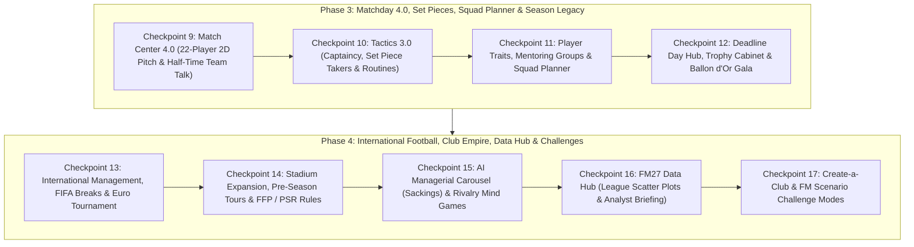

# แผนแม่บทการพัฒนา TOUCHLINE ฉบับสมบูรณ์: Phase 3 (Checkpoints 9–12) & Phase 4 (Checkpoints 13–17)

เอกสารฉบับนี้รวบรวมแผนการพัฒนาแบบละเอียดครบทุกมิติ ทั้งในส่วนของ **Phase 3 (Checkpoints 9–12)** และ **Phase 4 (Checkpoints 13–17)** เพื่อยกระดับเกม **TOUCHLINE** ให้เป็นเกมจำลองการคุมทีมฟุตบอลบนเว็บที่มีความลึกและความสมบูรณ์เทียบเท่า **Football Manager 27**

---

## แผนผังลำดับการพัฒนา (Master Roadmap Diagram)



---

# ส่วนที่ 1: Phase 3 — ความลึกของวันแข่ง, ลูกตั้งเตะ, การปั้นทีม และเกียรติยศประจำฤดูกาล (Checkpoints 9–12)

## 🏁 Checkpoint 9: Match Center 4.0 — จุดนักเตะ 22 คนเคลื่อนที่สดบนสนาม 2D & การพูดปลุกใจช่วงพักครึ่ง (Half-Time Team Talk)

1. **ไฟล์ที่แก้ไข**:
   - [game.ts](file:///c:/Users/chaiyasit/Documents/Football-Management-Simulation/src/types/game.ts)
   - [matchEngine.ts](file:///c:/Users/chaiyasit/Documents/Football-Management-Simulation/src/engine/matchEngine.ts)
   - [MatchCenterView.tsx](file:///c:/Users/chaiyasit/Documents/Football-Management-Simulation/src/components/MatchCenterView.tsx)
2. **โครงสร้างข้อมูลและอัลกอริทึม**:
   - เพิ่ม `HalfTimeTalkType = 'praise' | 'encourage' | 'demand_more' | 'aggressive' | 'no_complacency'` ใน [game.ts](file:///c:/Users/chaiyasit/Documents/Football-Management-Simulation/src/types/game.ts)
   - **Live 22-Player 2D Tactical Pitch Visualizer**:
     - คำนวณตำแหน่งผู้เล่นทั้ง 22 คนบนสนาม 2D (`11 Home` + `11 Away`) โดยนำพิกัดจาก `computeTacticalPhaseCoordinates` (`in_possession` สำหรับฝ่ายที่ครองบอลบุก และ `out_of_possession` สำหรับฝ่ายตั้งรับ) มาขยับตามโซนของลูกฟุตบอล (`activeEvent.pitchX`, `activeEvent.pitchY`)
     - แสดงเหรียญนักเตะทั้ง 22 คนพร้อมสีประจำสโมสร ชื่อย่อ และลูกฟุตบอลเคลื่อนที่อย่างลื่นไหลด้วย `transition-all duration-500`
   - **Half-Time Dressing Room Team Talk (`นาทีที่ 45'`)**:
     - เมื่อการจำลองสดถึงนาทีที่ `45` ระบบจะหยุดเวลาอัตโนมัติและเปิดแผง **ห้องแต่งตัวช่วงพักครึ่ง (Half-Time Team Talk)**:
       - `👏 ชื่นชมฟอร์มครึ่งแรก (Praise)`: บูสต์ความคมและขวัญกำลังใจครึ่งหลัง `+9%` เมื่อทีมกำลังนำ
       - `🔥 กระตุ้นให้ฮึดสู้ (Encourage)`: เพิ่มโมเมนตัมเกมรุกและความขยัน `+8%`
       - `⚡ เรียกร้องมาตรฐานที่สูงขึ้น (Demand More)`: เร่งจังหวะบุกและการเพรสซิ่งครึ่งหลัง `+10%`
       - `💢 ทุบโต๊ะจวกฟอร์มการเล่น (Aggressive / Hairdryer)`: หากทีมตามหลังจะกระตุ้นแรงฮึดครึ่งหลัง `+14%` (แต่หากนำอยู่จะทำให้ลูกทีมเสียขวัญ `-8%`)
       - `🎯 กำชับห้ามประมาท (Guard Against Complacency)`: ลดความผิดพลาดเกมรับและลดโอกาสเสียประตูท้ายเกมลง `-18%`
     - คำนวณเหตุการณ์ครึ่งหลัง (`นาที 46–90+`) ใหม่ผ่าน `reconcileMatchResultEventsAndStats` โดยรักษาสกอร์และสถิติครึ่งแรกไว้ 100%

---

## 🏁 Checkpoint 10: Tactics 3.0 — การตั้งกัปตันทีม, คนยิงลูกนิ่ง & แผนลูกตั้งเตะ (Captaincy & Set Piece Creator)

1. **ไฟล์ที่แก้ไข**:
   - [game.ts](file:///c:/Users/chaiyasit/Documents/Football-Management-Simulation/src/types/game.ts)
   - [tacticsEngine.ts](file:///c:/Users/chaiyasit/Documents/Football-Management-Simulation/src/engine/tacticsEngine.ts)
   - [matchEngine.ts](file:///c:/Users/chaiyasit/Documents/Football-Management-Simulation/src/engine/matchEngine.ts)
   - [TacticsView.tsx](file:///c:/Users/chaiyasit/Documents/Football-Management-Simulation/src/components/TacticsView.tsx)
2. **โครงสร้างข้อมูลและอัลกอริทึม**:
   - เพิ่ม `SetPieceSetup` ใน `TacticalSystem`:
     ```ts
     export type CornerRoutine = 'near_post' | 'far_post' | 'centre' | 'short';
     export type FreeKickRoutine = 'direct_shoot' | 'cross_box' | 'short_layoff';

     export interface SetPieceSetup {
       captainId: string | null;
       penaltyTakerId: string | null;
       freeKickTakerId: string | null;
       cornerTakerId: string | null;
       cornerRoutine: CornerRoutine;
       freeKickRoutine: FreeKickRoutine;
     }
     ```
   - **ผลลัพธ์ในเอนจินการแข่งขัน ([matchEngine.ts](file:///c:/Users/chaiyasit/Documents/Football-Management-Simulation/src/engine/matchEngine.ts))**:
     - **Captain Bonus**: ค่า `Leadership` และ `Determination` ของกัปตันทีม (`captainId`) ที่อยู่ในสนามช่วยเพิ่มความนิ่ง (`Composure`) ของทีมในช่วงท้ายเกม (`นาที 75–90+`) และในการดวลจุดโทษตัดสิน (`+4%` ถึง `+9%`)
     - **Set Piece Takers & Routines**: ดึงผู้เล่นที่ตั้งไว้เป็นคนยิงจุดโทษ, ฟรีคิก และเตะมุม พร้อมคำนวณโบนัสตามแผน เช่น `near_post` เน้นโยนให้กองหลัง/กองหน้าตัวสูงโฉบโหม่งเสาแรก (`+12%` โอกาสโหม่งเข้า), `short` เน้นต่อบอลสั้นหน้ากรอบเขตโทษเพื่อเพิ่มเปอร์เซ็นต์ครองบอลและยิงแถวสอง
   - **UI ใน [TacticsView.tsx](file:///c:/Users/chaiyasit/Documents/Football-Management-Simulation/src/components/TacticsView.tsx)**:
     - เพิ่มแผงตั้งค่า **กัปตันทีม & แผนลูกตั้งเตะ (Captain & Set Pieces)** และแสดงป้ายปลอกแขนกัปตัน `[C]` บนหมุดผู้เล่นในสนาม

---

## 🏁 Checkpoint 11: Player Traits (นิสัยการเล่นเฉพาะตัว), ระบบรุ่นพี่สอนรุ่นน้อง (Mentoring) & ผังขุมกำลัง (Squad Planner)

1. **ไฟล์ที่แก้ไข**:
   - [game.ts](file:///c:/Users/chaiyasit/Documents/Football-Management-Simulation/src/types/game.ts)
   - [worldGenerator.ts](file:///c:/Users/chaiyasit/Documents/Football-Management-Simulation/src/engine/worldGenerator.ts)
   - [matchEngine.ts](file:///c:/Users/chaiyasit/Documents/Football-Management-Simulation/src/engine/matchEngine.ts)
   - [worldSimulationService.ts](file:///c:/Users/chaiyasit/Documents/Football-Management-Simulation/src/engine/worldSimulationService.ts)
   - [SquadAndProfileModal.tsx](file:///c:/Users/chaiyasit/Documents/Football-Management-Simulation/src/components/SquadAndProfileModal.tsx)
   - [ManagementViews.tsx](file:///c:/Users/chaiyasit/Documents/Football-Management-Simulation/src/components/ManagementViews.tsx)
2. **โครงสร้างข้อมูลและอัลกอริทึม**:
   - **Player Traits (`Preferred Moves`)**:
     - เพิ่ม `PlayerTrait` 8 รูปแบบใน `Player.traits`:
       - `Places Shots (ยิงเล่นทางเสียบมุม)`
       - `Curls Ball (ปั่นโค้งไซด์ก้อย)`
       - `Tries Killer Balls Often (จ่ายคิลเลอร์พาสทะลุช่อง)`
       - `Dictates Tempo (คุมจังหวะเกมแดนกลาง)`
       - `Dives Into Tackles (เสียบสกัดดุดัน)`
       - `Beats Offside Trap (เช็กไลน์ล้ำหน้าเฉียบขาด)`
       - `Runs With Ball Often (กระชากลากเลื้อยจี้แนวรับ)`
       - `Power Header (โหม่งทำประตูทรงพลัง)`
     - แสดงป้าย `Player Traits` ในโปรไฟล์นักเตะ และนำมาคำนวณโบนัสพร้อมข้อความบรรยายพิเศษใน [matchEngine.ts](file:///c:/Users/chaiyasit/Documents/Football-Management-Simulation/src/engine/matchEngine.ts)
   - **Mentoring Groups (กลุ่มรุ่นพี่ติวเข้มรุ่นน้อง)**:
     - เพิ่มการจัดการกลุ่ม `MentoringGroup` ในหน้า **Training** ([ManagementViews.tsx](file:///c:/Users/chaiyasit/Documents/Football-Management-Simulation/src/components/ManagementViews.tsx)) ให้จับคู่ **รุ่นพี่ (`อายุ ≥ 24 ปี`)** กับ **ดาวรุ่ง (`อายุ ≤ 21 ปี`)**
     - ทุกสัปดาห์ใน `advanceWorldOneDay` ดาวรุ่งจะได้รับการถ่ายทอดค่า `Determination`, `Professionalism` และมีโอกาสเรียนรู้ `Player Trait` จากรุ่นพี่พร้อมแจ้งเตือนใน Inbox
   - **FM27 Squad Planner & Depth Chart**:
     - เพิ่มปุ่มสลับมุมมอง **`ตารางรายชื่อ (Squad Table)`** ↔ **`ผังวิเคราะห์ขุมกำลัง (Squad Planner)`** ใน `SquadView` ([SquadAndProfileModal.tsx](file:///c:/Users/chaiyasit/Documents/Football-Management-Simulation/src/components/SquadAndProfileModal.tsx))
     - แสดงการ์ดแยกตามตำแหน่ง (`GK`, `DL`, `DC`, `DR`, `DM`, `MC`, `AML/AMR`, `AMC`, `ST`) จัดลำดับ **ตัวจริงมือ 1 (`1st Choice`)**, **สำรอง (`Backup`)**, และ **ดาวรุ่ง (`Youth`)** พร้อมเกรดความแข็งแกร่งและคำเตือนจุดที่ควรเสริมทัพ

---

## 🏁 Checkpoint 12: วันเส้นตายตลาดซื้อขาย (Deadline Day Hub), ตู้โชว์ถ้วยรางวัล (Trophy Room) & รางวัล Ballon d'Or

1. **ไฟล์ที่แก้ไข**:
   - [game.ts](file:///c:/Users/chaiyasit/Documents/Football-Management-Simulation/src/types/game.ts)
   - [worldSimulationService.ts](file:///c:/Users/chaiyasit/Documents/Football-Management-Simulation/src/engine/worldSimulationService.ts)
   - [ManagementViews.tsx](file:///c:/Users/chaiyasit/Documents/Football-Management-Simulation/src/components/ManagementViews.tsx)
2. **โครงสร้างข้อมูลและอัลกอริทึม**:
   - **Transfer Deadline Day Live Hub & Agent Last-Minute Bargains**:
     - เมื่อวันที่ในเกมอยู่ในช่วงโค้งสุดท้ายของตลาดซื้อขาย (`28–31 ส.ค.` หรือ `28–31 ม.ค.`) หน้า **Transfers** จะแสดงแบนเนอร์พิเศษ **`⏰ TRANSFER DEADLINE DAY LIVE HUB`**
     - แสดงรายการ **ข้อเสนอเร่งด่วนจากเอเยนต์ (`Agent Last-Minute Deals`)** ที่ลดราคาตั้งขายลง `-25%` เฉพาะช่วงปิดตลาด และเพิ่มปุ่ม **ฉีกสัญญาทันที (`Activate Release Clause`)** สำหรับนักเตะที่มีค่าฉีกสัญญา
   - **Club Trophy Cabinet & Annual Awards Gala (`Ballon d'Or` / `Golden Boot` / `Golden Boy`)**:
     - บันทึกประวัติแชมป์ลีกทั้ง 5 ลีก, ฟุตบอลถ้วยในประเทศ 5 รายการ และ `UEFA Champions League` ลงใน `world.trophyHistory`
     - เมื่อจบฤดูกาล (`processEndOfSeasonRollover`) คำนวณและประกาศผลรางวัลเกียรติยศประจำปีลงใน `world.seasonAwardsHistory` พร้อมส่งจดหมายสรุปงานกาล่าเข้า Inbox:
       - 🥇 **Ballon d'Or (นักเตะยอดเยี่ยมแห่งปียุโรป)**
       - 👟 **European Golden Boot (ดาวซัลโวสูงสุดยุโรป)**
       - 🌟 **European Golden Boy (ดาวรุ่ง U21 ยอดเยี่ยม)**
       - 👔 **Manager of the Season (ผู้จัดการทีมยอดเยี่ยม)**
     - แสดง **ตู้โชว์ถ้วยรางวัลสโมสร (Trophy Cabinet)** และ **ทำเนียบรางวัล Ballon d'Or** ในหน้า **Club** และ **Manager Profile**

---

# ส่วนที่ 2: Phase 4 — ระบบทีมชาติ, อาณาจักรสโมสร & กฎ FFP, วัฏจักรโค้ช AI, Data Hub และโหมดท้าทาย (Checkpoints 13–17)

## 🏁 Checkpoint 13: ระบบทีมชาติ, เบรกทีมชาติ FIFA & ทัวร์นาเมนต์ชิงแชมป์แห่งชาติยุโรป (International Management & Euro Cup)

1. **ไฟล์ที่แก้ไข**:
   - [game.ts](file:///c:/Users/chaiyasit/Documents/Football-Management-Simulation/src/types/game.ts)
   - [leagueEngine.ts](file:///c:/Users/chaiyasit/Documents/Football-Management-Simulation/src/engine/leagueEngine.ts)
   - [worldSimulationService.ts](file:///c:/Users/chaiyasit/Documents/Football-Management-Simulation/src/engine/worldSimulationService.ts)
   - [ManagementViews.tsx](file:///c:/Users/chaiyasit/Documents/Football-Management-Simulation/src/components/ManagementViews.tsx)
2. **โครงสร้างข้อมูลและอัลกอริทึม**:
   - **FIFA International Call-ups (เบรกทีมชาติ)**:
     - เมื่อปฏิทินถึงช่วงเบรกทีมชาติ (`กลางเดือน ต.ค.` และ `กลางเดือน มี.ค.`) ระบบจะเรียกนักเตะที่มีค่าความสามารถสูง (`CA >= 135`) ไปรับใช้ทีมชาติ
     - นักเตะที่ติดทีมชาติจะได้เพิ่มค่าความมั่นใจ (`Morale +3`), ความเฉียบคม (`Match Sharpness +4`) แต่ใช้พลังงาน (`Fitness -6`) และมีโอกาสเล็กน้อย (`2.5%`) ที่จะได้รับบาดเจ็บจากการรับใช้ชาติ (`International Duty Injury`) พร้อมรายงานแจ้งเตือนใน Inbox
   - **Dual Club & National Team Management + European Nations Cup (`INT_EURO`)**:
     - เพิ่มตัวเลือกให้ผู้เล่นสามารถรับตำแหน่ง **ผู้จัดการทีมชาติ (`controlledNationalTeamCode`: เช่น `ENG`, `ESP`, `GER`, `ITA`, `FRA`, `BRA`, `ARG`, `POR`)** ควบคู่กับการคุมสโมสรได้ในหน้า **World / Manager Profile**
     - จัดการแข่งขันทัวร์นาเมนต์ทีมชาติระดับเมเจอร์ (`European Nations Cup / World Nations Trophy`) รอบ 8 ทีมสุดท้ายในช่วงปลายเดือนพฤษภาคม (`2027-05-20` ถึง `2027-05-30`) พร้อมถ้วยรางวัลเกียรติยศระดับทีมชาติ

---

## 🏁 Checkpoint 14: การขยายสนาม, ทัวร์ปรีซีซั่น, สปอนเซอร์ & กฎการเงิน FFP / PSR (Club Empire & Financial Fair Play)

1. **ไฟล์ที่แก้ไข**:
   - [game.ts](file:///c:/Users/chaiyasit/Documents/Football-Management-Simulation/src/types/game.ts)
   - [worldSimulationService.ts](file:///c:/Users/chaiyasit/Documents/Football-Management-Simulation/src/engine/worldSimulationService.ts)
   - [ManagementViews.tsx](file:///c:/Users/chaiyasit/Documents/Football-Management-Simulation/src/components/ManagementViews.tsx)
   - [App.tsx](file:///c:/Users/chaiyasit/Documents/Football-Management-Simulation/src/App.tsx)
2. **โครงสร้างข้อมูลและอัลกอริทึม**:
   - **Stadium Expansion (`ขอขยายความจุสนามแข่งขัน`)**:
     - เพิ่มคำร้องต่อบอร์ดบริหาร `expand_stadium` (ใช้งบประมาณ `€12.0M` เพื่อเพิ่มความจุสนาม `+8,000 ที่นั่ง`) ส่งผลให้รายได้ค่าตั๋ววันแข่งเหย้า (`Matchday Ticket Revenue`) เพิ่มขึ้นอย่างถาวรในทุกนัด
   - **Pre-Season Commercial Tours (`จัดทัวร์ปรีซีซั่นและ комเมอร์เชียล`)**:
     - ในหน้า **Club** ผู้เล่นสามารถเลือกจัดทัวร์ комเมอร์เชียลประจำฤดูกาล (`เอเชีย: โตเกียว/โซล +€4.5M`, `อเมริกาเหนือ: นิวยอร์ก/ลอสแอนเจลิส +€5.0M`, `ตะวันออกกลาง: ดูไบ/ริยาด +€5.5M`) เพื่อรับเงินอัดฉีด комเมอร์เชียลเข้าสโมสรシーズンละ 1 ครั้ง
   - **กฎควบคุมการเงิน FFP / PSR (`Profitability & Sustainability Rules`)**:
     - คำนวณดุลบัญชีขาดทุนสุทธิของสโมสรเทียบกับเพดาน FFP (`€105M`) และแสดงเกจสถานะ FFP (`🟢 ผ่านเกณฑ์ปกติ Compliant` / `🟡 เฝ้าระวัง Watchlist` / `🔴 ละเมิดกฎ Breach`)
     - หากสโมสรขาดทุนเกินเพดานเมื่อจบฤดูกาล จะถูกคณะกรรมการลีกสั่ง **ตัดแต้มในตารางคะแนน (`-6 คะแนน`)** ในฤดูกาลถัดไป

---

## 🏁 Checkpoint 15: วัฏจักรโค้ช AI ย้ายทีม/โดนปลด & สงครามจิตวิทยาก่อนแข่ง (AI Managerial Carousel & Rivalry Mind Games)

1. **ไฟล์ที่แก้ไข**:
   - [game.ts](file:///c:/Users/chaiyasit/Documents/Football-Management-Simulation/src/types/game.ts)
   - [worldSimulationService.ts](file:///c:/Users/chaiyasit/Documents/Football-Management-Simulation/src/engine/worldSimulationService.ts)
   - [ManagementViews.tsx](file:///c:/Users/chaiyasit/Documents/Football-Management-Simulation/src/components/ManagementViews.tsx)
2. **โครงสร้างข้อมูลและอัลกอริทึม**:
   - **AI Managerial Sackings & Carousel**:
     - ทุกวันที่ 1 ของเดือนใน `advanceWorldOneDay` ระบบจะประเมินอันดับตารางคะแนนของสโมสร AI เทียบกับค่าชื่อเสียง (`Reputation`)
     - สโมสรใหญ่ที่อันดับร่วงลงไปอยู่ครึ่งล่างของตารางจะขึ้นสถานะ **`เก้าอี้ร้อน (Under Pressure)`** และมีโอกาสปลดผู้จัดการทีม AI (`Sacked`) พร้อมแต่งตั้งโค้ชใหม่และแจ้งข่าวด่วนใน Inbox ทำให้ตลาดงาน **Job Center** มีความเคลื่อนไหวสมจริงตลอดฤดูกาล
   - **Pre-Match Rivalry Mind Games (`สงครามจิตวิทยาก่อนแข่ง`)**:
     - ในหน้า **Dashboard / Match Preview** ก่อนลงแข่งกับคู่แข่งนัดถัดไป ผู้เล่นสามารถเลือกส่งข้อความผ่านสื่อถึงกุนซือคู่แข่ง (1 ครั้งต่อสัปดาห์):
       - *🔥 เปิดศึกกดดันกุนซือคู่แข่ง (Attack Opponent Manager)* — มีโอกาสทำให้คู่แข่งเล่นรวนหรือบุกแลกจนเปิดพื้นที่ว่าง
       - *🤝 ยกย่องฝีมือคู่แข่ง (Praise Opponent)* — ลดความกดดันและเพิ่มสมาธิให้ลูกทีมตัวเอง (`Morale +2`)
       - *🛡️ ปกป้องลูกทีมและเน้นความรัดกุม (Deflect Pressure)* — เพิ่มความมั่นใจให้ผู้เล่นดาวรุ่งในทีม

---

## 🏁 Checkpoint 16: ศูนย์วิเคราะห์ข้อมูลเชิงลึก (FM27 Data Hub & League Scatter Plots)

1. **ไฟล์ที่แก้ไข**:
   - [ManagementViews.tsx](file:///c:/Users/chaiyasit/Documents/Football-Management-Simulation/src/components/ManagementViews.tsx)
2. **โครงสร้างข้อมูลและอัลกอริทึม**:
   - เพิ่มแท็บ **`📊 Data Hub (วิเคราะห์ข้อมูลเชิงลึก)`** ในหน้า **Competitions**:
     - **Attacking Efficiency SVG Scatter Plot**: กราฟพิกัด 2 มิติที่พล็อตทุกสโมสรในลีกตามค่า `ประตูที่ได้ต่อนัด (Goals/Match)` เทียบกับ `ความแข็งแกร่งเกมรุก/โอกาสเข้าทำ` แบ่งเป็น 4 จตุภาค (*คมกริบและบุกดุดัน*, *สร้างโอกาสมากแต่จบไม่คม*, *เน้นตั้งรับแต่สวนกลับคม*, *เกมรุกฝืด*) พร้อมไฮไลต์ตำแหน่งสโมสรของผู้เล่น
     - **Defensive Solidity SVG Scatter Plot**: กราฟพิกัด 2 มิติเปรียบเทียบ `ประตูที่เสียต่อนัด (GA/Match)` เทียบกับ `ผลต่างประตูได้เสียและวินัยเกมรับ`
     - **Next Opponent Analyst Report (`รายงานส่องคู่แข่งนัดถัดไป`)**: สรุปจุดแข็ง-จุดอ่อนของคู่แข่งนัดต่อไป (แผนการเล่นที่ใช้, สตาร์ตัวอันตรายที่สุด, ดาวซัลโวประจำทีม และคำแนะนำแท็กติกในการรับมือ)

---

## 🏁 Checkpoint 17: โหมดสร้างสโมสรเอง (`Create-a-Club`) & โหมดภารกิจท้าทาย (`FM Scenario Challenge Modes`)

1. **ไฟล์ที่แก้ไข**:
   - [game.ts](file:///c:/Users/chaiyasit/Documents/Football-Management-Simulation/src/types/game.ts)
   - [worldGenerator.ts](file:///c:/Users/chaiyasit/Documents/Football-Management-Simulation/src/engine/worldGenerator.ts)
   - [TitleScreen.tsx](file:///c:/Users/chaiyasit/Documents/Football-Management-Simulation/src/components/TitleScreen.tsx)
   - [App.tsx](file:///c:/Users/chaiyasit/Documents/Football-Management-Simulation/src/App.tsx)
2. **โครงสร้างข้อมูลและอัลกอริทึม**:
   - **Create-a-Club Customizer** ในหน้าเริ่มต้นสร้างเซฟเกมใหม่ ([TitleScreen.tsx](file:///c:/Users/chaiyasit/Documents/Football-Management-Simulation/src/components/TitleScreen.tsx)):
     - ผู้เล่นสามารถเปิดสวิตช์ **`🛠️ ก่อตั้งสโมสรของคุณเอง (Create-a-Club)`** เพื่อกำหนด **ชื่อสโมสรใหม่**, **ตัวย่อ 3 ตัวอักษร**, **สีประจำสโมสร**, และ **ชื่อสนามเหย้า** แทนที่สโมสรที่เลือกในลีกได้ทันที
   - **FM Scenario Challenge Modes (`โหมดภารกิจท้าทายพิเศษ`)**:
     - ให้เลือกโหมดความท้าทายก่อนเริ่มเกมใน [TitleScreen.tsx](file:///c:/Users/chaiyasit/Documents/Football-Management-Simulation/src/components/TitleScreen.tsx):
       1. `STANDARD`: โหมดอาชีพผู้จัดการทีมมาตรฐาน
       2. `POINTS_DEDUCTION`: **🔥 กู้วิกฤตโดนตัด `-10 คะแนน` (Points Deduction Survival)** — เริ่มต้นฤดูกาลด้วยคะแนนในตาราง `-10 แต้ม` และงบประมาณจำกัด
       3. `INJURY_CRISIS`: **🏥 วิกฤตนักเตะตัวหลักบาดเจ็บระนาว (Hospital Crisis)** — สตาร์ตัวจริง 5 คนของทีมเริ่มต้นด้วยอาการบาดเจ็บ ต้องบริหารทีมสำรองและดาวรุ่งฝ่าวิกฤตช่วงต้นฤดูกาล
       4. `YOUTH_ONLY`: **🌱 ปั้นเด็กอคาเดมีล้วน (Class of '27 Youth-Only)** — ล็อกตลาดซื้อขายขาเข้าถาวร แต่ยกระดับศูนย์ฝึกเยาวชนเป็น `20/20` พร้อมแจกดาวรุ่ง Wonderkids 3 คนตั้งแต่วันแรก

---

## แผนการตรวจสอบและทดสอบ (Verification Plan)
1. **Automated Unit Tests ([engine.test.ts](file:///c:/Users/chaiyasit/Documents/Football-Management-Simulation/src/engine/engine.test.ts))**:
   - ทดสอบครบทุกฟีเจอร์ตั้งแต่ Checkpoint 9 ถึง Checkpoint 17 (Half-Time Team Talk, Set Pieces & Captaincy, Player Traits & Mentoring, Deadline Day & Ballon d'Or/Trophies, International Call-ups & Euro Cup, Stadium Expansion/Pre-Season Tour/FFP, AI Managerial Carousel, และ Scenario Challenge Modes)
   - ทดสอบการบีบอัดและกู้คืนข้อมูลเซฟเกมบน Cloud Firestore (`dehydrateWorldStateToCareerMap` / `rehydrateWorldStateFromCareerDoc`) ให้รองรับฟิลด์ใหม่ทั้งหมด 100%
2. **UI & Syntax Verification**:
   - ตรวจสอบทุกคอมโพเนนต์ใน `src/components/` และ `src/App.tsx` ให้ทำงานร่วมกันได้อย่างไร้รอยต่อ
