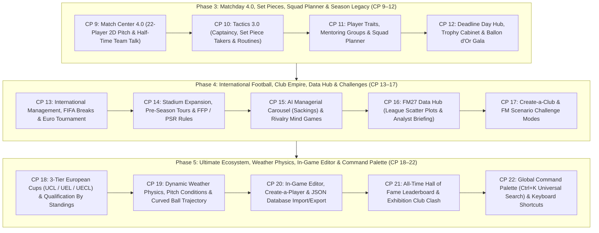

# แผนแม่บทการพัฒนา TOUCHLINE ฉบับสมบูรณ์สูงสุด: Phase 3, Phase 4 & Phase 5 (Checkpoints 9–22)

เอกสารฉบับนี้คือแผนแม่บท (Master Implementation Plan) ที่วางโครงสร้างทางเทคนิคอย่างละเอียดครบทุกขั้นตอน ตั้งแต่ **Checkpoint 9 ถึง Checkpoint 22** ต่อเนื่องจาก Phase 1–2 (Checkpoints 1–8 ที่พัฒนาเสร็จและผ่านการทดสอบ `10/10` แล้ว) เพื่อยกระดับ **TOUCHLINE** ให้เป็นเกมบริหารสโมสรฟุตบอลบนเว็บที่ครบเครื่องที่สุดในระดับเดียวกับ **Football Manager 27**

---

## แผนผังสถาปัตยกรรมทั้ง 3 เฟส (Master Roadmap: Checkpoints 9–22)

---

# ส่วนที่ 1: Phase 3 — ความลึกของวันแข่ง, ลูกตั้งเตะ, การปั้นทีม และเกียรติยศประจำฤดูกาล (Checkpoints 9–12)

## 🏁 Checkpoint 9: Match Center 4.0 — จุดนักเตะ 22 คนเคลื่อนที่สดบนสนาม 2D & การพูดปลุกใจช่วงพักครึ่ง (Half-Time Team Talk)

1. **ไฟล์ที่แก้ไข**:
   - [game.ts](file:///c:/Users/chaiyasit/Documents/Football-Management-Simulation/src/types/game.ts)
   - [matchEngine.ts](file:///c:/Users/chaiyasit/Documents/Football-Management-Simulation/src/engine/matchEngine.ts)
   - [MatchCenterView.tsx](file:///c:/Users/chaiyasit/Documents/Football-Management-Simulation/src/components/MatchCenterView.tsx)
2. **โครงสร้างข้อมูลและอัลกอริทึม**:
   - เพิ่ม `HalfTimeTalkType = 'praise' | 'encourage' | 'demand_more' | 'aggressive' | 'no_complacency'` ใน [game.ts](file:///c:/Users/chaiyasit/Documents/Football-Management-Simulation/src/types/game.ts)
   - **Live 22-Player 2D Tactical Pitch Visualizer**:
     - คำนวณตำแหน่งผู้เล่นทั้ง 22 คนบนสนาม 2D (`11 Home` + `11 Away`) โดยนำพิกัดจาก `computeTacticalPhaseCoordinates` (`in_possession` สำหรับฝ่ายครองบอลบุก และ `out_of_possession` สำหรับฝ่ายตั้งรับ) มาขยับตามโซนของลูกฟุตบอล (`activeEvent.pitchX`, `activeEvent.pitchY`)
     - วาดเหรียญนักเตะทั้ง 22 คนพร้อมสีประจำสโมสร ชื่อย่อ และลูกฟุตบอลเคลื่อนที่อย่างลื่นไหลด้วย `transition-all duration-500`
   - **Half-Time Dressing Room Team Talk (`นาทีที่ 45'`)**:
     - เมื่อการจำลองสดถึงนาทีที่ `45` ระบบจะหยุดเวลาชั่วคราวและเปิดแผง **ห้องแต่งตัวช่วงพักครึ่ง (Half-Time Team Talk)**:
       - `👏 ชื่นชมฟอร์มครึ่งแรก (Praise)`: บูสต์ความคมและขวัญกำลังใจครึ่งหลัง `+9%` เมื่อทีมกำลังนำ
       - `🔥 กระตุ้นให้ฮึดสู้ (Encourage)`: เพิ่มโมเมนตัมเกมรุกและความขยัน `+8%`
       - `⚡ เรียกร้องมาตรฐานที่สูงขึ้น (Demand More)`: เร่งจังหวะบุกและการเพรสซิ่งครึ่งหลัง `+10%`
       - `💢 ทุบโต๊ะจวกฟอร์มการเล่น (Aggressive / Hairdryer)`: หากทีมตามหลังจะกระตุ้นแรงฮึดครึ่งหลัง `+14%` (แต่หากนำอยู่จะทำให้ลูกทีมเสียขวัญ `-8%`)
       - `🎯 กำชับห้ามประมาท (Guard Against Complacency)`: ลดความผิดพลาดเกมรับและลดโอกาสเสียประตูท้ายเกมลง `-18%`
     - คำนวณเหตุการณ์ครึ่งหลัง (`นาที 46–90+`) ใหม่ผ่าน `reconcileMatchResultEventsAndStats` โดยรักษาสกอร์และสถิติครึ่งแรกไว้ 100%

---

## 🏁 Checkpoint 10: Tactics 3.0 — การตั้งกัปตันทีม, คนยิงลูกนิ่ง & แผนลูกตั้งเตะ (Captaincy & Set Piece Creator)

1. **ไฟล์ที่แก้ไข**:
   - [game.ts](file:///c:/Users/chaiyasit/Documents/Football-Management-Simulation/src/types/game.ts)
   - [tacticsEngine.ts](file:///c:/Users/chaiyasit/Documents/Football-Management-Simulation/src/engine/tacticsEngine.ts)
   - [matchEngine.ts](file:///c:/Users/chaiyasit/Documents/Football-Management-Simulation/src/engine/matchEngine.ts)
   - [TacticsView.tsx](file:///c:/Users/chaiyasit/Documents/Football-Management-Simulation/src/components/TacticsView.tsx)
2. **โครงสร้างข้อมูลและอัลกอริทึม**:
   - เพิ่ม `SetPieceSetup` ใน `TacticalSystem`:
     - `captainId`: กัปตันทีม (นำค่า `Leadership` + `Determination` มาเพิ่มโบนัสความนิ่งให้ทั้งทีมในช่วงท้ายเกม `นาที 75–90+` และในการดวลจุดโทษตัดสิน `+4%` ถึง `+9%`)
     - `penaltyTakerId`: คนยิงจุดโทษมือ 1
     - `freeKickTakerId`: คนยิงฟรีคิกมือ 1
     - `cornerTakerId`: คนเตะมุมหลัก
     - `cornerRoutine`: `'near_post' (โยนโฉบเสาแรก)` | `'far_post' (โยนกดเสาสอง)` | `'centre' (อัดจุดโทษ/กรอบ 6 หลา)` | `'short' (เล่นสั้นเซ็ตเข้าเขตโทษ)`
     - `freeKickRoutine`: `'direct_shoot' (ยิงตรงเข้ากรอบ)` | `'cross_box' (โยนเข้าหัวตัวโหม่ง)` | `'short_layoff' (เขี่ยสั้นให้แถวสองยิง)`
   - เพิ่มแผงตั้งค่า **กัปตันทีม & แผนลูกตั้งเตะ (Captain & Set Pieces)** ใน [TacticsView.tsx](file:///c:/Users/chaiyasit/Documents/Football-Management-Simulation/src/components/TacticsView.tsx) พร้อมป้ายปลอกแขนกัปตัน `[C]` บนหมุดผู้เล่นในสนาม

---

## 🏁 Checkpoint 11: Player Traits (นิสัยการเล่นเฉพาะตัว), ระบบรุ่นพี่สอนรุ่นน้อง (Mentoring) & ผังขุมกำลัง (Squad Planner)

1. **ไฟล์ที่แก้ไข**:
   - [game.ts](file:///c:/Users/chaiyasit/Documents/Football-Management-Simulation/src/types/game.ts)
   - [worldGenerator.ts](file:///c:/Users/chaiyasit/Documents/Football-Management-Simulation/src/engine/worldGenerator.ts)
   - [matchEngine.ts](file:///c:/Users/chaiyasit/Documents/Football-Management-Simulation/src/engine/matchEngine.ts)
   - [worldSimulationService.ts](file:///c:/Users/chaiyasit/Documents/Football-Management-Simulation/src/engine/worldSimulationService.ts)
   - [SquadAndProfileModal.tsx](file:///c:/Users/chaiyasit/Documents/Football-Management-Simulation/src/components/SquadAndProfileModal.tsx)
   - [ManagementViews.tsx](file:///c:/Users/chaiyasit/Documents/Football-Management-Simulation/src/components/ManagementViews.tsx)
2. **โครงสร้างข้อมูลและอัลกอริทึม**:
   - **Player Traits (`Preferred Moves`)**:
     - เพิ่ม `PlayerTrait` 8 รูปแบบใน `Player.traits`: `Places Shots`, `Curls Ball`, `Tries Killer Balls Often`, `Dictates Tempo`, `Dives Into Tackles`, `Beats Offside Trap`, `Runs With Ball Often`, `Power Header`
     - แสดงป้าย `Player Traits` ในโปรไฟล์นักเตะ และคำนวณโบนัสพร้อมข้อความบรรยายพิเศษใน [matchEngine.ts](file:///c:/Users/chaiyasit/Documents/Football-Management-Simulation/src/engine/matchEngine.ts)
   - **Mentoring Groups (กลุ่มรุ่นพี่ติวเข้มรุ่นน้อง)**:
     - จับคู่ **รุ่นพี่ (`อายุ ≥ 24 ปี`)** กับ **ดาวรุ่ง (`อายุ ≤ 21 ปี`)** ในหน้า **Training** เพื่อถ่ายทอดค่า `Determination`, `Professionalism` และ `Player Trait` ใน `advanceWorldOneDay`
   - **FM27 Squad Planner & Depth Chart**:
     - มุมมอง **`ผังวิเคราะห์ขุมกำลัง (Squad Planner)`** ใน `SquadView` แยกตามตำแหน่ง (`GK`, `DL`, `DC`, `DR`, `DM`, `MC`, `AML/AMR`, `AMC`, `ST`) จัดลำดับ **มือ 1 (`1st Choice`)**, **สำรอง (`Backup`)**, และ **ดาวรุ่ง (`Youth`)** พร้อมเกรดความแข็งแกร่งและคำเตือนจุดที่ควรเสริมทัพ

---

## 🏁 Checkpoint 12: วันเส้นตายตลาดซื้อขาย (Deadline Day Hub), ตู้โชว์ถ้วยรางวัล (Trophy Room) & รางวัล Ballon d'Or

1. **ไฟล์ที่แก้ไข**:
   - [game.ts](file:///c:/Users/chaiyasit/Documents/Football-Management-Simulation/src/types/game.ts)
   - [worldSimulationService.ts](file:///c:/Users/chaiyasit/Documents/Football-Management-Simulation/src/engine/worldSimulationService.ts)
   - [ManagementViews.tsx](file:///c:/Users/chaiyasit/Documents/Football-Management-Simulation/src/components/ManagementViews.tsx)
2. **โครงสร้างข้อมูลและอัลกอริทึม**:
   - **Transfer Deadline Day Live Hub & Agent Last-Minute Bargains**:
     - เมื่อวันที่ในเกมอยู่ในช่วง `28–31 ส.ค.` หรือ `28–31 ม.ค.` หน้า **Transfers** จะแสดงแบนเนอร์ **`⏰ TRANSFER DEADLINE DAY LIVE HUB`**, รายการ **ข้อเสนอเร่งด่วนจากเอเยนต์ลดราคา `-25%`** และปุ่ม **ฉีกสัญญาทันที (`Activate Release Clause`)**
   - **Club Trophy Cabinet & Annual Awards Gala (`Ballon d'Or` / `Golden Boot` / `Golden Boy`)**:
     - บันทึกประวัติแชมป์ลีกทั้ง 5 ลีก, ฟุตบอลถ้วยในประเทศ และถ้วยยุโรปลงใน `world.trophyHistory`
     - ประกาศผลรางวัล **Ballon d'Or**, **European Golden Boot**, **European Golden Boy (U21)** และ **Manager of the Season** ลงใน `world.seasonAwardsHistory` เมื่อจบฤดูกาล และแสดงตู้โชว์ถ้วยรางวัลในหน้า **Club / Manager Profile**

---

# ส่วนที่ 2: Phase 4 — ระบบทีมชาติ, อาณาจักรสโมสร & กฎ FFP, วัฏจักรโค้ช AI, Data Hub และโหมดท้าทาย (Checkpoints 13–17)

## 🏁 Checkpoint 13: ระบบทีมชาติ, เบรกทีมชาติ FIFA & ทัวร์นาเมนต์ชิงแชมป์แห่งชาติยุโรป (International Management & Euro Cup)

1. **ไฟล์ที่แก้ไข**:
   - [game.ts](file:///c:/Users/chaiyasit/Documents/Football-Management-Simulation/src/types/game.ts)
   - [leagueEngine.ts](file:///c:/Users/chaiyasit/Documents/Football-Management-Simulation/src/engine/leagueEngine.ts)
   - [worldSimulationService.ts](file:///c:/Users/chaiyasit/Documents/Football-Management-Simulation/src/engine/worldSimulationService.ts)
   - [ManagementViews.tsx](file:///c:/Users/chaiyasit/Documents/Football-Management-Simulation/src/components/ManagementViews.tsx)
2. **โครงสร้างข้อมูลและอัลกอริทึม**:
   - **FIFA International Call-ups (เบรกทีมชาติ)**:
     - เรียกนักเตะระดับท็อป (`CA >= 135`) ไปรับใช้ทีมชาติในช่วงฟีฟ่าเดย์ (`ต.ค.` และ `มี.ค.`) เพิ่ม `Morale +3`, `Match Sharpness +4` แต่ลด `Fitness -6` และมีโอกาส `2.5%` ที่จะบาดเจ็บจากการรับใช้ชาติ (`International Duty Injury`)
   - **Dual Club & National Team Management + European Nations Cup (`INT_EURO`)**:
     - ผู้เล่นสามารถเลือกรับตำแหน่ง **ผู้จัดการทีมชาติ (`controlledNationalTeamCode`)** ควบคู่สโมสรในหน้า **World / Manager Profile** และแข่งขันศึกทีมชาติรอบน็อกเอาต์ในเดือนพฤษภาคม

---

## 🏁 Checkpoint 14: การขยายสนาม, ทัวร์ปรีซีซั่น, สปอนเซอร์ & กฎการเงิน FFP / PSR (Club Empire & Financial Fair Play)

1. **ไฟล์ที่แก้ไข**:
   - [game.ts](file:///c:/Users/chaiyasit/Documents/Football-Management-Simulation/src/types/game.ts)
   - [worldSimulationService.ts](file:///c:/Users/chaiyasit/Documents/Football-Management-Simulation/src/engine/worldSimulationService.ts)
   - [ManagementViews.tsx](file:///c:/Users/chaiyasit/Documents/Football-Management-Simulation/src/components/ManagementViews.tsx)
   - [App.tsx](file:///c:/Users/chaiyasit/Documents/Football-Management-Simulation/src/App.tsx)
2. **โครงสร้างข้อมูลและอัลกอริทึม**:
   - **Stadium Expansion (`ขอขยายความจุสนามแข่งขัน`)**: ยื่นขอบอร์ดใช้งบ `€12.0M` ขยายความจุสนาม `+8,000 ที่นั่ง` เพิ่มรายได้ค่าตั๋ววันแข่งเหย้าถาวร
   - **Pre-Season Commercial Tours**: เลือกจัดทัวร์ комเมอร์เชียลประจำฤดูกาล (`เอเชีย +€4.5M`, `อเมริกาเหนือ +€5.0M`, `ตะวันออกกลาง +€5.5M`) เพื่อรับเงินอัดฉีดเข้าสโมสร
   - **กฎควบคุมการเงิน FFP / PSR (`Profitability & Sustainability Rules`)**: แสดงเกจสถานะ FFP (`🟢 Compliant` / `🟡 Watchlist` / `🔴 Breach`) และตัดแต้ม `-6 คะแนน` หากขาดทุนสุทธิเกินเพดานเมื่อจบฤดูกาล

---

## 🏁 Checkpoint 15: วัฏจักรโค้ช AI ย้ายทีม/โดนปลด & สงครามจิตวิทยาก่อนแข่ง (AI Managerial Carousel & Rivalry Mind Games)

1. **ไฟล์ที่แก้ไข**:
   - [game.ts](file:///c:/Users/chaiyasit/Documents/Football-Management-Simulation/src/types/game.ts)
   - [worldSimulationService.ts](file:///c:/Users/chaiyasit/Documents/Football-Management-Simulation/src/engine/worldSimulationService.ts)
   - [ManagementViews.tsx](file:///c:/Users/chaiyasit/Documents/Football-Management-Simulation/src/components/ManagementViews.tsx)
2. **โครงสร้างข้อมูลและอัลกอริทึม**:
   - **AI Managerial Sackings & Carousel**: ประเมินผลงานสโมสร AI ทุกต้นเดือน หากทีมใหญ่อันดับร่วงต่ำกว่าเป้าจะขึ้นสถานะ **`เก้าอี้ร้อน (Under Pressure)`** และปลดโค้ช AI (`Sacked`) พร้อมเปิดรับสมัครใน **Job Center**
   - **Pre-Match Rivalry Mind Games (`สงครามจิตวิทยาก่อนแข่ง`)**: ส่งข้อความผ่านสื่อถึงกุนซือคู่แข่งนัดถัดไปในหน้า **Dashboard** (*เปิดศึกกดดันกุนซือคู่แข่ง*, *ยกย่องฝีมือคู่แข่ง*, *ปกป้องลูกทีม*) ซึ่งส่งผลต่อขวัญกำลังใจและแท็กติกของคู่แข่ง

---

## 🏁 Checkpoint 16: ศูนย์วิเคราะห์ข้อมูลเชิงลึก (FM27 Data Hub & League Scatter Plots)

1. **ไฟล์ที่แก้ไข**:
   - [ManagementViews.tsx](file:///c:/Users/chaiyasit/Documents/Football-Management-Simulation/src/components/ManagementViews.tsx)
2. **โครงสร้างข้อมูลและอัลกอริทึม**:
   - เพิ่มแท็บ **`📊 Data Hub (วิเคราะห์ข้อมูลเชิงลึก)`** ในหน้า **Competitions**:
     - **Attacking Efficiency SVG Scatter Plot**: พล็อตทุกสโมสรในลีกตามค่า `ประตูที่ได้ต่อนัด` vs `พลังเกมรุก/โอกาสยิง` แบ่งเป็น 4 จตุภาคพร้อมไฮไลต์สโมสรของผู้เล่น
     - **Defensive Solidity SVG Scatter Plot**: เปรียบเทียบ `ประตูที่เสียต่อนัด` vs `ผลต่างประตูได้เสียและวินัยเกมรับ`
     - **Next Opponent Analyst Briefing**: รายงานวิเคราะห์คู่แข่งนัดถัดไป (แผนที่ใช้, สตาร์ตัวอันตราย, ดาวซัลโว และคำแนะนำแท็กติกในการรับมือ)

---

## 🏁 Checkpoint 17: โหมดสร้างสโมสรเอง (`Create-a-Club`) & โหมดภารกิจท้าทาย (`FM Scenario Challenge Modes`)

1. **ไฟล์ที่แก้ไข**:
   - [game.ts](file:///c:/Users/chaiyasit/Documents/Football-Management-Simulation/src/types/game.ts)
   - [worldGenerator.ts](file:///c:/Users/chaiyasit/Documents/Football-Management-Simulation/src/engine/worldGenerator.ts)
   - [TitleScreen.tsx](file:///c:/Users/chaiyasit/Documents/Football-Management-Simulation/src/components/TitleScreen.tsx)
   - [App.tsx](file:///c:/Users/chaiyasit/Documents/Football-Management-Simulation/src/App.tsx)
2. **โครงสร้างข้อมูลและอัลกอริทึม**:
   - **Create-a-Club Customizer** ใน [TitleScreen.tsx](file:///c:/Users/chaiyasit/Documents/Football-Management-Simulation/src/components/TitleScreen.tsx): กำหนดชื่อสโมสรใหม่, ตัวย่อ 3 ตัวอักษร, สีประจำสโมสร และชื่อสนามเหย้าแทนที่สโมสรเดิมได้ทันที
   - **FM Scenario Challenge Modes**:
     1. `STANDARD`: โหมดอาชีพผู้จัดการทีมมาตรฐาน
     2. `POINTS_DEDUCTION`: **🔥 กู้วิกฤตโดนตัด `-10 คะแนน`**
     3. `INJURY_CRISIS`: **🏥 วิกฤตนักเตะตัวหลักบาดเจ็บระนาว 5 คน**
     4. `YOUTH_ONLY`: **🌱 ปั้นเด็กอคาเดมีล้วน (Class of '27 Youth-Only)**

---

# ส่วนที่ 3: Phase 5 — ระบบถ้วยยุโรปครบ 3 ใบ, สภาพอากาศวันแข่ง, In-Game Editor, Hall of Fame และ Command Palette (Checkpoints 18–22)

## 🏁 Checkpoint 18: ถ้วยยุโรปครบ 3 ใบ (`UCL` / `Europa League` / `Conference League`) & การคัดโควตาตามอันดับตารางคะแนนจริง

1. **ไฟล์ที่แก้ไข**:
   - [game.ts](file:///c:/Users/chaiyasit/Documents/Football-Management-Simulation/src/types/game.ts)
   - [leagueEngine.ts](file:///c:/Users/chaiyasit/Documents/Football-Management-Simulation/src/engine/leagueEngine.ts)
   - [worldGenerator.ts](file:///c:/Users/chaiyasit/Documents/Football-Management-Simulation/src/engine/worldGenerator.ts)
   - [worldSimulationService.ts](file:///c:/Users/chaiyasit/Documents/Football-Management-Simulation/src/engine/worldSimulationService.ts)
   - [ManagementViews.tsx](file:///c:/Users/chaiyasit/Documents/Football-Management-Simulation/src/components/ManagementViews.tsx)
2. **โครงสร้างข้อมูลและอัลกอริทึม**:
   - ขยาย `CupId` ให้รองรับถ้วยยุโรปครบทั้ง 3 ระดับ:
     - 🏆 **`EUR_UCL` (UEFA Champions League)**: 16 ทีมท็อป 4 จาก 5 ลีกใหญ่ (โบนัสชนะนัดละ `€2.8M`, แชมป์รับ `€25.0M`)
     - 🟠 **`EUR_UEL` (UEFA Europa League)**: 16 ทีมอันดับ 5–7 จาก 5 ลีกใหญ่ (โบนัสชนะนัดละ `€1.2M`, แชมป์รับ `€12.0M`)
     - 🟢 **`EUR_UECL` (UEFA Conference League)**: 16 ทีมอันดับ 8–10 จาก 5 ลีกใหญ่ (โบนัสชนะนัดละ `€0.7M`, แชมป์รับ `€6.5M`)
   - เมื่อจบฤดูกาล (`processEndOfSeasonRollover`) ระบบจะดึง **อันดับตารางคะแนนจริงเมื่อจบฤดูกาล** มาคัดเลือกสโมสรเข้าสู่ `UCL`, `UEL` และ `UECL` ในฤดูกาลถัดไปโดยอัตโนมัติ พร้อมปรับโทษปรับเงิน/ลดชื่อเสียงสำหรับทีมที่จบในโซนตกชั้น (`Relegation Penalty`)

---

## 🏁 Checkpoint 19: ฟิสิกส์สภาพอากาศวันแข่ง (`Weather & Pitch Physics`) & เส้นวิถีลูกฟุตบอลโค้งบนสนาม 2D

1. **ไฟล์ที่แก้ไข**:
   - [game.ts](file:///c:/Users/chaiyasit/Documents/Football-Management-Simulation/src/types/game.ts)
   - [matchEngine.ts](file:///c:/Users/chaiyasit/Documents/Football-Management-Simulation/src/engine/matchEngine.ts)
   - [MatchCenterView.tsx](file:///c:/Users/chaiyasit/Documents/Football-Management-Simulation/src/components/MatchCenterView.tsx)
2. **โครงสร้างข้อมูลและอัลกอริทึม**:
   - เพิ่ม `weather?: 'Clear' | 'Light Rain' | 'Heavy Rain' | 'Strong Wind' | 'Snow'` และ `pitchCondition?: 'Perfect' | 'Slick' | 'Waterlogged' | 'Frozen'` ใน `MatchResult`
   - **ผลกระทบต่อเอนจินการแข่งขัน ([matchEngine.ts](file:///c:/Users/chaiyasit/Documents/Football-Management-Simulation/src/engine/matchEngine.ts))**:
     - `Heavy Rain / Waterlogged`: ผลาญความฟิต (`Fitness`) เร็วขึ้น `+18%`, ลดความแม่นยำการต่อบอลสั้นลง `-4%` แต่เพิ่มโอกาสผู้รักษาประตูรับบอลกระฉอกจากการยิงไกล `+10%`
     - `Strong Wind`: ลดความแม่นยำของการวางบอลยาวและลูกครอสริมเส้น
   - **SVG Curved Ball Trajectory Trail ([MatchCenterView.tsx](file:///c:/Users/chaiyasit/Documents/Football-Management-Simulation/src/components/MatchCenterView.tsx))**:
     - วาดเส้นโค้งวิถีลูกบอล (`SVG Quadratic Bezier Curve`) เชื่อมจากจุดเริ่มต้นการจ่าย/ยิงไปยังจุดปัจจุบันของลูกฟุตบอล พร้อมป้ายแสดงสภาพอากาศและสภาพสนามบนหัวตารางถ่ายทอดสด

---

## 🏁 Checkpoint 20: เครื่องมือแก้ไขฐานข้อมูลในเกม (`In-Game Editor`), สร้างนักเตะใหม่ (`Create-a-Player`) & ระบบนำเข้า/ส่งออกไฟล์ `.json`

1. **ไฟล์ที่แก้ไข**:
   - [worldSimulationService.ts](file:///c:/Users/chaiyasit/Documents/Football-Management-Simulation/src/engine/worldSimulationService.ts)
   - [ManagementViews.tsx](file:///c:/Users/chaiyasit/Documents/Football-Management-Simulation/src/components/ManagementViews.tsx)
   - [App.tsx](file:///c:/Users/chaiyasit/Documents/Football-Management-Simulation/src/App.tsx)
2. **โครงสร้างข้อมูลและอัลกอริทึม**:
   - เพิ่มแผง **`🛠️ In-Game Database Editor & Roster JSON`** ในหน้า **World / Manager**:
     - **Create-a-Player / Wonderkid Builder**: สร้างนักเตะใหม่ (กำหนดชื่อ-นามสกุล, สัญชาติ, อายุ, ตำแหน่ง, บทบาทที่ถนัด, ค่าพลัง `CA` / `PA`) เข้าสู่สโมสรของผู้เล่นหรือสโมสรใดก็ได้ในยุโรปทันที
     - **Club & Player Live Editor**: ปรับงบประมาณสโมสร หรือแก้ไขค่าพลัง/สัญญานักเตะแบบเรียลไทม์
     - **JSON Career & Roster Export / Import**: ปุ่มดาวน์โหลดไฟล์ฐานข้อมูล/เซฟเกมเป็นไฟล์ `.json` ลงเครื่องคอมพิวเตอร์ และปุ่มอัปโหลดไฟล์ `.json` เพื่อโหลดเซฟหรือแชร์ฐานข้อมูลข้ามเครื่องได้แม้ขณะออฟไลน์

---

## 🏁 Checkpoint 21: ทำเนียบผู้จัดการทีมระดับตำนาน (`Hall of Fame Leaderboard`) & โหมดจำลองศึกดวลสโมสรพิเศษ (`Exhibition Club Clash`)

1. **ไฟล์ที่แก้ไข**:
   - [worldSimulationService.ts](file:///c:/Users/chaiyasit/Documents/Football-Management-Simulation/src/engine/worldSimulationService.ts)
   - [ManagementViews.tsx](file:///c:/Users/chaiyasit/Documents/Football-Management-Simulation/src/components/ManagementViews.tsx)
2. **โครงสร้างข้อมูลและอัลกอริทึม**:
   - **All-Time Hall of Fame Leaderboard**:
     - คำนวณคะแนนเกียรติยศสะสม (`Hall of Fame Points`: แชมป์ `UCL +120`, แชมป์ลีก `+80`, แชมป์ `UEL +55`, แชมป์ฟุตบอลถ้วย `+35`, ชนะแต่ละนัด `+2`) เปรียบเทียบอันดับของผู้เล่นกับตำนานกุนซือระดับโลก (*Sir Alex Ferguson*, *Pep Guardiola*, *Carlo Ancelotti*, *Arsène Wenger*, *José Mourinho*, *Jürgen Klopp*)
   - **Exhibition Club Clash (`ศึกดวลสโมสรข้ามลีก`)**:
     - เครื่องมือจำลองการแข่งขันนัดพิเศษในหน้า **World** ที่ให้ผู้เล่นจับคู่ 2 สโมสรใดก็ได้ใน 5 ลีกใหญ่มาดวลกันทันทีพร้อมดูผลสกอร์และสถิติ `xG` โดยไม่กระทบความฟิตหรือตารางแข่งหลัก

---

## 🏁 Checkpoint 22: ระบบค้นหาด่วนอัจฉริยะ `Ctrl + K` (`Global Command Palette`)

1. **ไฟล์ที่แก้ไข**:
   - [App.tsx](file:///c:/Users/chaiyasit/Documents/Football-Management-Simulation/src/App.tsx)
2. **โครงสร้างข้อมูลและอัลกอริทึม**:
   - เพิ่มคีย์ลัดระดับโกลบอล **`Ctrl + K` (หรือ `Cmd + K`)** และปุ่มค้นหาด่วนบนแถบด้านบนของ [App.tsx](file:///c:/Users/chaiyasit/Documents/Football-Management-Simulation/src/App.tsx)
   - เปิดหน้าต่าง **FM27 Command Palette & Universal Search** ที่ค้นหาได้ทั้ง **นักเตะกว่า 2,100 คน**, **96 สโมสร**, และ **คำสั่งนำทางทั้ง 15 หน้าจอ** ทันทีที่พิมพ์ คลิกผลลัพธ์เพื่อเปิดโปรไฟล์นักเตะหรือกระโดดไปยังหน้าสโมสรนั้นได้ในคลิกเดียว

---

## แผนการตรวจสอบและทดสอบ (Verification Plan)
1. **Automated Unit Tests ([engine.test.ts](file:///c:/Users/chaiyasit/Documents/Football-Management-Simulation/src/engine/engine.test.ts))**:
   - ทดสอบครบทุกฟีเจอร์ตั้งแต่ Checkpoint 9 ถึง Checkpoint 22 (Match Center 4.0 Half-Time Talk, Set Pieces & Captaincy, Player Traits & Mentoring, Deadline Day & Ballon d'Or/Trophies, International Call-ups & Euro Cup, Stadium Expansion/Pre-Season Tour/FFP, AI Managerial Carousel, Challenge Modes, UEL/UECL, Weather Physics, และ In-Game Editor / Create-a-Player)
   - ทดสอบความเข้ากันได้ของ `dehydrateWorldStateToCareerMap` และ `rehydrateWorldStateFromCareerDoc` สำหรับ Cloud Firestore
2. **UI & Syntax Verification**:
   - ตรวจสอบทุกคอมโพเนนต์ให้ทำงานร่วมกันได้อย่างสมบูรณ์แบบไร้ข้อผิดพลาด
