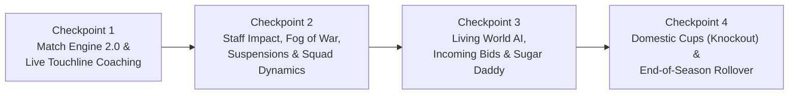

# แผนการพัฒนาอัปเกรดเกม TOUCHLINE สู่ความลึกซึ้งระดับ Football Manager 27

เอกสารนี้วางแผนการอัปเกรดระบบจำลองและเกมเพลย์ของ **TOUCHLINE** โดยอ้างอิงกลไกจาก **Football Manager 27** (`FM.Match`, `sianim/schemas`, `versus comps/knockout.xml`, `edt/permanent/*`) แบ่งออกเป็น **4 Checkpoints** ที่ชัดเจน โดยแต่ละ Checkpoint จะมีการรัน Typecheck และ Unit Tests เพื่อยืนยันความถูกต้องก่อนก้าวสู่ขั้นถัดไป

> [!IMPORTANT]
> **หลักการสำคัญในการอัปเกรด:**
> 1. **Backward-Compatible Save State:** ฟิลด์ใหม่ทั้งหมดใน [`WorldState`](file:///c:/Users/chaiyasit/Documents/Football-Management-Simulation/src/types/game.ts#L616-L639) และ [`Player`](file:///c:/Users/chaiyasit/Documents/Football-Management-Simulation/src/types/game.ts#L180-L228) ต้องมีค่า Default รองรับเซฟเก่าและไม่ทำให้ขนาดเอกสารใน Cloud Firestore เกินขีดจำกัด
> 2. **100% Deterministic Simulation:** ทุกการคำนวณใน Match Engine และ World Simulation ต้องใช้ [`SeededRNG`](file:///c:/Users/chaiyasit/Documents/Football-Management-Simulation/src/engine/random.ts) เพื่อให้ตรวจสอบย้อนหลังและทดสอบด้วย Unit Test ได้แม่นยำ

---

## โครงสร้างภาพรวม 4 Checkpoints

---

## Checkpoint 1: Match Engine 2.0 & Live Touchline Coaching (การแข่งขันและแก้เกมสด)

### เป้าหมาย
เปลี่ยนการจำลองแมตช์จากที่คำนวณแค่ 4 ตัวแปรหลัก ให้รองรับคำสั่งแท็กติกทุกตัว, คำสั่งรายบุคคล (Player Instructions), การเปลี่ยนตัวสำรองระหว่างเกม (สูงสุด 5 คน), ผลกระทบของใบแดงต่อทีมที่เหลือ 10 คน, ลูกตั้งเตะ/จุดโทษ และการแสดงตำแหน่ง 2D บนสนามตามผัง Formation จริง (In-Possession vs Out-of-Possession)

### ไฟล์ที่จะแก้ไข
- [`src/types/game.ts`](file:///c:/Users/chaiyasit/Documents/Football-Management-Simulation/src/types/game.ts)
  - เพิ่มข้อมูลการเปลี่ยนตัวสำรอง (`MatchSubstitution`), สถานะจุดโทษ/ต่อเวลาพิเศษใน `MatchResult` และ `inMatchStamina` รายบุคคล
- [`src/engine/matchEngine.ts`](file:///c:/Users/chaiyasit/Documents/Football-Management-Simulation/src/engine/matchEngine.ts)
  - อัปเกรด [`evaluateTeamMatchStrength`](file:///c:/Users/chaiyasit/Documents/Football-Management-Simulation/src/engine/matchEngine.ts#L50-L213) และลูปนาทีที่ `1..90` ใน [`simulateMatch`](file:///c:/Users/chaiyasit/Documents/Football-Management-Simulation/src/engine/matchEngine.ts#L242-L585):
    - **Team Instructions ครบทุกตัว:**
      - `passingDirectness`: ส่งผลต่อจำนวน Pass, Pass Accuracy และโอกาสเกิด `ThroughBall` vs การโยนยาว
      - `attackingWidth`: `Wide` เพิ่มโอกาส `Cross` และ `Corner` จากริมเส้น; `Narrow` เพิ่มการเจาะทะลุช่องตรงกลาง
      - `buildUp`: `Play Out of Defence` เพิ่มการครองบอลแต่เสี่ยงเสียบอลหน้ากรอบหากกองหลัง `composure`/`passing` ต่ำ
      - `transition`: `Counter-Press` เพิ่มโอกาสแย่งบอลคืนไวแต่กิน Stamina เพิ่ม 20%; `Counter` เพิ่มความอันตรายจังหวะสวนกลับ
      - `tackling`: `Get Stuck In` เพิ่มโอกาสชนะ `Tackle` แต่เพิ่มโอกาสเสียฟาวล์/ใบเหลือง/จุดโทษ; `Stay On Feet` ลดโอกาสเสียฟาวล์
      - `offsideTrap`: เพิ่มโอกาสดักล้ำหน้าสำเร็จตามค่า `positioning` + `anticipation` ของแผงหลัง แต่ถ้าพลาดจะหลุดเดี่ยว (`isBigChance`)
    - **Player Instructions ทั้ง 13 คำสั่งส่งผลต่อผู้เล่นคนนั้นจริง:**
      - `Shoot More` / `Shoot Less`, `Dribble More`, `Cut Inside`, `Stay Wider`, `Cross More Often`, `Take More Risks`, `Mark Tighter`, `Trigger Press More`
    - **Action Schemas ตามแบบ FM27 (`sianim/schemas`):**
      - เพิ่มเหตุการณ์ `Penalty`, `PenaltyMissed`, `FreeKick` (คำนวณจากค่า `freeKickTaking` และ `penaltyTaking` ของผู้เล่นที่เก่งที่สุดในสนาม), `Corner` โหม่งทำประตู (คำนวณจาก `corners` + `heading` + `jumpingReach`), และการเซฟปัดบอล (`gk_save_parry`) ที่นำไปสู่จังหวะซ้ำหรือเตะมุม
    - **Dynamic Red Card & In-Match Stamina:**
      - เมื่อมีผู้เล่นโดนใบแดง (`RedCard`) พลังของทีมฝั่งนั้นจะถูกลดทอนลงทันทีในนาทีที่เหลือ และผู้เล่นที่โดนไล่ออกจะไม่ถูกสุ่มขึ้นมาทำเกมอีก
      - รองรับการส่งรายชื่อเปลี่ยนตัวสำรอง (`substitutions`) และผลของ `Half-Time Team Talk` (`encourage`, `praise`, `demand`, `tactical`) เพื่อคำนวณครึ่งหลังใหม่ตั้งแต่นาทีปัจจุบัน
- [`src/components/MatchCenterView.tsx`](file:///c:/Users/chaiyasit/Documents/Football-Management-Simulation/src/components/MatchCenterView.tsx)
  - **2D Pitch Visualizer ตาม Formation จริง:** แทนที่พิกัดคงที่ [`homeBaseCoords`](file:///c:/Users/chaiyasit/Documents/Football-Management-Simulation/src/components/MatchCenterView.tsx#L277-L284) ด้วยพิกัด `slot.x, slot.y` จาก `primaryTactic.lineup` ของทั้งสองทีม พร้อมแสดงชื่อย่อ/เบอร์และขยับตำแหน่งตามจังหวะรุก/รับ (In/Out of Possession)
  - **แผงเปลี่ยนตัวสำรองข้างสนาม (Live Substitutions Panel):** เปลี่ยนตัวผู้เล่นจากม้านั่งสำรองลงสนามได้สูงสุด 5 คนระหว่างเกม พร้อมแสดงแถบความฟิตสดๆ รายนาที
  - **Half-Time Team Talk ที่มีผลจริง:** แสดงปฏิกิริยาของนักเตะในห้องแต่งตัวและบูสต์ค่าพลังความมุ่งมั่นในครึ่งหลัง

### เกณฑ์ตรวจสอบ (Verification Checkpoint 1)
- [ ] เปลี่ยนตัวสำรองระหว่างเกมแล้วผู้เล่นใหม่ปรากฏในสนามและมีผลต่อเรตติ้ง/เหตุการณ์ตั้งแต่นาทีที่เปลี่ยนลงไป
- [ ] คำสั่งแท็กติกและ Player Instructions มีผลต่อสถิติการแข่งขันอย่างมีนัยสำคัญ (ทดสอบด้วย Unit Test)
- [ ] ผู้เล่นที่โดนใบแดงจะไม่ทำประตูหรือแอสซิสต์ในนาทีหลังจากโดนไล่ออก

---

## Checkpoint 2: Staff Impact, Fog of War, Suspensions & Squad Dynamics (ระบบสตาฟฟ์, แมวมอง และวินัยทีม)

### เป้าหมาย
ทำให้การจ้างสตาฟฟ์โค้ช, ศูนย์ฝึกซ้อม, รายงานแมวมอง, โทษแบนใบเหลือง/ใบแดง และความพึงพอใจของนักเตะในห้องแต่งตัวส่งผลต่อเกมเพลย์จริงครบวงจร

### ไฟล์ที่จะแก้ไข
- [`src/types/game.ts`](file:///c:/Users/chaiyasit/Documents/Football-Management-Simulation/src/types/game.ts)
  - เพิ่ม `suspensionMatchesRemaining?: number` ใน `Player`
  - เพิ่ม `unhappyReason?: string | null` และ `consecutiveBenchedMatches?: number` ใน `Player`
- [`src/engine/worldSimulationService.ts`](file:///c:/Users/chaiyasit/Documents/Football-Management-Simulation/src/engine/worldSimulationService.ts)
  - **Staff & Facility Multipliers:**
    - คำนวณโบนัสจากทีมงานสตาฟฟ์ของสโมสร (`Fitness Coach` เพิ่มการฟื้นฟูความฟิตต่อวัน, `Physio` ลดระยะเวลาบาดเจ็บลงสูงสุด 25%, `First Team Coach` / `Assistant Manager` + `trainingFacilities` เพิ่มโอกาสพัฒนาค่าพลังวันจันทร์, `Youth Coach` + `youthFacilities` เพิ่มค่าตั้งต้น CA/PA ของเด็กอคาเดมีใน [`recruitYouthAcademyProspect`](file:///c:/Users/chaiyasit/Documents/Football-Management-Simulation/src/engine/worldSimulationService.ts#L1020))
  - **Dynamic Scouting Accuracy (Fog of War):**
    - อัปเกรด [`buildScoutReportForPlayer`](file:///c:/Users/chaiyasit/Documents/Football-Management-Simulation/src/engine/worldSimulationService.ts#L650-L688) ให้ดึงค่า `judgingAbility` และ `judgingPotential` ของแมวมองจริงมากำหนดความแคบ-กว้างของ `caEstimate` และ `paEstimate` รวมถึง `confidence`
  - **Suspensions (ระบบติดโทษแบน):**
    - ใน [`applyMatchResultToWorld`](file:///c:/Users/chaiyasit/Documents/Football-Management-Simulation/src/engine/worldSimulationService.ts#L66-L307): หากนักเตะได้ใบแดง จะติดโทษแบน 2 นัด; หากสะสมใบเหลืองครบทุกๆ 5 ใบ จะติดโทษแบน 1 นัด พร้อมส่งแจ้งเตือนเข้า Inbox และลดจำนวนนัดแบนลงเมื่อทีมลงแข่งเสร็จ
  - **Squad Dynamics & Playing Time Promises:**
    - นักเตะสถานะ `Star Player` หรือ `Important Player` ที่ฟิตสมบูรณ์แต่ไม่ได้ลงสนามติดต่อกัน 3+ นัด จะลดค่า `satisfaction` และ `morale` พร้อมส่งข้อความเข้า Inbox เพื่อขอคุยเรื่องโอกาสลงสนาม (มีตัวเลือกตอบโต้เหมือน Press Conference)
- [`src/engine/tacticsEngine.ts`](file:///c:/Users/chaiyasit/Documents/Football-Management-Simulation/src/engine/tacticsEngine.ts)
  - อัปเดต [`autoPickLineup`](file:///c:/Users/chaiyasit/Documents/Football-Management-Simulation/src/engine/tacticsEngine.ts#L317-L373) และ [`analyzeTacticalRisks`](file:///c:/Users/chaiyasit/Documents/Football-Management-Simulation/src/engine/tacticsEngine.ts#L378-L460) ให้คัดกรองนักเตะที่ติดโทษแบน (`suspensionMatchesRemaining > 0`) ออกจากการลงสนามเหมือนนักเตะบาดเจ็บ
- [`src/components/ManagementViews.tsx`](file:///c:/Users/chaiyasit/Documents/Football-Management-Simulation/src/components/ManagementViews.tsx) & [`src/components/SquadAndProfileModal.tsx`](file:///c:/Users/chaiyasit/Documents/Football-Management-Simulation/src/components/SquadAndProfileModal.tsx)
  - แสดงป้าย `SUSP (แบน X นัด)` ในหน้า Squad และ Tactics
  - แสดงผลกระทบโบนัสของ Staff ในหน้า Staff View (เช่น "+18% ความเร็วพัฒนาการซ้อม", "-22% ระยะเวลาบาดเจ็บ")
  - ในหน้า Scouting: นักเตะที่ยังไม่ได้ส่องฟอร์มจะแสดง CA เป็นช่วงประเมิน (`Fog of War`) จนกว่าจะมี Scout Report

### เกณฑ์ตรวจสอบ (Verification Checkpoint 2)
- [ ] นักเตะที่ได้ใบแดงติดโทษแบนอัตโนมัติและถูกแจ้งเตือนใน Tactical Risk Analyzer หากยังค้างอยู่ใน 11 ตัวจริง
- [ ] การจ้างโค้ชและอัปเกรดศูนย์ฝึกส่งผลต่อตัวเลขโบนัสการซ้อมและระยะเวลาพักฟื้นอาการบาดเจ็บจริง

---

## Checkpoint 3: Living World AI, Incoming Transfer Bids & Financial Models (โลกฟุตบอลมีชีวิตและตลาดซื้อขายสองทาง)

### เป้าหมาย
ทำให้สโมสร AI อีก 95 ทีมมีการโรเตชันนักเตะ, พัฒนาผู้เล่น, ซื้อขายนักเตะระหว่างกัน และยื่นข้อเสนอเข้ามาซื้อนักเตะของทีมผู้เล่น พร้อมระบบการเงินผ่อนชำระและเจ้าของสโมสร (Sugar Daddy ตามแบบ `sugardaddy.edt` ของ FM27)

### ไฟล์ที่จะแก้ไข
- [`src/types/game.ts`](file:///c:/Users/chaiyasit/Documents/Football-Management-Simulation/src/types/game.ts)
  - เพิ่ม `sugarDaddyType?: 'FRONT_END' | 'BACK_END' | 'UNDERWRITER' | 'NONE'` ใน `Club`
  - เพิ่มรองรับข้อเสนอซื้อตัวขาเข้า (Incoming Offers ที่ `sellingClubId === controlledClubId`)
- [`src/engine/worldSimulationService.ts`](file:///c:/Users/chaiyasit/Documents/Football-Management-Simulation/src/engine/worldSimulationService.ts)
  - **Global Weekly Tick สำหรับทุกสโมสร (96 ทีม):**
    - ให้นักเตะของสโมสร AI พัฒนาค่าพลังตามอายุและศูนย์ฝึกซ้อมของสโมสรนั้นๆ
    - ให้สโมสร AI เรียก `autoPickLineup` ก่อนแข่งเพื่อโรเตชันนักเตะที่บาดเจ็บ ติดโทษแบน หรือความฟิตต่ำ
  - **Incoming Transfer Bids & AI-to-AI Transfers:**
    - ทุกสัปดาห์ในช่วงตลาดซื้อขาย (ส.ค., ม.ค., มิ.ย.–ก.ค.) สโมสร AI ที่มีงบประมาณจะสุ่มยื่นข้อเสนอซื้อนักเตะจากทีมอื่น (รวมถึงยื่นซื้อนักเตะของสโมสรผู้เล่น!)
    - เมื่อมีข้อเสนอยื่นซื้อนักเตะของทีมเรา จะส่งเข้า Inbox พร้อมหยุดการเดินเวลา (`stoppedReason: 'TRANSFER_OFFER'`) ให้ผู้เล่นกด **ตอบรับ (Accept)**, **โก่งราคา (+20%)**, หรือ **ปฏิเสธ (Reject)** ได้โดยตรง
  - **Wage Cap & Installments Enforcement:**
    - ตรวจสอบเพดานค่าเหนื่อย (`wageBudgetPerWeek`) และเพิ่มปุ่มปรับสัดส่วนงบ `Transfer Budget <-> Wage Budget` (Budget Slider เหมือนใน FM)
- [`src/components/ManagementViews.tsx`](file:///c:/Users/chaiyasit/Documents/Football-Management-Simulation/src/components/ManagementViews.tsx)
  - เพิ่มแท็บ **"ข้อเสนอที่ได้รับ (Incoming Offers)"** ในหน้า `TransfersView` เพื่อให้ผู้เล่นกดอนุมัติขายหรือปล่อยยืมนักเตะในทีมและรับเงินเข้าสโมสรทันที
  - เพิ่มแถบปรับโยกงบประมาณ (Transfer Budget ↔ Wage Budget Slider) ในหน้า `Club & Finance`

### เกณฑ์ตรวจสอบ (Verification Checkpoint 3)
- [ ] ผู้เล่นสามารถรับข้อเสนอซื้อตัวขาเข้า (Incoming Transfer Offer) และกดขายนักเตะเพื่อรับเงินเข้าคลังสโมสรได้จริง
- [ ] สโมสร AI ถอดนักเตะบาดเจ็บหรือติดโทษแบนออกจาก 11 ตัวจริงก่อนลงแข่งทุกนัด

---

## Checkpoint 4: Domestic Cups (Knockout) & End-of-Season Rollover (ฟุตบอลถ้วยและระบบข้ามฤดูกาลต่อเนื่อง)

### เป้าหมาย
ปลดล็อกการเล่นระยะยาวหลายฤดูกาล (Multi-Season Career) พร้อมฟุตบอลถ้วยน็อกเอาต์ประจำชาติ (`ENG_CUP`, `ESP_CUP`, `GER_CUP`, `ITA_CUP`, `FRA_CUP`) ที่มีกติกาต่อเวลาพิเศษ 120 นาทีและดวลจุดโทษตามแบบ `knockout.xml` ของ FM27

### ไฟล์ที่จะแก้ไข
- [`src/engine/leagueEngine.ts`](file:///c:/Users/chaiyasit/Documents/Football-Management-Simulation/src/engine/leagueEngine.ts) & [`src/engine/matchEngine.ts`](file:///c:/Users/chaiyasit/Documents/Football-Management-Simulation/src/engine/matchEngine.ts)
  - เพิ่ม `generateDomesticCupRoundFixtures`: สร้างสายการแข่งขันฟุตบอลถ้วย (รอบ 16 ทีม → รอบก่อนรองฯ → รอบรองฯ → รอบชิงชนะเลิศ) แทรกในปฏิทินฤดูกาล
  - รองรับกติกาน็อกเอาต์ใน `simulateMatch`: หากเสมอกันใน 90 นาทีของแมตช์บอลถ้วย จะจำลองช่วงต่อเวลาพิเศษ (`91'..120'`) และหากยังเสมอกันจะตัดสินด้วยการดวลจุดโทษ (`Penalty Shootout`) พร้อมบันทึกสกอร์ดวลจุดโทษใน `MatchResult`
  - เมื่อจบรอบบอลถ้วยแต่ละรอบ ระบบจะจับสลากผู้ชนะเข้าสู่รอบถัดไปอัตโนมัติจนได้แชมป์ฟุตบอลถ้วย
- [`src/engine/worldSimulationService.ts`](file:///c:/Users/chaiyasit/Documents/Football-Management-Simulation/src/engine/worldSimulationService.ts)
  - สร้างฟังก์ชัน **`processEndOfSeasonRollover`** (ทำงานเมื่อจบ Matchday สุดท้ายของฤดูกาล / ช่วงปลายเดือนพฤษภาคม-มิถุนายน):
    1. **ตัดสินแชมป์ลีกและบอลถ้วย:** บันทึกถ้วยแชมป์ลง `manager.careerStats.trophies` และส่งข่าวสรุปฤดูกาลเข้า Inbox
    2. **จ่ายเงินรางวัลและค่าลิขสิทธิ์ทีวี:** โอนเงิน `prizePoolTotal` (ตามอันดับตารางคะแนน) + `tvRevenuePerClub` + เงินอุดหนุนเจ้าของทีม (`UNDERWRITER` / `FRONT_END` Sugar Daddy) เข้าบัญชีสโมสร พร้อมบันทึก `FinanceTransaction`
    3. **พัฒนาการและสังขารตามอายุ:** นักเตะอายุ 32+ มีโอกาสลดค่า Physical (`pace`, `acceleration`, `stamina`) ลงตามค่า `naturalFitness`
    4. **จัดการสัญญานักเตะและสัญญายืมตัว:** ส่งนักเตะที่ยืมตัว (`loanedFromClubId`) กลับสโมสรแม่, ต่อสัญญาอัตโนมัติหรือปล่อยตัวนักเตะหมดสัญญา, และเติมดาวรุ่ง Youth Intake ชุดใหม่เข้าสู่สโมสร
    5. **รีเซ็ตสถิติประจำฤดูกาลและสร้างตารางแข่งฤดูกาลใหม่ (`2027/28`, `2028/29`, ...):** รีเซ็ตตารางคะแนนและสถิตินักเตะประจำซีซัน พร้อมสร้างตารางแข่งลีกและบอลถ้วยของฤดูกาลถัดไปทันที
- [`src/components/ManagementViews.tsx`](file:///c:/Users/chaiyasit/Documents/Football-Management-Simulation/src/components/ManagementViews.tsx)
  - ในหน้า `CompetitionsView`: เพิ่มปุ่มสลับดูสายการแข่งขัน **ฟุตบอลถ้วยภายในประเทศ (Domestic Cup Bracket/Fixtures)** ควบคู่กับตารางคะแนนลีก
  - เพิ่มปุ่มเปรียบเทียบค่าพลังนักเตะ 2 คนแบบเคียงข้างกัน (**Player Comparison Modal**) ในหน้าโปรไฟล์นักเตะ

### เกณฑ์ตรวจสอบ (Verification Checkpoint 4)
- [ ] แมตช์ฟุตบอลถ้วยไม่มีผลเสมอ (ตัดสินด้วยต่อเวลาพิเศษหรือจุดโทษเสมอ) และผู้ชนะผ่านเข้ารอบถัดไปอัตโนมัติ
- [ ] เมื่อจำลองจบฤดูกาล `2026/27` ระบบทำการจ่ายเงินรางวัล, สรุปแชมป์, อัปเดตปีฤดูกาลเป็น `2027/28` และสร้างตารางแข่งขันฤดูกาลใหม่ครบทั้ง 5 ลีกโดยไม่เกิดข้อมูลซ้ำ

---

## ขั้นตอนการดำเนินงานและการทดสอบ
ในทุกๆ Checkpoint ผมจะดำเนินการดังนี้:
1. เขียนโค้ดตามรายละเอียดของ Checkpoint นั้นๆ
2. เพิ่มชุดทดสอบใน [`src/engine/engine.test.ts`](file:///c:/Users/chaiyasit/Documents/Football-Management-Simulation/src/engine/engine.test.ts) เพื่อทดสอบฟีเจอร์ใหม่
3. รันตรวจสอบ TypeScript (`tsc --noEmit`) และรัน Unit Tests ทั้งหมดให้ผ่าน 100%
4. รายงานผลสรุปของ Checkpoint ให้คุณทราบก่อนเริ่ม Checkpoint ถัดไป
