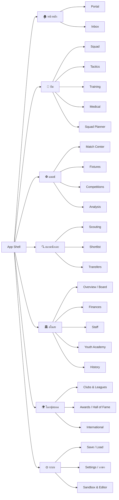
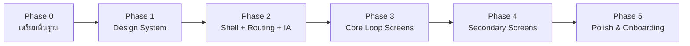

# แผนยกเครื่อง UI — TOUCHLINE (Football Management Simulation)

> เป้าหมาย: **เข้าใจง่าย ใช้ง่าย แต่ยังคงความลึกแบบเกม FM** — เห็นสิ่งที่ต้องทำก่อนเสมอ, คลิกน้อยลง, ข้อมูลแน่นแต่อ่านง่าย

ดู mockup โครงหน้าจอใหม่ได้ที่ [ui_mockup_shell.html](file:///C:/Users/chaiyasit/.gemini/antigravity/brain/677f9701-893f-4f40-91b9-7b5efb5af180/ui_mockup_shell.html) (คลิกเมนูซ้ายสลับหน้า Portal / Squad ได้)

---

## 1. สรุปสภาพ UI ปัจจุบัน (Audit จากโค้ด)

| # | ปัญหา | หลักฐานในโค้ด | ผลกระทบ |
|---|---|---|---|
| 1 | **เมนูแบน 15 รายการ** มีเลขนำหน้า ("01. Dashboard"…) และไม่จัดกลุ่ม | [App.tsx](file:///c:/Users/chaiyasit/Documents/Football-Management-Simulation/src/App.tsx#L101-L117) `NAV_ITEMS` | ต้องสแกนทั้งลิสต์ทุกครั้ง หาไม่เจอว่าอะไรอยู่ไหน |
| 2 | **ไม่มีระบบ route / ปุ่ม Back** — ใช้แค่ `activeTab` state | [App.tsx](file:///c:/Users/chaiyasit/Documents/Football-Management-Simulation/src/App.tsx#L129) | ไปหน้า Club → นักเตะ → กลับไม่ได้, รีเฟรชแล้วหลุดหน้า, bookmark ไม่ได้ |
| 3 | **Mega component** — Club/Staff/Youth/World/Settings รวมใน `ClubStaffYouthWorldView` ตัวเดียว (ไฟล์ ~5.5k บรรทัด) | [ManagementViews.tsx](file:///c:/Users/chaiyasit/Documents/Football-Management-Simulation/src/components/ManagementViews.tsx#L3489) | แก้ UI ยาก, ไม่มี component กลางให้ใช้ซ้ำ (ปุ่ม 96 ตัวเขียน class เองทุกตัว) |
| 4 | **ปุ่ม Debug/Cheat ปนกับ gameplay** — Trigger Takeover, FIFA Break, AI Carousel, Simulate Euro/CWC round, Season Rollover, DB Editor, JSON Import, Super Club Bid | [App.tsx](file:///c:/Users/chaiyasit/Documents/Football-Management-Simulation/src/App.tsx#L1164-L1241) | ผู้เล่นสับสนว่าอะไรคือ "เกม" อะไรคือ "เครื่องมือ" |
| 5 | **ตัวอักษรเล็กมาก** — `text-[10px]`/`text-[11px]` ~280 จุด | ทุกไฟล์ใน `components/` | ภาษาไทยมีวรรณยุกต์/สระบนล่าง อ่านยากมากที่ <13px |
| 6 | **ฟอนต์ไม่รองรับภาษาไทย** — โหลดแค่ Barlow Condensed / Plus Jakarta Sans / JetBrains Mono | [index.html](file:///c:/Users/chaiyasit/Documents/Football-Management-Simulation/index.html) | ไทยตก fallback เป็น Tahoma/Leelawadee — หน้าตาไม่สม่ำเสมอ |
| 7 | **ป้ายข้อความยาวและปนภาษา** — เช่น "🏥 FM27 Sports Science & Medical Center (Injury Risk Matrix)", "ขุมกำลัง (Squad)" | heading ทั่ว `ManagementViews.tsx` | หัวข้อยาว 2 บรรทัด, emoji + "FM27" + วงเล็บอังกฤษ = noise |
| 8 | **สีใช้เพื่อตกแต่ง ไม่ใช่สื่อความหมาย** — หัวข้อเป็น emerald/sky/amber/rose สลับกัน | headings ทุก view | ผู้เล่นแยกไม่ออกว่าสีไหนแปลว่า "ดี/เตือน/อันตราย" |
| 9 | **Player Profile เป็น modal** ที่อัดทั้งค่าพลัง, สัญญา, ฟอร์มยื่นซื้อ, scouting, training, dev log | [SquadAndProfileModal.tsx](file:///c:/Users/chaiyasit/Documents/Football-Management-Simulation/src/components/SquadAndProfileModal.tsx#L825) | ฟอร์มซื้อขายใน modal รก, ไปนักเตะคนถัดไปไม่ได้ |
| 10 | **ความสูง fix** `h-[680px]`, `h-[580px]` ใน Tactics/Match Center | [TacticsView.tsx](file:///c:/Users/chaiyasit/Documents/Football-Management-Simulation/src/components/TacticsView.tsx#L824), [MatchCenterView.tsx](file:///c:/Users/chaiyasit/Documents/Football-Management-Simulation/src/components/MatchCenterView.tsx#L1542) | จอ 1366×768 ล้น/จอ 1440p เหลือที่ว่างเยอะ |
| 11 | **Feedback มีแค่ Toast 3.5 วิ** และไม่มีประวัติ | [App.tsx](file:///c:/Users/chaiyasit/Documents/Football-Management-Simulation/src/App.tsx#L141-L149) | ข้อความยาว ๆ หายก่อนอ่านจบ |
| 12 | Command palette กดชื่อสโมสร → ไปแท็บ World เฉย ๆ ไม่ได้เปิดหน้าสโมสรนั้น | [App.tsx](file:///c:/Users/chaiyasit/Documents/Football-Management-Simulation/src/App.tsx#L1445-L1448) | ค้นหาเจอแต่ไปไม่ถึง |

**สิ่งที่ดีอยู่แล้ว ควรเก็บไว้:** ปุ่ม `Continue` เด่นมุมขวาบน + ล็อกเมื่อมี urgent inbox, Command Palette (Ctrl+K), คีย์ลัด (C / Esc / M), dark theme, ตัวเลข tabular-nums, ระบบ 2 ภาษา

---

## 2. References (แรงบันดาลใจ + บทเรียน)

### 2.1 Football Manager 26/27 (เกมที่คุณเล่นอยู่ — Unity UI ใหม่)
| สิ่งที่ FM26/27 ทำ | ควรเอามาไหม |
|---|---|
| **Top bar 6 หมวดหลัก** + dropdown เมนูย่อย แทน sidebar ยาว | ✅ เอา "การจัดกลุ่ม 6 หมวด" มาใช้ |
| **Bookmarks** ปักหน้าโปรดได้สูงสุด 12 อัน บน top bar | ✅ เอามา — ประโยชน์มากกับเกมที่มีหลายหน้า |
| **Portal** หน้าแรกรวมข่าว, คำแนะนำสตาฟฟ์, นัดถัดไป แทน inbox ล้วน | ✅ เอามา — เปลี่ยน Dashboard เป็น "ศูนย์สั่งการ" |
| **Tile → Card**: tile สรุปสั้น คลิกแล้วขยายเป็น card รายละเอียดโดยไม่เปลี่ยนหน้า | ✅ เอามาในรูป **Side Panel (peek)** |
| ไอคอนบอกว่าลิงก์นี้ "ไปหน้าใหม่" หรือ "เปิด card" | ✅ เอามา — ทำให้คาดเดาได้ |

**บทเรียนจากเสียงวิจารณ์ FM26 (สิ่งที่ห้ามทำซ้ำ):**
- ❌ การ์ดใหญ่ padding เยอะ → ข้อมูลน้อยต่อจอ, ต้อง scroll มาก
- ❌ ข้อมูลที่เคยเห็นในจอเดียวถูกซ่อนหลังหลายชั้นคลิก
- ❌ ตารางเสียความแน่น (FM คือ "spreadsheet game")
- 👉 สรุป: **เอา IA (โครงสร้างเมนู) ของ FM26 + ความแน่นของข้อมูลแบบ FM24**

### 2.2 Football Manager 24 และก่อนหน้า (classic)
- Sidebar จัดกลุ่ม + ปุ่ม Back/Forward + breadcrumb
- **Squad Views** — preset คอลัมน์ (General / Condition / Contract / Stats) สลับได้ทันที
- สีค่าพลัง 1–20 (แดง → เหลือง → เขียว → ฟ้า) อ่านได้ภายในเสี้ยววินาที
- Hover/คลิกขวาที่ชื่อนักเตะ → เมนูลัด (Shortlist, Offer, Scout)

### 2.3 แอปฟุตบอลจริง — FotMob / Sofascore
- **Match Center**: momentum graph, คะแนนนักเตะบนผังสนาม, stat bar สองฝั่งเปรียบเทียบ, timeline เหตุการณ์ด้วยไอคอน
- ตารางคะแนนแบบย่อ (ตำแหน่งเราอยู่กลาง ± 3 อันดับ) + form chips W/D/L
- อ้างอิง: https://www.fotmob.com, https://www.sofascore.com

### 2.4 เกม Management อื่น
- **Motorsport Manager** — UI สะอาด, onboarding tooltip แบบค่อยเป็นค่อยไป, "ต้องทำอะไรต่อ" ชัด
- **Out of the Park Baseball (OOTP)** — ตัวอย่างข้อมูลแน่นมากแต่ยังอ่านได้ด้วย tab + ตาราง customize ได้

### 2.5 Productivity UI (keyboard-first)
- **Linear / Raycast** — Command palette ที่ "ทำ action ได้" ไม่ใช่แค่ค้นหา (เช่นพิมพ์ "renew salah" → เปิดหน้าต่อสัญญา)
- อ้างอิง: https://linear.app, https://www.raycast.com

### 2.6 Component / Library ที่เหมาะกับ stack ปัจจุบัน (React 19 + Tailwind 4)
- `lucide-react` และ `motion` **ติดตั้งแล้วแต่ยังไม่ได้ใช้** → ใช้แทน emoji ได้ทันที
- ตัวเลือกเพิ่ม (ถ้าต้องการ): Radix UI primitives (Dialog/Tabs/Tooltip ที่ accessible), TanStack Table (sort/คอลัมน์ preset)

---

## 3. หลักการออกแบบ (Design Principles)

1. **Action first** — ทุกหน้าบอก "ต้องทำอะไร" ก่อน "ข้อมูลทั้งหมด"
2. **3 ระดับความลึก**: Tile (สรุป) → Side panel (peek) → Full page (เต็ม) — ไม่บังคับให้เปิดหน้าใหม่ทุกครั้ง
3. **Dense but calm** — ตารางแน่นแบบ FM แต่ตัวอักษร ≥ 12px, ไทย ≥ 13px, ใช้ whitespace แบ่งกลุ่มแทนกรอบ
4. **สี = ความหมาย** — เขียว=ดี, เหลืองอำพัน=เตือน, แดง=อันตราย, ฟ้า=ข้อมูล, accent=สีสโมสร
5. **ภาษาเดียวต่อป้าย** — ไม่เขียน "ขุมกำลัง (Squad)"; ศัพท์เทคนิค (CA/PA/xG) อธิบายผ่าน tooltip/glossary
6. **คาดเดาได้** — ทุก route มี URL, มี Back, ปุ่มประเภทเดียวกันหน้าตาเหมือนกันทุกหน้า
7. **แยก "เกม" ออกจาก "เครื่องมือ"** — Sandbox/Editor ซ่อนไว้ใน Settings

---

## 4. โครงสร้างเมนูใหม่ (Information Architecture)

จาก 15 เมนูแบน → **6 หมวด + ระบบ** (แต่ละหมวดมี sub-tab ด้านบนของหน้า)



**Mapping จากเมนูเดิม:**

| เมนูเดิม | ไปอยู่ที่ |
|---|---|
| 01 Dashboard | หน้าหลัก › Portal |
| 02 Inbox & Media | หน้าหลัก › Inbox |
| 03 Squad | ทีม › Squad (+ Squad Planner แยก tab) |
| 04 Tactics | ทีม › Tactics |
| 05 Match Center | แมตช์ › Match Center |
| 06 Training | ทีม › Training (+ Medical แยก tab) |
| 07 Scouting | ตลาดนักเตะ › Scouting / Shortlist |
| 08 Transfers | ตลาดนักเตะ › Transfers |
| 09 Schedule / 10 Competitions | แมตช์ › Fixtures / Competitions |
| 11 Club & Finance | สโมสร › Overview / Finances |
| 12 Staff / 13 Youth | สโมสร › Staff / Youth Academy |
| 14 World | โลกฟุตบอล |
| 15 Settings & Save | ระบบ (ไอคอนล่างซ้าย) |
| ปุ่ม Trigger/Simulate/Editor ต่าง ๆ | ระบบ › Sandbox (เปิดด้วย toggle "Developer mode") |

### App Shell ใหม่

```
┌────┬──────────────────────────────────────────────────────────────────┐
│LOGO│ ← →  ทีม › Squad          ★Tactics ★Shortlist ★ตาราง   🔍Ctrl+K  │
│    │                                   13 พ.ย. 2026  [Continue ▶]     │
├────┼──────────────────────────────────────────────────────────────────┤
│ 🏠 │ Squad   Tactics   Training   Medical   Planner     [View ▾][⋯]  │  ← sub-tabs + page actions
│ 👥 │──────────────────────────────────────────────────────────────────│
│ ⚽ │                                                │ Side panel       │
│ 🔍 │          เนื้อหาหลัก (ตาราง / pitch / tiles)      │ (peek นักเตะ /   │
│ 🏛 │                                                │  ข่าว / สโมสร)   │
│ 🌍 │                                                │                  │
│ ⚙  │                                                │                  │
└────┴──────────────────────────────────────────────────────────────────┘
```
- **Left rail** แคบ (ไอคอน + label สั้น) ประหยัดพื้นที่ กว่า sidebar `w-60` เดิม
- **Top bar**: Back/Forward, breadcrumb, bookmarks, search, วันที่, Continue
- **Notification center** (กระดิ่ง) เก็บประวัติ toast ทั้งหมด

---

## 5. Design System

### 5.1 Tokens (ใส่ใน `src/index.css` ผ่าน Tailwind 4 `@theme`)
| กลุ่ม | Token | ค่าเสนอ |
|---|---|---|
| Surface | `--surface-0/1/2/3` | #0b1120 / #111827 / #1a2233 / #243046 |
| Text | `--text-primary/secondary/muted` | #f1f5f9 / #cbd5e1 / #8b97a8 |
| Semantic | `--positive / --warning / --negative / --info` | emerald-400 / amber-400 / rose-400 / sky-400 |
| Accent | `--accent` | **สีหลักของสโมสรที่คุม** (fallback emerald) |
| Attribute 1–20 | `--attr-poor/avg/good/elite` | 1–6 แดง, 7–10 อำพัน, 11–15 เขียว, 16–20 ฟ้า/ทอง |

### 5.2 Typography
| ระดับ | ขนาด | ใช้กับ |
|---|---|---|
| Page title | 22px | ชื่อหน้า |
| Section | 15px semibold | หัวการ์ด |
| Body | 14px | ข้อความทั่วไป |
| Table / meta | 13px | ตาราง, ป้ายกำกับ |
| Caption (ต่ำสุด) | 12px | ตัวเลขรอง, badge |

- เพิ่มฟอนต์ไทย: **IBM Plex Sans Thai** หรือ **Noto Sans Thai** (body) + **Kanit/Prompt** (display ไทย คู่กับ Barlow Condensed)
- ยกเลิก `text-[10px]` ทั้งหมด

### 5.3 Component Library (`src/ui/`)
| Component | หน้าที่ |
|---|---|
| `AppShell`, `NavRail`, `TopBar`, `PageHeader` (title + sub-tabs + actions) | โครงหน้า |
| `Button` (primary / secondary / ghost / danger, size sm/md) | แทน class ซ้ำ 160+ ปุ่ม |
| `Card`, `Tile`, `StatTile`, `EmptyState` | กล่องข้อมูล |
| `DataTable` (sort, sticky header, column presets, row → peek) | Squad, Scouting, Transfers, World |
| `Tabs`, `SegmentedControl`, `Select`, `Slider`, `Stepper` | input |
| `SidePanel` (peek), `Dialog` (ยืนยัน), `Drawer` | overlay |
| `Badge`, `FormChips` (W/D/L), `AttrValue` (1–20 สี), `ProgressBar`, `Gauge` | แสดงสถานะ |
| `PlayerLink`, `ClubLink` (คลิก=peek, Ctrl+คลิก=หน้าเต็ม, คลิกขวา=เมนูลัด) | ลิงก์ entity ทั่วเกม |
| `Tooltip` + `Glossary` (CA, PA, xG, Sharpness…) | อธิบายศัพท์ |
| `Toast` + `NotificationCenter` | feedback |

---

## 6. รีดีไซน์รายหน้าจอ (ตามลำดับความสำคัญ)

### 6.1 Portal (แทน Dashboard) — *ref: FM26 Portal*
- **แถว 1 "ต้องจัดการ" (Action Queue)**: urgent inbox, ข้อเสนอซื้อเข้ามา, สัญญาใกล้หมด, นักเตะเจ็บ/ความฟิตต่ำ, ลงทะเบียนไม่ครบ 25 คน — แต่ละรายการมีปุ่ม action ในตัว
- **Next Match tile**: โลโก้ 2 ทีม, เหย้า/เยือน, form 5 นัดของทั้งคู่, ปุ่ม [ตั้งทีม] [รายงานคู่แข่ง] [Mind games ▾]
- **Mini table** (±3 อันดับรอบทีมเรา), **Board/Fans gauge**, **Squad status** (ฟิต/ขวัญใจ/เจ็บ), **ข่าวล่าสุด 5 รายการ**
- KPI 4 กล่องเดิม → ย่อเป็น strip เล็ก

### 6.2 Inbox — *ref: Gmail / FM classic*
- 2-pane: ลิสต์ซ้าย (filter: ทั้งหมด / ต้องตอบ / ข่าว / ซื้อขาย / บอร์ด) + เนื้อหาขวา
- ข้อความที่ต้องตอบ pin ด้านบน พร้อมปุ่มตอบในตัว

### 6.3 Squad — *ref: FM Squad Views*
- `DataTable` + **View presets**: ภาพรวม / ความพร้อม / สัญญา / สถิติ / พัฒนาการ / ลงทะเบียน
- Filter chips: ตำแหน่ง, ชุดใหญ่/สำรอง/ยืมตัว, บาดเจ็บ
- คลิกแถว → **Side panel** (รูป, ค่าพลังเด่น, สถานะ, ปุ่มลัด); ดับเบิลคลิก → หน้าโปรไฟล์เต็ม
- ย้าย "ลงทะเบียน 25 คน" เป็น view แยก (ตอนนี้ปนอยู่คอลัมน์แรกของตารางหลัก)

### 6.4 Player Profile — เปลี่ยนจาก modal → **full page `/player/:id`**
- Header strip: รูป, ชื่อ, ตำแหน่ง, อายุ, สัญชาติ, มูลค่า, สัญญา, chips สถานะ, เมนู [⋯ Actions]
- Tabs: **ภาพรวม** (ค่าพลัง 3 คอลัมน์ + position map + traits) · **พัฒนาการ & ฝึกซ้อม** · **สัญญา** · **สถิติ & ประวัติ** · **รายงานแมวมอง**
- ปุ่ม ◀ ▶ ไปนักเตะคนก่อน/ถัดไปในลิสต์ที่เปิดมา
- **ยื่นข้อเสนอซื้อ/ต่อสัญญา** → Dialog แบบ **Stepper 3 ขั้น**: ค่าตัว → เงื่อนไขสัญญา → สรุป/ยืนยัน (แทนฟอร์มยาวในหน้าเดียว)

### 6.5 Tactics — *ref: FM tactics screen*
- 3 คอลัมน์ยืดตามจอ (ไม่มี fixed height): **รายชื่อ XI + สำรอง** | **สนาม (drag & drop)** | **Instructions แยกตาม phase** (In possession / Out of possession / Transition)
- แถบบนสุด: สลับ Tactic A/B, formation, mentality, familiarity bar
- Captain & set pieces → tab ย่อย

### 6.6 Match Center — *ref: FotMob / Sofascore + FM match screen*
แบ่งเป็น 3 สถานะชัดเจน:
1. **Pre-match**: ยืนยัน XI, team talk, รายงานคู่แข่ง → ปุ่ม Kick-off
2. **Live**: scoreboard ใหญ่บน, กลาง = 2D pitch/commentary, ขวา = stats + momentum, ล่าง = **Touchline bar** (shouts, mentality, เปลี่ยนตัว)
3. **Post-match**: คะแนนนักเตะบนผังสนาม, xG, shot map, ผู้เล่นยอดเยี่ยม → ปุ่ม "กลับ Portal"

### 6.7 ตลาดนักเตะ (Scouting + Transfers)
- Tabs: **ค้นหา** (filter + DataTable) · **Shortlist** · **งานแมวมอง** · **ข้อเสนอเข้า/ออก** · **ดีลพิเศษ** (release clause, bargain)
- ข้อเสนอที่ต้องตอบ แสดงเป็นการ์ดพร้อมปุ่ม รับ/ต่อรอง/ปฏิเสธ

### 6.8 แมตช์ › Fixtures / Competitions
- Fixtures: ปฏิทิน/ลิสต์รายเดือนของทีมเรา + filter รายการแข่ง
- Competitions: เลือกรายการ (ลีก, บอลถ้วย, UCL/UEL/UECL) → tabs: ตาราง / โปรแกรม / สถิติ / สายการแข่ง
- หัวข้อสั้นลง: "📊 10-Country 36-Team Qualification Quota Allocation (UCL / UEL / UECL)" → "โควตายุโรป" + tooltip

### 6.9 สโมสร / โลกฟุตบอล / ระบบ
- แตก `ClubStaffYouthWorldView` เป็นหน้าแยก: Overview & Board, Finances (กราฟรายรับ-จ่าย), Staff, Youth Academy, History
- World: browser สโมสร/ลีก → หน้า `/club/:id` จริง (command palette ลิงก์ไปถึงได้)
- **Sandbox & Editor**: รวมปุ่ม Trigger/Simulate/DB Editor/JSON import ไว้ที่เดียว ซ่อนหลัง Developer mode

### 6.10 Title Screen & New Career
- New career เป็น **wizard 3 ขั้น**: โปรไฟล์ผู้จัดการ → เลือกลีก/สโมสร (พร้อม preview งบ/ความคาดหวัง) → Scenario → เริ่ม

---

## 7. แผนการทำงาน (Roadmap)



| Phase | งาน | ผลลัพธ์ที่ตรวจได้ | ขนาด |
|---|---|---|---|
| **0. เตรียม** | • แคปหน้าจอทุกหน้าเป็น baseline (1366×768 / 1920×1080)<br/>• ย้าย handler `setWorld(...)` ทั้งหมดจาก `App.tsx` ไปเป็น `GameContext` + `useGameActions()`<br/>• สร้างโฟลเดอร์ `src/ui/`, `src/features/` | เกมเล่นได้เหมือนเดิม, `App.tsx` สั้นลงมาก | S–M |
| **1. Design System** | • tokens ใน `@theme`, ฟอนต์ไทย<br/>• `Button, Card, Tile, Tabs, Badge, AttrValue, DataTable, SidePanel, Dialog, Tooltip, Toast`<br/>• หน้า `/dev/ui` โชว์ทุก component | component ครบ, ไม่มี `text-[10px]` ใน `src/ui` | M |
| **2. Shell + Routing** | • hash router (`#/team/squad`, `#/player/:id`) + Back/Forward<br/>• NavRail 6 หมวด, TopBar, sub-tabs, Bookmarks, Notification center<br/>• ใส่ view เดิมเข้าไปใน route ใหม่ก่อน (ยังไม่รีดีไซน์เนื้อหา)<br/>• ย้ายปุ่ม debug ไป Sandbox | เมนูใหม่ใช้งานได้ทั้งเกม, รีเฟรชแล้วอยู่หน้าเดิม | M |
| **3. Core loop** | Portal → Inbox → Squad + Player Profile page → Tactics → Match Center | วงจร "Continue → ตั้งทีม → แข่ง → ดูผล" ใช้ UI ใหม่ทั้งหมด | L |
| **4. Secondary** | ตลาดนักเตะ → Fixtures/Competitions → Club/Finance/Staff/Youth → World → Title/New career wizard | ลบ `ManagementViews.tsx` ได้ทั้งไฟล์ | L |
| **5. Polish** | • Glossary tooltip, onboarding tips ครั้งแรก<br/>• Command palette แบบมี action<br/>• Density toggle (Compact/Comfortable), สี accent ตามสโมสร<br/>• ตรวจ responsive 1366 / 1920 / 2560, keyboard focus | checklist UX ผ่านทุกหน้า | M |

**กลยุทธ์สำคัญ:** ทำแบบ **Strangler** — shell ใหม่ห่อ view เดิมก่อน แล้วค่อยแทนทีละหน้า → เกมเล่นได้ตลอดทุกขั้น ไม่ต้อง big-bang

### โครงสร้างโฟลเดอร์เป้าหมาย
```
src/
  app/        AppShell, router, GameContext, useGameActions
  ui/         Button, Card, DataTable, SidePanel, ... (ไม่รู้จัก game logic)
  features/
    home/       Portal, Inbox
    team/       Squad, PlayerProfile, Tactics, Training, Medical
    match/      MatchCenter, Fixtures, Competitions
    recruitment/ Scouting, Shortlist, Transfers
    club/       Overview, Finances, Staff, Youth, History
    world/      Clubs, Awards, International
    system/     Save, Settings, Sandbox
  engine/     (ไม่แตะ)
```

### การตรวจสอบแต่ละ phase
- `bun run lint` (tsc) ต้องผ่าน
- engine tests (`node:test` ใน `src/engine/engine.test.ts`) ต้องผ่าน — UI overhaul ไม่ควรแตะ engine
- เปิดเกมจริงเล่น 1 วงจร (Continue → Matchday → แข่ง → ผล) ทุกครั้งที่จบ phase
- เทียบ screenshot กับ baseline ของ Phase 0

---

## 8. คำถามที่ต้องตัดสินใจก่อนเริ่ม

1. **รูปแบบเมนู**: (A) Left rail 6 หมวด + sub-tab บนหน้า *(แนะนำ — ประหยัดพื้นที่แนวตั้ง, คุ้นมือแบบ FM เก่า)* หรือ (B) Top bar + dropdown แบบ FM26 เป๊ะ ๆ
2. **ความแน่นของข้อมูล**: ชอบแบบ FM classic (แน่น) หรือแบบ FM26 (โปร่ง) — หรือทำ toggle ทั้งสองแบบ
3. **ภาษา**: ยังให้สลับ EN/TH เหมือนเดิมใช่ไหม? (แผนนี้จะเลิกเขียนอังกฤษในวงเล็บต่อท้ายภาษาไทย)
4. **สี accent ตามสโมสร** (เช่นคุมลิเวอร์พูล UI เป็นโทนแดง) — เอาไหม?
5. **Player Profile เป็นหน้าเต็ม** แทน modal — โอเคไหม?
6. **Library เพิ่ม**: ยอมเพิ่ม Radix UI / TanStack Table หรืออยากเขียนเองทั้งหมดด้วย Tailwind
